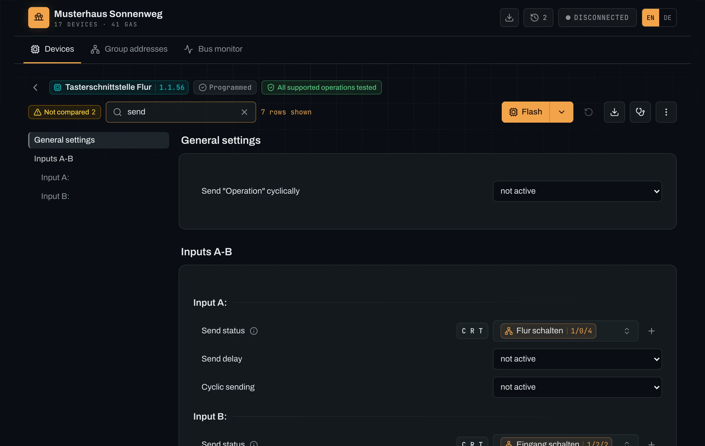
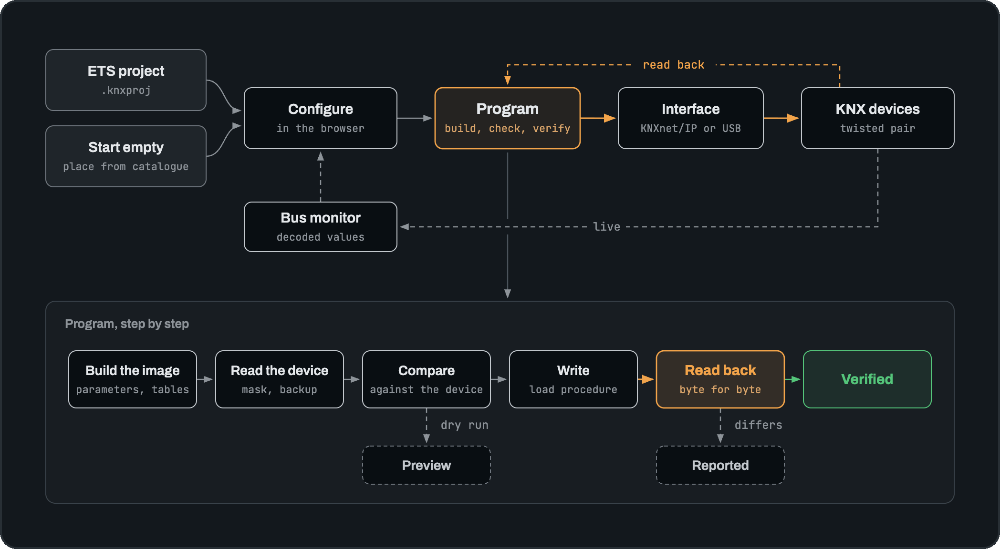
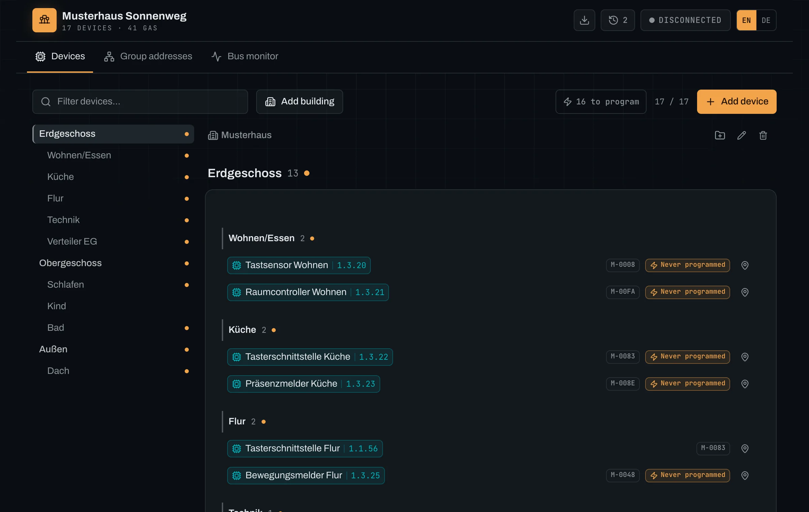
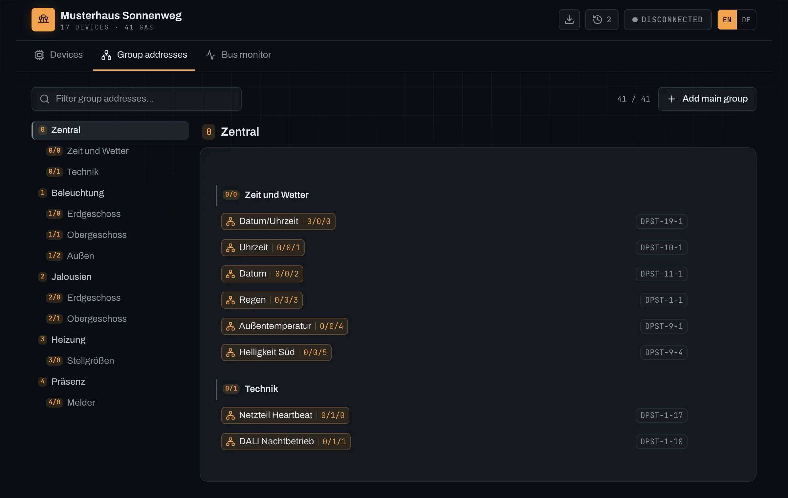
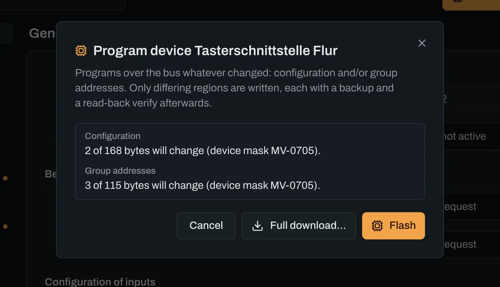
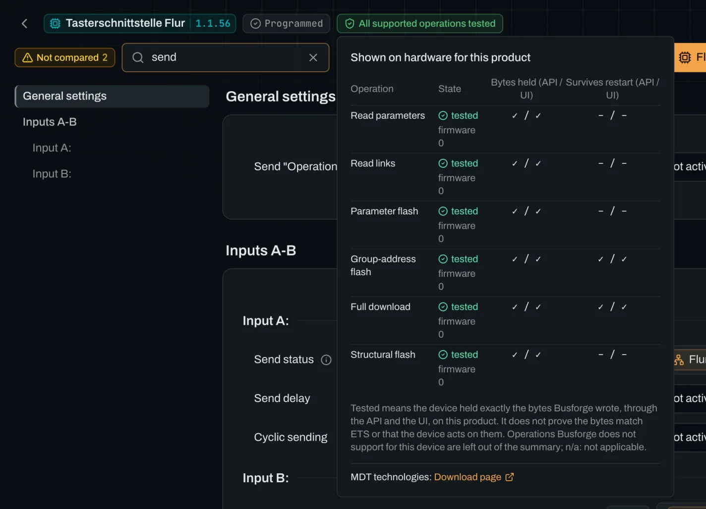

<p align="center">
  
</p>

<p align="center">
  Busforge imports your ETS project, shows the bus live and programs real KNX devices, then reads each device back to check it holds what was written. Self-hosted in one Docker container, on Linux or a Mac.
</p>

<p align="center">
  
  
  
</p>

<p align="center">
  
</p>

<p align="center">
  <em>Public alpha, for technically capable KNX users. Keep your ETS project as a backup.</em>
</p>

---

## How it works

Bring an ETS project, or start empty and place devices from the product catalogue, and configure
them in the browser. When you program, Busforge builds the device's memory image, checks the device,
writes through your interface and reads it back byte for byte. A device that differs is reported,
never shown as done.

<p align="center">
  
</p>

- **What a read-back proves:** that the device holds Busforge's bytes. Whether they are the bytes
  ETS would write is a separate check, made against ETS captures product by product and shown in
  [`docs/compatibility.md`](docs/compatibility.md).
- **Drift before you write:** read any device and see, parameter by parameter, where it differs
  from your project.
- **Small writes:** a flash writes only the regions that differ, and backs them up first.

Busforge reads a device, programs parameter and group-address changes that take effect on the
bus, and commissions a factory-fresh device. Every claim in this repository is backed by a
read-back from real hardware, by a comparison with an ETS capture, or explicitly marked as unproven.

## What it does

| | |
|---|---|
| **Import** | Decrypt and parse `.knxproj` (ETS 5/6) and manufacturer `.knxprod` catalogs |
| **Browse** | Topology, building structure, devices, group addresses, full-text search |
| **Watch** | Live bus monitor with DPT-decoded values and group-address names |
| **Configure** | The complete dynamic parameter UI: conditions, unions, modules, channels, translations |
| **Program** | Parameters, group addresses and full first-time downloads, with backup, verify and revert |
| **Commission** | Assign an individual address and bring up a factory-fresh device without ETS |
| **Verify** | Read a device back and compare it byte-for-byte against the project |
| **Keep** | Snapshots, drift detection, encrypted export/import |

Which of these is proven on which device, and what is still unproven, is tracked
honestly in **[`docs/status.md`](docs/status.md)**. Read it before trusting a capability:
a passing test suite proves stability and codec math, never that a device is programmed
correctly.

## The application

Screens from the demo project, an invented house with seventeen devices of ten manufacturers, one
of them programmed on a test bench. To try Busforge without a bus, build a demo project of open
OpenKNX devices into your instance, or this one from your manufacturers' product databases:
[`docs/demo.md`](docs/demo.md).

| | |
|---|---|
|  |  |
| **Your building, room by room.** Every device with its individual address, its product and its programming state, under the floor and room it sits in. | **Group addresses, with their types.** Main and middle groups, names and datapoint types, editable in place; the bus monitor shows their values decoded. |
|  |  |
| **A preview before every write.** The program dialog checks against the real device and says what it would write: here one parameter and one group address. | **What has been shown for this product.** Each operation with its state from the kept evidence. A product nobody has tested says so, and is written only after you confirm it for the project. |

## Design principle: refuse, never pretend

Flashing writes bytes into a real device, and wrong bytes mean a misconfigured device in
a live building. Busforge therefore refuses loudly rather than guessing quietly.

- A device family, mask version or segment type that is not implemented is **refused with
  a coded error**, never routed into a path that produces a plausible-looking result.
- Anything the parameter engine cannot render is shown as an explicit "not supported yet"
  marker, never omitted and never shown as an empty control. A silently missing parameter
  would hide both configuration and drift.
- A flash is refused when the stored configuration contains parameters the image builder
  cannot place, so an incomplete render can never reset a device to defaults.
- Every surgical write is backed up first, only applied on a confirmed change, and read
  back afterwards to verify. (A full download rebuilds every byte from the project, so its
  pre-unload backup is opt-in and off by default.)

## Install

One container, one data volume, one master key that seals the Data Secure keys Busforge stores.
Keep the key with your backups: without it a restored backup cannot open them.

```bash
# once; keep this file safe
[ -f busforge-master.key ] ||
  openssl rand -hex 32 > busforge-master.key

docker run -d --name busforge \
  --stop-timeout 1800 \
  -p 127.0.0.1:3000:3000 \
  -v busforge-data:/app/apps/server/data \
  -e BUSFORGE_MASTER_KEY="$(cat busforge-master.key)" \
  ghcr.io/busforge/busforge:latest
```

The published image is for x86_64; on arm64, build it from the source. Then open `http://127.0.0.1:3000`. Busforge has no
login: keep it on a trusted network and never expose it to the internet.

**[`docs/install.md`](docs/install.md)** takes you from nothing to a project on your bus: start
the container, create an empty project or import your ETS project, bring in the manufacturers'
product definitions, set up a KNXnet/IP or USB interface. It also lists the platforms Busforge has actually run on, and the update, backup and restore route.

Busforge is an alpha. What it does not do yet, and the known issues, are in
[`docs/limitations.md`](docs/limitations.md). Report a problem, or a device that works, as a
[GitHub issue](https://github.com/busforge/busforge/issues); [`docs/reporting.md`](docs/reporting.md)
says how, and what stays out of a public issue.

## Run it from source

Requirements: [Bun](https://bun.sh), plus a KNXnet/IP or KNX-USB interface and your own
`.knxproj` for the bus features.

```bash
bun install
bun run dev:server     # API on :3000
bun run dev:web        # web UI on :5173, proxies /api
bun run check          # typecheck, lint, tests and build across every workspace
```

Some tests need files this repository does not carry: manufacturer catalogue data, which may
not be redistributed, and captures and backups read from real devices. They sit in a private
corpus outside the repository. Without it, `bun run check` runs everything else,
skips those tests by name (`[needs private corpus] ...`) and ends with a status line listing
their files; that is how it runs in public CI. With the corpus, export its absolute path first:

```bash
export BUSFORGE_CORPUS=/path/to/busforge-corpus
bun run check          # last line: private corpus: present at /path/to/busforge-corpus; ...
```

See [`docs/testing.md`](docs/testing.md#the-private-corpus) for how those tests run and skip.

For the container, see [Install](#install) and [`docs/deployment.md`](docs/deployment.md) for the
runtime model; [`docs/development.md`](docs/development.md) covers working on the code.

> **Writing to a device follows a real load procedure that unloads tables first.**
> Busforge backs up the segment, writes only on a confirmed change and reads it back to
> verify, but keep a recovery path. See the safety model in
> [`docs/architecture.md`](docs/architecture.md).

## Documentation

Start at **[`docs/README.md`](docs/README.md)** for the full index. The most useful
entry points:

- [`docs/install.md`](docs/install.md): installation, first steps, tested platforms
- [`docs/limitations.md`](docs/limitations.md): what Busforge does not do, and the known issues
- [`docs/reporting.md`](docs/reporting.md): reporting problems and device feedback on GitHub
- [`docs/status.md`](docs/status.md): what works, on which hardware, and how far it is proven
- [`docs/device-support.md`](docs/device-support.md): how a device is classified, and the full mask matrix
- [`docs/findings.md`](docs/findings.md): the protocol knowledge (wire formats, load procedure, gotchas)
- [`docs/architecture.md`](docs/architecture.md): how the running system fits together

The genuinely hard part of this project was protocol **discovery**, the subtle KNXnet/IP
and load-procedure behaviour that no specification spells out. That is captured in
`docs/findings.md`, it is language-agnostic, and it is the most valuable artifact here.

## Why this stack

- **Bun + TypeScript.** One language with the React frontend, native TypeScript, built-in
  WebSocket, and a clean single-container deployment. The KNX code is written
  runtime-agnostic, so it also runs on Node.
- **Own KNX implementation.** Existing open KNX libraries do runtime group communication
  only, not device programming. The management and load procedures had to be implemented
  from scratch either way, so there is no third-party library to depend on.

## Trademarks and independence

Busforge is an **independent, community project**. It is **not affiliated with, endorsed
by, sponsored by, or certified by the KNX Association** or any device manufacturer.

- **KNX** and **ETS** are registered trademarks of the KNX Association cvba. Manufacturer
  and product names are trademarks of their respective owners.
- These names are used **only descriptively**, to identify the standard and the devices
  Busforge interoperates with (nominative use). Busforge does not claim any KNX
  certification and is not "KNX software" in the certified sense.
- The Busforge application and its container image ship **tooling only**, never
  manufacturer product data or any proprietary binary. Users bring their own `.knxproj`
  (which embeds the manufacturer data they legally obtained) or download `.knxprod` from the
  manufacturer. Parsing files you own and speaking the standardized KNX management protocol
  is legitimate interoperability.
- The **source tree** carries no manufacturer catalogue files either: the tests that need
  real application programs read them from a private corpus outside the repository (see
  [Run it from source](#run-it-from-source)). Its test suite does carry two keyring files from the xknx test suite
  under the MIT license (`packages/project/test/fixtures/knxkeys`), which do not enter the
  container image.

## License

Busforge is free software under the **[GNU AGPL-3.0-or-later](LICENSE)**. Anyone may use,
modify and share it, including professionally: homeowners, electricians and integrators
commissioning installations for their customers. Copies you distribute, and modified versions you
distribute or offer to others over a network, stay under the AGPL, with their source. The start
page links to the source code (`SOURCE_URL` in `apps/web/src/components/SourceCodeLink.tsx`); a
modified version offered over a network has to point it to its own source.

If you want to build Busforge, or parts of it, into a closed product or service without the AGPL's
obligations, a **commercial license** is available on request via the
[project homepage](https://fohlmeister.com).

Contributions are welcome ([CONTRIBUTING.md](CONTRIBUTING.md)). The first pull request asks once
for a short [Contributor License Agreement](CLA.md), whose sole reason is to allow this dual
licensing.

Copyright (c) 2026 Thorben Fohlmeister ([NOTICE](NOTICE)).
