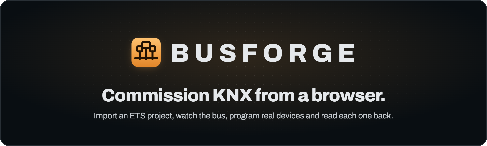

<p align="center">
  
</p>

<p align="center">
  <em>Cross-platform, self-hostable alternative to KNX ETS. Import a project, watch the bus, configure and program real KNX devices, all from a web UI.</em>
</p>

<p align="center">
  
  
  
</p>

---

**An open commissioning tool for KNX installations.** Import a project, browse the
installation, watch the bus with decoded values, edit a device's configuration,
and **program ("download") real KNX devices** over IP, all from a web UI.
Self-hostable as a single Docker container (think: deploy it on your NAS).
TypeScript on Bun, React frontend.

The hard, risky core is proven: with our own code we read a device, reconstruct
byte-for-byte what ETS flashed, and program real parameter and group-address
changes that take effect on the bus, **verified on live hardware, from the UI,
with backup and read-back verification.** See [`docs/ui.md`](docs/ui.md) for the
current architecture and features.

---

## Status

| Capability | Status |
|---|---|
| KNXnet/IP tunneling (own TS implementation, runs on Bun) | ✅ |
| Connection-oriented management: read device descriptor / memory / properties | ✅ |
| Decrypt `.knxproj` (ETS6 AES) + parse topology / devices / group addresses | ✅ |
| Read-back: reconstruct a device's loaded tables, **byte-match** vs. the project | ✅ |
| Flash a device (full load procedure, TS on Bun) | ✅ verified on the bus |
| Functional change proven on the bus (group address + a device setting) | ✅ |
| Parameter engine: full dynamic UI (conditions, unions, modules/channels, i18n) | ✅ |
| Web app: multi-project, persistence, devices, group addresses, bus monitor | ✅ |
| Bus monitor with DPT-decoded values + GA names | ✅ |
| Device configuration UI (edit + persist parameters) | ✅ |
| Program parameters and group addresses from the UI (backup + verify + revert) | ✅ verified on the bus |
| Snapshots: config-only restore points (capture, compare, restore) | ✅ |
| DCA replacement plugins: native device-specific views, no ETS DCA needed | ✅ (Theben DALI gateway) |
| KNX Data Secure: read + write secure devices (tool keys from the project, AES-128-CCM) | ✅ read + write verified on the bus; full secure param-flash pending suitable hardware ([gap](docs/knx-secure-design.md#the-gap-honest-hardware-bound)) |
| KNX IP Secure (secure tunnelling transport) | ⬜ (out of scope for now) |

All ✅ items except where noted are **verified against a real KNX installation**
(a live, multi-manufacturer house bus via an MDT KNXnet/IP interface).

---

## How it fits together

<p align="center">
  
</p>

A user-provided `.knxproj` is decrypted and parsed into a SQLite store. The web UI
reads and edits the configuration; the programming path builds the exact image
bytes, backs up the device segment, flashes over KNXnet/IP, and reads it back to
verify. The live bus monitor decodes telegrams from the installation straight
back into the UI.

---

## ETS compatibility & coverage

The goal is **100% parity with ETS** for the device configuration view: every
parameter, channel and com-object ETS shows, busforge should show and program
identically. We are not there yet, and the importer in front of a real, multi
manufacturer installation already exercises a large slice of what ETS supports.

**A hard rule keeps the gap honest: nothing is ever dropped silently.** Anything
the engine cannot render is shown in the UI as an explicit "not supported yet"
marker (with the parameter's type or the unknown element's name), never omitted
and never shown as an empty control. The device page also carries a notice at the
top summarizing exactly what that device uses that is not yet supported, so the
gap is visible at a glance. A missing parameter that merely looks absent
is the worst failure mode: it hides configuration and hides drift (a changed
value the user cannot see). Completeness is treated as a correctness property, so
the same model must drive what we parse, what the UI shows, and the image we
program. A flash is refused when the stored configuration contains parameters the
image builder cannot place, so an incomplete render can never silently reset a
device to defaults. Full detail and roadmap: [`docs/ets-coverage.md`](docs/ets-coverage.md).

**Dynamic elements**

| Element | Status |
|---|---|
| ParameterBlock (heading from Text / ParamRefId / Name) | ✅ |
| ParameterRefRef / ComObjectRefRef | ✅ |
| choose / when / default (+ `test` grammar) | ✅ |
| ParameterSeparator | ✅ |
| Module instantiation (scope rewrite, com-object base numbering) | ✅ |
| Repeat (channel replication) | ✅ |
| Assign / Union / TextParameterRefId substitution | ✅ |
| ChannelIndependentBlock | ✅ |
| Channel heading/label (becomes a navigable section) | ✅ |
| Unknown / vendor element | 🔶 surfaced as a visible "not supported" marker |

**Parameter types**

| Type | Status |
|---|---|
| Enumeration (TypeRestriction) / Number / Float / Text / Color (RGB) | ✅ editable |
| Time (hh:mm:ss duration for second-based units) / IP address (validated dotted quad) | ✅ editable |
| Color (HSV) / Picture | 🔶 shown read-only with a "not supported yet" badge |
| TypeNone (display) | ✅ named ones shown as a read-only label; empty spacers omitted |

**Programming, by device memory / load model**

ETS does not hand-author a recipe per device. It applies a small, finite set of
memory layouts and load procedures, selected by the device's **mask version**, on top
of the manufacturer data the project already carries. Busforge follows the same model.
Where a device sits in that set is what determines how far we can program it today.
Full detail and the per-axis gap analysis: [`docs/device-memory-model.md`](docs/device-memory-model.md).

The model is decided by the device's **mask version**, which maps to a system family and
thus to a memory model (System 7 → absolute, System B → relative, BCU1/BCU2 → the classic
fixed-EEPROM models). A device is `classify()`-ed to exactly one profile, and a recognised
family we have not implemented is refused, not guessed. This matters: an `MV-0012` (System 1 /
BCU1) device happens to carry an absolute segment, so the earlier "decide by segment structure"
heuristic misrouted it into the absolute path and silently mis-decoded its tables; mask-based
classification refuses it honestly. The full ~40-mask matrix and per-mask support status:
[`docs/device-support.md`](docs/device-support.md).

| Memory model | Masks (seen here) | Config UI (read + edit) | Image build + byte-match | On-bus flash |
|---|---|---|---|---|
| Relative segment (LSM4, allocator) | MV-07B0 | ✅ | ✅ | ✅ verified on the bus (1 device) |
| Absolute segment (fixed EEPROM) | MV-0705, MV-0701 | ✅ | ✅ owned-byte match (corpus 28/32) | ✅ verified on the bus (M-0081, MV-0705); MV-0701 offline-matched, not yet bus-verified. Driven by the device's declared load procedure |
| Module / channel placement | (offset modifier) | ✅ | ✅ per-instance offsets resolved (from the project, or by re-running the app's allocators) | ✅ hardware-verified on both memory models (Theben 493B, Steinel M-0083) |
| Property / interface-object | System B / IP | 🔶 standard params only | ⛔ not a memory image | ⛔ property-write download not implemented |

**First-time commissioning without ETS** works on System B: individual-address assignment (by
programming mode or by serial number), and a full download that authors the com-object table (L3)
alongside the parameter image and group tables. Byte-verified on real hardware against the OpenKNX
AB-PRE; the device's *application* starting after a Busforge-only download is not yet demonstrated,
so treat it as "the KNX stack is programmed correctly" for now. See
[`docs/commissioning.md`](docs/commissioning.md) and [`docs/openknx.md`](docs/openknx.md).

**Not covered yet (gaps beyond the four layouts):** true property-based loading,
legacy System 1 / BCU1 (MV-001x), MV-0705 L3 authoring / full download, application code (LSM5),
KNX Secure, and non-TP media (RF/PL).
None require per-device code; each is a generic, mask-version-keyed capability still to
add. See [`docs/device-memory-model.md`](docs/device-memory-model.md).

---

## What was proven on the bus

**Group address change.** Changed a device's group table entry `2/1/7 → 2/1/8`,
flashed, and confirmed with a `GroupValueRead` that the device now answers on the
new address and not the old one, then reverted.

**Device setting change.** Changed a power supply's cyclic-voltage-send interval
from 600 s to 60 s by flashing its parameter segment, then watched the bus: the
device started broadcasting its voltage within 75 s (silent at 600 s), then we
reverted. The device autonomously changed its behaviour after we wrote the setting.

---

## Repository layout

```
packages/
  knx/          KNX transport (own implementation)
    frame/connection/device.ts  KNXnet/IP, tunnel, connection-oriented device
    flash.ts                     the load procedures (parameter + group tables)
    dpt.ts                       browser-safe DPT value decoder
  project/      .knxproj loader: dependency-free ZIP + WinZip-AES + 0.xml parser
  product/      application-program engine
    appconfig/config.ts          the dynamic parameter UI (visibility, modules)
    image.ts / grouptables.ts    build the bytes to flash (params / GA tables)
apps/
  server/       Bun server: handleApi router, SQLite (db/), Bus, flash, snapshots
  web/          React / Vite / shadcn frontend (the "Precision Instrument" theme)
plugins/
  dca-theben-dali-e64/   DCA replacement: a native, read-only DALI view rebuilt
                         from the device's own backup store (no ETS DCA plugin)
docs/
  ui.md             current architecture and features (start here)
  findings.md       the protocol knowledge: formats, load procedure, gotchas
  ets-coverage.md   ETS parity tracking and roadmap
  device-memory-model.md   segment families, the owned-byte flash, support matrix
  drift-forensics.md   how to trace a byte-level diff to its cause (bug vs drift vs preserve)
  dca-plugin-architecture.md   how native DCA-replacement plugins are wired
  design-system.md  brand and visual language (also the diagram style handoff)
  storage-and-snapshots-design.md   DB, catalog and snapshot model
  deployment.md     CI/CD pipeline and NAS deployment
```

The genuinely hard part of this project was the protocol **discovery** (the subtle
KNXnet/IP and load-procedure gotchas), and that is captured in
[`docs/findings.md`](docs/findings.md). It is language-agnostic and is the most
valuable artifact here.

---

## Run it

Requirements: [Bun](https://bun.sh), and (for the bus features) a reachable
KNXnet/IP interface and your own `.knxproj`.

```bash
bun install
bun run dev:server     # Bun API on :3000
bun run dev:web        # Vite UI, proxies /api  (or: bun run build && bun run apps/server/src/index.ts)
bun run check          # typecheck + tests + build, across every workspace
```

The monorepo is managed with Bun workspaces. `check` aggregates each workspace's
own `typecheck` / `test` / `build` scripts via `bun run --filter='*'`, so a new
package is picked up automatically.

Open the web app, import a `.knxproj`, set the interface, and go. **Writing to a
device follows a real load procedure that unloads tables first; Busforge backs up
the segment, only writes on a confirmed change, and reads it back to verify, but
keep a recovery path.** See the safety notes in `docs/findings.md` and the flash
safety model in [`docs/ui.md`](docs/ui.md).

### Docker / deployment

```bash
docker build -t busforge .
docker run -p 3000:3000 -v busforge-data:/app/apps/server/data busforge
```

Pushing to `main` builds the image into the Forgejo container registry and
deploys it to the NAS (reachable at `busforge.internal` / `busforge.lan.example.org`).
See [`docs/deployment.md`](docs/deployment.md) for the pipeline and runtime model.

---

## Why this stack
- **Bun + TypeScript**: one language with the React frontend, native TS, built-in
  WebSocket, fast, clean single-container Docker deploy. `node:dgram` (UDP, which
  KNXnet/IP needs) is verified working on Bun; the KNX code is written runtime
  agnostic so it also runs on Node if needed.
- **Own KNX implementation**: existing open KNX libraries do runtime group
  communication only, not device programming. We implement the management and load
  procedure ourselves, which we have to anyway, so there is no third-party library
  to depend on.

---

## Trademarks and independence

Busforge is an **independent, community project**. It is **not affiliated with,
endorsed by, sponsored by, or certified by the KNX Association** or any device
manufacturer.

- **KNX** is a registered trademark of the KNX Association cvba. **ETS** is a
  registered trademark of the KNX Association cvba. Manufacturer and product names
  (for example the device families Busforge can configure) are trademarks of their
  respective owners.
- These names are used **only descriptively**, to identify the standard and the
  devices Busforge interoperates with (nominative use). Busforge does not claim any
  KNX certification and is not "KNX software" in the certified sense.
- Busforge ships **tooling only**, never manufacturer product data or any
  proprietary binary. The user brings their own `.knxproj` (which embeds the
  manufacturer data they legally obtained) or downloads `.knxprod` from the
  manufacturer. Parsing files you own and speaking the standardized KNX management
  protocol is legitimate interoperability.

---

## License

Busforge is **source-available under the
[PolyForm Noncommercial License 1.0.0](LICENSE)**, a dual-licensing model:

- **Noncommercial use is free.** Private use, hobby projects, research, education,
  and noncommercial organizations may use, modify, and share Busforge at no cost
  under the license terms.
- **Commercial use requires a separate commercial license** from the author.
  Using Busforge (or parts of it) in a for-profit or business context, for example
  an integrator commissioning client installations for pay, or a manufacturer
  embedding it in a product or paid service, is **not** granted by the
  noncommercial license.

If you want to use Busforge commercially, or license parts of it for your own
product, reach out via the [project homepage](https://fohlmeister.com).

The full terms are in [`LICENSE`](LICENSE). Copyright (c) 2026 Thorben Fohlmeister.

---

## Next steps
1. Full group-address link management (add/remove links, multiple GAs per
   com-object, create new GAs).
2. KNX Data Secure: full secure param-flash (write primitive done; needs a non-gateway
   secure device to verify) and FDSK provisioning ([design + gap](docs/knx-secure-design.md)).
3. Config display completeness (DPT-9 float / text / binary value editors).
4. Prove the device's application *runs* after a Busforge-only full download (the KNX stack is
   programmed and byte-verified; the application not yet starting is the one open item, see
   [openknx.md](docs/openknx.md)). Then: MV-0705 L3 authoring, and DCA plugin configuration.
