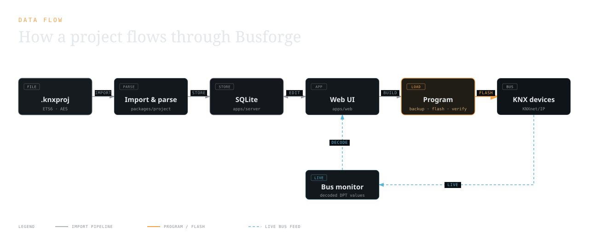
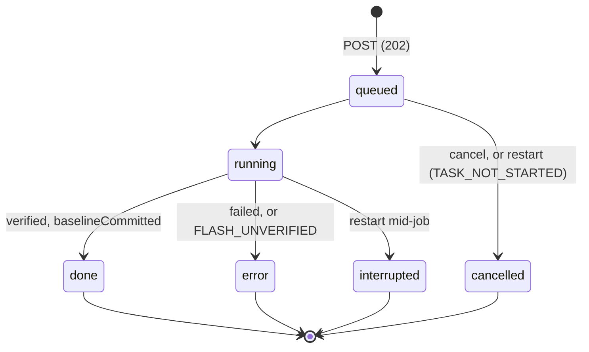

# Architecture

How the running system is put together: the server, the database, the web app, the bus, and the
rails that stand between a click in the browser and a byte written into a real KNX device.

This is the page to read before changing anything. What is proven on hardware and what is not is
tracked in [status.md](status.md), never here.

## Repository layout

A Bun workspace. No build step for the libraries: the packages ship TypeScript source and are
consumed directly by Bun (server) and Vite (web).

| Workspace | What it is |
|---|---|
| `packages/project` | Reads a `.knxproj` / `.knxprod`: a dependency-free ZIP reader with WinZip-AES, the ETS6 password derivation, and the `0.xml` parser (topology, group addresses, per-device parameter values, module instances, com-object links, building structure, per-device security). |
| `packages/product` | The application-program engine. One parser (`appconfig.ts`) with two projections: the configuration view (`config.ts`) and the memory image (`application.ts` → `image.ts`, `grouptables.ts`, `comobjtable.ts`). Also the device profiles and the flash operations (`profiles.ts`, `deviceflash.ts`, `deviceimage.ts`, `loadproc.ts`, `masks.ts`). |
| `packages/knx` | The KNX side: transports (`connection.ts` KNXnet/IP, `usb.ts` HID), the connection-oriented device layer (`device.ts`), the load-procedure executor (`loadrunner.ts`), KNX Data Secure (`secure.ts`, `secureSession.ts`), a KNXnet/IP **server** (`ipserver.ts`), and a browser-safe DPT decoder (`dpt.ts`, exported as `@busforge/knx/dpt`). |
| `apps/server` | A single `Bun.serve`: the `handleApi()` router, the SQLite layer (`db/`), the bus, the task queue, and the flash orchestration. In production it also serves the built web app. |
| `apps/web` | The React UI (Vite, Tailwind, shadcn/Radix, TanStack Router + Query). |
| `apps/bridge` | `busforge-bridge`: puts a locally attached KNX-USB interface on the network as a KNXnet/IP gateway. See [connections.md](connections.md). |
| `plugins/*` | Native replacements for manufacturer ETS DCA plugins. See [plugins.md](plugins.md). |
| `tools/` | Developer CLIs (read-back, byte diffing, the hardware smoke runner). See [development.md](development.md) and [testing.md](testing.md). |

## From a click to a device

A parameter edit and a flash take the same road:

1. The browser mutates through `apps/web/src/api.ts`; TanStack Query invalidates the affected keys.
2. `handleApi()` (`apps/server/src/app.ts`) dispatches to a route module under
   `apps/server/src/routes/`.
3. An edit writes a **sparse override** into SQLite: a value equal to the application default
   deletes the row rather than storing it.
4. The configuration view is rebuilt from the application program plus the stored values
   (`buildDeviceView` in `apps/server/src/deviceservice.ts`), so conditional visibility, module
   expansion and localisation are always recomputed, never cached as state.
5. A flash is not executed inline. The route validates it, takes a restore point, **enqueues**
   a task on the serial bus queue, and answers `202` with that task. The client polls the task
   for the outcome; the job does not depend on the client still listening.
6. The task opens a transport, connects to the device, checks its mask, backs up, writes, restarts,
   and reads the segment back.
7. The device's own read-back decides whether the submitted configuration becomes the
   programmed baseline. Adoption happens inside the queued job, before its completion is reported;
   edits made while waiting or programming remain drift. Unwritten fields retain their old baseline.

A local device-generation token changes on insertion, replacement (including the same product),
or address/application changes. A programming job checks its captured token before accessing the
bus and before adopting its result. A stale target fails with `DEVICE_TARGET_CHANGED`; it cannot
transfer a previous device's verified state to a replacement. This is project identity protection,
not physical serial-number verification.

The bus owns both monitor transitions and exclusive queued operations. A job waits for a pending
monitor connection to settle and close before opening its management transport. Monitor connect
requests during exclusive work receive `BUS_BUSY` (HTTP 409), including requests from another
project or client. After success or failure the monitor remains **disconnected**; the user reconnects
it explicitly. Monitor connect/disconnect transitions serialize, and failed cleanup must finish
before a new owner can open a transport.

## The server

`Bun.serve` in `apps/server/src/index.ts`. Three things share the port:

- The bus-monitor WebSocket, matched on `/api/projects/:id/bus/monitor` **before** the API router.
- `handleApi(req, state)`, which returns `null` for anything outside `/api` so the caller can fall
  through.
- The built web app from `apps/web/dist`, with an `index.html` fallback for client-side routes. If
  `dist` does not exist the server says so instead of serving a blank page (development runs Vite).

`handleApi` splits the path into segments and walks a fixed list of route modules
(`catalog`, `connections`, then the project-scoped `projects`, `groups`, `spaces`, `devices`,
`deviceops`); the first module that returns a response wins. Each module matches on segment count,
literal segments and method. There is no path-pattern library.

**Errors are coded, never prose.** Every failure serialises as
`{ "error": { "code": "...", "message": "..." } }`. `errorCode()` duck-types a `.code` off any
thrown value, so `ApiError`, `ProductError`, `KnxprojError` and `KnxError` all reach the client as
a stable code without the server importing those classes. The web app localises the code
(`errors.<CODE>` in `apps/web/src/locales/{en,de}.ts`) and falls back to the English message. A new
refusal therefore means: a new code, and a new entry in both locale files.

`AppState` carries `{ db, bus, dataDir, masterKey, now, queue, appCache }`. `createState` **refuses
to start** when the database holds sealed Data Secure tool keys and no master key is available,
rather than generating a fresh key that cannot open them.

### API surface

| Group | Routes |
|---|---|
| Version | `GET /api/version` |
| Projects | `GET/POST /api/projects`, `POST /api/projects/import`, `GET/PATCH/DELETE /api/projects/:id`, `GET /api/projects/:id/telegrams` |
| Group addresses | `POST/PATCH/DELETE` on `/api/projects/:id/group-ranges[/:rangeId]` and `/group-addresses[/:raw]`, plus `/impact` (what a delete would drop) and `/group-addresses/:raw/devices` (senders and receivers) |
| Building structure | `POST/PATCH/DELETE /api/projects/:id/spaces[/:spaceId]`, `/impact`, `PUT /api/projects/:id/devices/:deviceId/space` |
| Devices (model only) | `POST /api/projects/:id/devices` (place from catalog), `PATCH /api/projects/:id/devices/:deviceId` (rename), `GET .../config`, `GET .../baggage`, `PUT .../params`, `PUT .../links`, `PUT .../address`, `POST .../replace`, `POST .../revert`, `/revert-param`, `/revert-link` |
| Devices (on the bus) | `GET /api/projects/:id/prog-mode`, `POST .../assign-ia`, `.../read-back`, `.../secure-identify`, `PUT .../tool-key` (stored only after the device answered a secure Sync under it), `.../flash`, `.../flash-ga`, `.../download` (each accepts `?dry=1` where a dry run is meaningful). A real `assign-ia`, `flash`, `flash-ga` or `download` answers `202` with its task; the dry runs, reads and identify answer with their result |
| Bus and tasks | `GET/POST /api/projects/:id/bus/{status,connect,disconnect}`, `GET /api/projects/:id/tasks`, `GET .../tasks/:taskId`, `POST .../tasks/:taskId/cancel`, `WS /api/projects/:id/bus/monitor` |

Three more groups are documented where the feature they belong to is: restore points and the
product catalog in [storage-and-snapshots.md](storage-and-snapshots.md), saved connections and
discovery in [connections.md](connections.md), and archive export/analyze/import in
[export-format.md](export-format.md).

## Persistence

SQLite through `bun:sqlite`, one file, WAL, foreign keys on, forward-only migrations keyed on
`PRAGMA user_version`. The database is the single source of truth: the imported `.knxproj` is not
kept. The full model, the catalog/project split and the restore-point semantics are in
[storage-and-snapshots.md](storage-and-snapshots.md); the portable archive is
[export-format.md](export-format.md).

Only three things live outside the database: the SQLite file itself, the master key that seals
Data Secure tool keys (`data/master.key`, or `BUSFORGE_MASTER_KEY`), and flash backups
(`data/projects/<id>/backups/`, raw device memory dumps taken before every surgical write,
deliberately kept as plain files and never served over the API).

## The bus: one interface, one queue

A project reaches the bus through exactly one interface, and the connection-oriented device link is
a single conversation. Reads and flashes therefore cannot run in parallel. Instead of rejecting a
concurrent request, the server queues it (`apps/server/src/taskqueue.ts`):

- Jobs run strictly FIFO, one at a time. Task kinds are `read`, `flash-params`, `flash-ga`,
  `assign-ia`, `download`.
- Each job reports a phase and chunk-level progress (`connect`, `backup`, `params`, `links`,
  `write`, `verify`, and the address-assignment phases), which the header indicator shows live.
- **Cancelling a queued task is always allowed.** A *running* task that writes nothing (a read, a
  dry run) is cancelled too; it stops between memory chunks. A running flash or download reads the
  device first (backup, compare) and can be cancelled until its first write: the flash calls the
  task's write gate right before it (`WriteGate.beforeWrite` in `@busforge/product`), which throws
  if the task was cancelled and makes the task uncancellable otherwise. From then on, and for every
  other running write (an address assignment, an activation), a cancel is refused with
  `TASK_WRITE_NOT_CANCELLABLE`: aborting mid-bracket can leave the device reset. The task list
  carries `cancellable`, so the UI offers the button exactly when the server accepts it.
- The queue is also an honesty rail. When a finished flash reports `verified: false`, the task is
  forced into the error state with `FLASH_UNVERIFIED` instead of being reported as done.

### Programming jobs outlive the request

A download runs for minutes, longer than an HTTP request can be trusted to stay open. So a real
write (`assign-ia`, `flash`, `flash-ga`, `download`) is a **job**: the route answers `202` with the
task as soon as it is queued, and the client polls `GET .../tasks/:taskId` until the task is
finished. The task carries the operation's full `result`, the `snapshotId` of the restore point
taken of the submitted configuration, and `baselineCommitted`.

- **Tasks are persisted** in the `tasks` table on every state change and phase change. The header
  list shows active tasks and up to 50 finished within the last day; any task stays retrievable
  by id for 30 days.
- **One write per device at a time.** A second write to a device whose write is still queued or
  running is refused with `DEVICE_WRITE_ACTIVE` (HTTP 409). A client that lost the response to its
  first submission and retries therefore cannot program the device twice. The flash dialog
  recognises a write it did not start and waits for it before previewing.
- **The baseline commit is atomic with its record.** Adopting the verified submission and setting
  `baselineCommitted` happen in one transaction.
- **Nothing is replayed after a restart.** At startup, a queued task becomes `cancelled`
  (`TASK_NOT_STARTED`, nothing was sent). A running write becomes `interrupted`
  (`TASK_WRITE_INTERRUPTED`): the device's state is unknown until it is read back, and the header
  indicator warns about it. A running read becomes `interrupted` (`TASK_READ_INTERRUPTED`), with
  nothing written. A running write whose baseline was already committed was verified, so it is
  closed as `done`.

Dry runs, read-back and identify stay plain requests: they write nothing, so losing the response
loses nothing.

- **A normal shutdown drains the running write.** On `SIGTERM`/`SIGINT`/`SIGHUP` the queue refuses
  new work (`SERVER_SHUTTING_DOWN`, HTTP 503), cancels queued tasks as `TASK_NOT_STARTED`, aborts a
  running read or dry run, stops a flash or download still in its read-only part, and waits for a
  running write that has started writing to end, read-back and baseline commit included.
  Then the monitor tunnel closes, a new monitor connection is refused, and the process exits. A repeated signal does not skip the wait;
  only `SIGKILL` does, and that is the `interrupted` case above. The container's stop grace period
  that makes this hold under `docker stop` is in [deployment.md](deployment.md#stopping-and-updating).

Starting a bus task disconnects the monitor tunnel first, because the interface is the same one.

## The configuration engine

`buildDeviceConfig(app, values, lang, moduleInstances)` produces the visible, grouped, localised
parameter tree plus the device's com-objects. It evaluates the dynamic tree's conditional
visibility (`choose`/`when` and the `test` grammar), resolves unions and `Assign`, applies
`DisplayOrder` and `IndentLevel`, expands module instances, and hides `Access="None"` parameters
while still applying their side effects on later conditions.

**Channel devices.** No allocator computation is needed for an imported project: the device's
`0.xml` pins each module instance's resolved arguments. The engine reads those and expands each
instance through a scope that rewrites module ids to the device's flattened
`…_MD-x_M-k_MI-n_…` form, substitutes text arguments and resolves com-object numbering. A device
placed from the catalog (no `0.xml`) resolves the same arguments from the application's
`<Allocators>`.

The configuration view and the memory image are **two projections of one parsed model**, not two
parsers. The image path is the byte projection (`toAppModel`), the view is the
visibility-filtered, localised projection. A CI lock asserts that everything the view exposes is
placeable by the image builder, so a feature added to one projection but not the other fails the
build. Coverage of the ETS dynamic grammar is tracked in [ets-coverage.md](ets-coverage.md); the
byte layout itself is [device-memory-model.md](device-memory-model.md).

## The flash safety model

Flashing writes to real hardware and is hard to reverse. Every write goes through the same rails,
in this order. They are split deliberately: the cheap refusals happen before anything touches the
bus.

**Before the task is even queued** (`apps/server/src/routes/deviceops.ts`):

1. **The device, the connection and the application program must resolve.** `DEVICE_NOT_FOUND`,
   `INTERFACE_NOT_SET`, `APP_PROGRAM_MISSING`.
2. **The device family must declare the capability.** `classify(app).capabilities()` gates each
   operation: `DEVICE_READBACK_UNSUPPORTED`, `DEVICE_FAMILY_UNSUPPORTED`, `GA_FLASH_UNSUPPORTED`,
   `FULL_DOWNLOAD_UNSUPPORTED`. An unsupported family is a profile whose every capability is false
   and whose every operation throws, not a code path that guesses.
3. **The com-object table must not go stale.** See below.
4. **An automatic restore point** is taken before every real (non-dry) write.
5. The configuration is read **once** and the same snapshot feeds both the image and the
   post-flash baseline decision, so a concurrent edit cannot desynchronise them.

**Inside the session** (`withDeviceSession` in `apps/server/src/deviceprofile.ts`):

6. **Verify the device before writing.** The device descriptor is read and its mask compared
   against the application's, by canonical equality, never substring. A mismatch aborts with
   `MASK_MISMATCH`, so the wrong device is never programmed. Teardown always runs.

**Inside the operation** (`runFlashOp` in `packages/product/src/profiles.ts`, one sequence for
every device model):

7. **Back up first**, structurally before any write, to `data/projects/<id>/backups/`. The
   surgical paths always hand over the segments they are about to overwrite; a full download
   hands over nothing unless its opt-in pre-unload backup is asked for (see
   [load-procedures.md](load-procedures.md)).
8. **Build only if changed.** A zero-byte diff returns `unchanged` without touching the device, but
   only when every load-state machine the operation brackets is LOADED. Equal bytes under a machine
   left Loading by an interrupted write are not a running configuration: a System B flash, whose
   bracket always covers its load-state machines, runs anyway and completes the load; a System 7
   flash, whose plan brackets only the segments or tables it changes, refuses with
   `DEVICE_LOAD_INCOMPLETE` whenever one of its load-state machines is not LOADED, diff or not, and
   points at a full download.
9. **Dry run** returns the diff and stops.
10. **Write**, then reconnect after the device's restart, then **read the segment back** and compare
    it against the intended bytes. The result type is a discriminated union: a `flashed` result
    *must* carry `verified`.
11. **Baselines are adopted only on `verified: true`.** An unverified flash leaves the programmed
    baseline untouched, so the UI keeps showing the device as unprogrammed rather than claiming
    success. Parameters the flash provably did not write stay marked as drift.

Additional refusals raised by the load path rather than the route: a declared load step the engine
cannot execute (`LOAD_STEP_UNSUPPORTED`) rather than a partial recipe, a failed pre-flight
`CompareProp` check (`LOAD_PROC_CHECK_FAILED`), a link pointing at an inactive com-object
(`LINK_COM_OBJECT_INACTIVE`), a group table that would outgrow the device's declared capacity
(`GA_TABLE_TOO_LARGE`), and a System B group-address flash that left the application object in a
worse load state than it found it (`GA_FLASH_BROKE_APPLICATION`).

### The three write paths

| Path | Writes | Leaves alone |
|---|---|---|
| **Parameters** (`flash`) | the parameter segment built from the device's edited values | the addressing and com-object tables |
| **Group addresses** (`flash-ga`) | the address and association tables, plus the com-object table: rebuilt from the current link set on System B, the device's own with each linked bit following the links on System 7 | the parameter image |
| **Structural flash** (`flash` or `flash-ga`, when the change alters the com-object table) | the parameter bytes, the com-object table authored for the new configuration and links, and the group tables, in one load bracket on System B (one per load-state machine on System 7), only what differs from the device | everything else of the parameter image |
| **Full download** (`download`) | application id, parameter image, com-object table and group tables, in one load bracket | nothing; this is what commissions a virgin device |

Neither the parameter flash nor the group-address flash can change the *set* of com-objects. A
change that would alter it (activating or disabling a channel, flipping a com-object flag, changing
a datapoint size) is detected **before any bus write** by comparing the programmed baseline against
the edited configuration. Where the family claims `structuralFlash`, both routes then run the
structural flash, which writes the change the way ETS's partial download does
([load-procedures.md](load-procedures.md#structural-flash)); the flash dialog writes it once even when
both the configuration and the group addresses preview it. Where the family cannot, the route
refuses: with `COM_OBJECT_TABLE_STALE_USE_DOWNLOAD` where it can commission from scratch (the dialog
offers the full download on the device's existing address), otherwise with the plain
`COM_OBJECT_TABLE_STALE`. The dialog also offers the full download as a choice of its own wherever
the family can commission.

The load brackets themselves (which load state machine, which steps, when the device is restarted)
are in [load-procedures.md](load-procedures.md); commissioning a factory device is
[commissioning.md](commissioning.md).

## Read-back: adopting the device state as the baseline

**Read from device** is the reverse of flashing. It reads the device's current parameter segment and
group tables off the bus, decodes them, and stores the result as that device's **programmed
baseline**, leaving the live configuration untouched. Because the change indicator is a diff of live
configuration against baseline, anything the project does not match on the hardware immediately
shows as a change, and **Revert** adopts the device's value while programming pushes the project's
value the other way.

- **Decoding is the exact inverse of the builders.** `decodeParameterImage` and `decodeGroupTables`
  mirror `buildParameterImage` and `buildGroupTables` field for field, and a per-fixture CI lock
  asserts the codec is its own inverse on the real model wiring.
- **The baseline stays sparse.** Only parameters whose device value actually differs from what the
  project would flash are stored as overrides, both sides normalised through the same build and
  decode, so default-valued parameters never produce phantom changes.
- The read is read-only on the bus and writes no backup. A device that was never programmed is
  refused (`DEVICE_NOT_PROGRAMMED`) instead of having garbage decoded out of it.

Interpreting a byte that differs is [verification.md](verification.md).

## The web app

React on Vite, shadcn/ui over Radix, styled per [design-system.md](design-system.md). Routing is
TanStack Router; server data is fetched and cached with TanStack Query, with all query keys
centralised in `apps/web/src/queries.ts`.

| Route | View |
|---|---|
| `/` | projects: import, blank project, export, rename, delete |
| `/projects/:id/devices` | the installation by building structure, with an unassigned section and a flat fallback |
| `/projects/:id/devices/:deviceId` | the device: parameters, com-objects, group-address links, flash, read-back, commission, replace |
| `/projects/:id/groups` | the group-address tree, with range and address editing |
| `/projects/:id/monitor` | the live bus monitor |

Conventions that hold across views:

- **Filter and search state lives in the URL**, so a filtered view survives reload and browser
  back/forward and can be shared.
- **Catalogue text is language-keyed.** The UI language is mapped to the nearest language the
  manufacturer catalogue actually ships (exact match, then primary subtag), falling back to the
  catalogue's base text. Language is part of the query key, so switching it refetches.
- **A gap is shown, never hidden.** An ETS element the engine does not handle renders as a visible
  marker in place; a parameter type it cannot edit keeps its row with a "not supported" badge and
  the raw stored value.
- **The dangerous dialogs step.** `CommissionDialog` gates each of its three steps (find the device
  in programming mode, assign the address, download) on the previous one having been *verified*; a
  `verified: false` renders as a terminal failure, never as success.

The bus indicator in the header doubles as the connection status: the running task with its
progress, a popover listing the queue with cancel controls, and the saved-connection picker.

## Cross-cutting

| Concern | Doc |
|---|---|
| Transports, the connection library, the USB gateway | [connections.md](connections.md) |
| Database model, restore points, catalog | [storage-and-snapshots.md](storage-and-snapshots.md) |
| The `.busforge` archive | [export-format.md](export-format.md) |
| KNX Data Secure and the key store | [knx-secure.md](knx-secure.md) |
| DCA-replacement plugins | [plugins.md](plugins.md) |
| Device classification and the mask matrix | [device-support.md](device-support.md) |
| Local setup, checks, CLIs | [development.md](development.md) |
| Test levels and the hardware smoke framework | [testing.md](testing.md) |
| Self-hosting | [deployment.md](deployment.md) |
