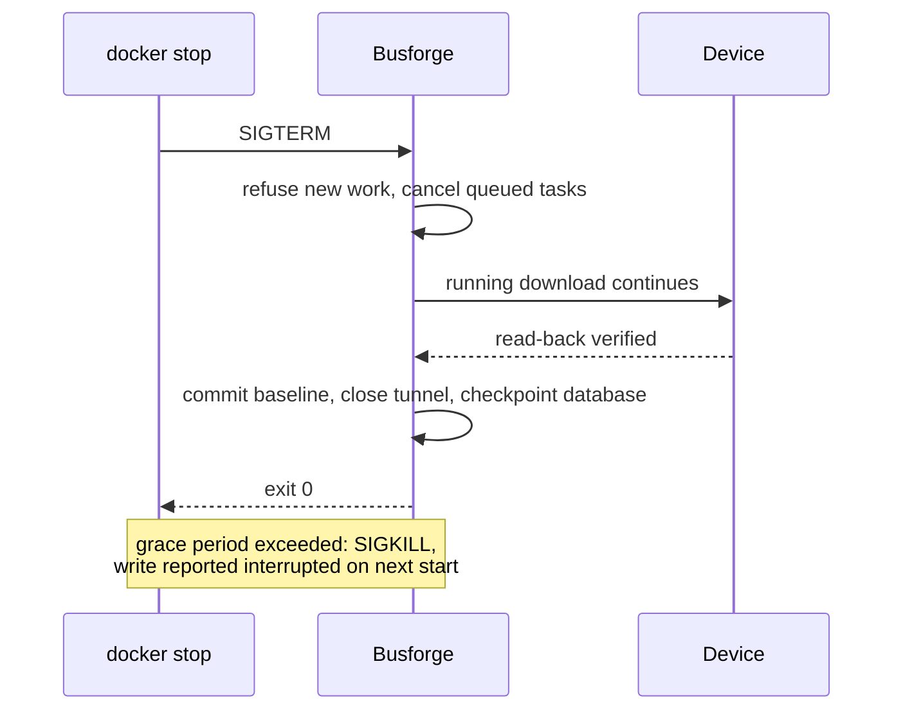

# Deployment

Busforge ships as a **single Docker container**: the Bun server serves both the API and the built
web app. There is no separate frontend service, no database server, no message broker. State is one
SQLite file plus the uploaded project files, in one directory.

## Build

```bash
docker build -t busforge .
```

The build stage installs dependencies and runs `bun run build` (which builds the web app); the
runtime stage carries the result. Three optional build arguments bake the build identity into the
image, read back through `/api/version` and shown in the UI footer, and set as the OCI labels
`org.opencontainers.image.version`, `.revision` and `.created`:

| Build arg | Meaning |
|---|---|
| `BUSFORGE_VERSION` | Version string, e.g. `v0.4.0` |
| `BUSFORGE_COMMIT` | Commit hash |
| `BUSFORGE_BUILT_AT` | Build timestamp |

They default to `unknown`, which keeps a local `docker build` honest rather than claiming a version
it does not have. The build context excludes `.git`, so the server cannot read this from git at
runtime.

### What the image contains

The build context is an allowlist (`.dockerignore` starts with `*`): the license, the root and
workspace manifests, the lockfile, the source of the workspaces and the web build inputs. Tests,
fixtures, `docs/`, `tools/` (apart from its manifest), local scratch and runtime state are never
sent to the builder, so no layer of any build stage carries them. The runtime image then holds:

| Path in `/app` | What |
|---|---|
| `LICENSE` | The license, including its required notice |
| `package.json`, `bun.lock`, `tsconfig.base.json`, every workspace's `package.json` (`tools` and `apps/bridge` included) | Needed by the frozen-lockfile install |
| `apps/server/src`, `packages/*/src`, `plugins/*/src`, the `tsconfig.json` of `packages/*` and `plugins/*` | The server and the workspaces it imports, run from source by Bun |
| `node_modules` | Production dependencies of `@busforge/server` and the peer dependencies Bun adds for them (`react`, from the DALI plugin), about 9 MB |
| `apps/web/dist` | The built web app |
| `version.json` | The build identity above |
| `apps/server/data` | Declared `VOLUME`: all persistent state, see below |

The web source, the web app's own dependencies and the development toolchain (TypeScript, Vite,
oxlint, Playwright) stay in the build stage. A context that bypasses `.dockerignore` (a tar piped
into `docker build -`, which Docker sends as-is) is refused: the build stops if it finds tests,
fixtures, captures, project or key files, a database or a `master.key` in the context.

### Release build

Build a version from a clean checkout of its commit, never from a working tree, so the image holds
exactly what the commit holds and the stamped identity is true:

```bash
git worktree add --detach /tmp/busforge-release v0.4.0
cd /tmp/busforge-release
docker build -t busforge:v0.4.0 \
  --build-arg BUSFORGE_VERSION="$(git describe --tags --always)" \
  --build-arg BUSFORGE_COMMIT="$(git rev-parse --short=7 HEAD)" \
  --build-arg BUSFORGE_BUILT_AT="$(date -u +%Y-%m-%dT%H:%M:%SZ)" .
cd - && git worktree remove /tmp/busforge-release
```

Check the result with `docker inspect --format '{{json .Config.Labels}}' busforge:v0.4.0` and,
once it runs, `GET /api/version`.

## Run

```bash
docker run -d --name busforge \
  --stop-timeout 1800 \
  -p 3000:3000 \
  -v /srv/busforge/data:/app/apps/server/data \
  -e BUSFORGE_MASTER_KEY=<32 random bytes, hex or base64> \
  busforge
```

Or with the `docker-compose.yml` in the repository, which runs as-is and takes every
site-specific value from the environment:

```bash
BUSFORGE_IMAGE=busforge:latest \
BUSFORGE_DATA=/srv/busforge/data \
BUSFORGE_MASTER_KEY=<32 random bytes> \
  docker compose up -d
```

| Variable | Default | Meaning |
|---|---|---|
| `BUSFORGE_IMAGE` | `busforge:latest` | Image to run, including a registry prefix if it is not local |
| `BUSFORGE_DATA` | named volume `busforge-data` | Host path for the data directory, if you want it on a specific (backed-up) filesystem |
| `BUSFORGE_MASTER_KEY` | unset | Passed through only when set, so an empty value can never look like a configured key |

**No host port is published.** Compose can add published ports but never withdraw them, so a
port in the shared file would be forced on every deployment that fronts the container with a
proxy. Publish it, together with reverse-proxy labels, an external proxy network and any other
site-specific wiring, in a second file that stays out of the repository
(`docker-compose.deploy.yml` is gitignored for exactly this):

```yaml
# docker-compose.deploy.yml
services:
  busforge:
    ports: ["127.0.0.1:3000:3000"]
```

```bash
docker compose -f docker-compose.yml -f docker-compose.deploy.yml up -d
```

The image declares a healthcheck that polls the SPA root, so `docker compose ps` and a deploy gate
can wait for readiness.

### Stopping and updating

A stop must not cut a device write short. A download interrupted mid-transfer can leave the device
reset, not merely half-configured. So on `SIGTERM`, `SIGINT` or `SIGHUP` the server:

1. refuses new bus operations (`503 SERVER_SHUTTING_DOWN`),
2. cancels every queued task without running it (`TASK_NOT_STARTED`), and aborts a running read or
   dry run (neither writes anything),
3. stops a running flash or download that is still reading the device, before its first write, and
   otherwise waits for the running write to finish, its read-back and baseline commit included,
4. closes the monitor tunnel, refusing any new monitor connection,
5. checkpoints the database, so `busforge.db` holds every committed write and `busforge.db-wal` is
   empty or gone, and exits. If closing the bus connection fails, that is logged, the checkpoint
   still runs, and the exit code is 1. Another process reading or writing the database at that
   moment (an open transaction in an `sqlite3` shell, a second server on the same directory) blocks
   the checkpoint; it waits up to 5 seconds for that to end. If it cannot complete, the log says so
   (`closing the database failed`) and names which case it is, and the exit code is 1: either some
   recent writes are still only in `busforge.db-wal`, or every write reached `busforge.db` but the
   log could not be emptied.

With no write running it exits at once. A second signal does not skip the wait; the log names the
write it is still finishing. The HTTP API stays up meanwhile, so an open client keeps seeing the
write's progress.



Docker's default grace period is 10 seconds, far shorter than a download, after which it sends
`SIGKILL`. The shipped `docker-compose.yml` sets `stop_grace_period: 30m` (use
`--stop-timeout 1800` with `docker run`). A `SIGKILL`, whether from an exhausted grace period or
`docker kill`, still ends the process mid-write. The next start then reports that write as
`interrupted` with the device state unknown, and replays nothing.

**Why 30 minutes.** The `tasks` table of the development instance held 686 finished writes on
2026-09-30 (downloads, parameter and group-address flashes on the bench and on the installation bus,
TP through a KNXnet/IP interface or the bench bridge). The longest took 229 s (a parameter flash of a
Steinel True Presence), the longest full download 211 s (the ABB US/U 4.2); a group-address flash at
most 145 s. That is a margin of about eight. What is not measured is a large MV-0705 image: the only
MV-0705 device timed, the MDT BE-02001, downloads in 19 s. A device written with `A_Memory_Write`
takes 12 bytes per frame, each a confirmed round trip with a per-frame retry budget of a few seconds,
so a slow line and retries can stretch a download well past the measured ones; 30 minutes leaves
room for that. The grace period only costs time when
a write is actually running. Every write's start and end are recorded in the `tasks` table, so the
bound can be checked against real downloads. A deploy pipeline that replaces the container must wait
at least as long; the NAS deploy job allows 45 minutes.

The grace period covers `docker stop` and container replacement. A **host** shutdown or a restart of
the Docker daemon is also bounded by the daemon's and the init system's own timeouts (dockerd's
`shutdown-timeout`, the service manager's stop timeout for dockerd), which this file does not set
and which can end a running write earlier. Do not reboot the host while a device
is being programmed; the next start reports such a write as interrupted.

### Ports

| Port | Purpose |
|---|---|
| `3000` (`PORT`) | HTTP: the API, the web app, and the bus-monitor WebSocket on the same port |

Nothing else is exposed. Outbound, the container reaches a KNXnet/IP interface on the network
(UDP/TCP 3671 by default).

### Environment

| Variable | Default | Meaning |
|---|---|---|
| `PORT` | `3000` | HTTP listen port |
| `BUSFORGE_MASTER_KEY` | unset | The instance master key: **32 random bytes** as hex or base64. Not a passphrase, no key derivation is applied |
| `TZ` | container default | Timestamps in the UI and logs |

### State and the master key

Everything persistent lives under `/app/apps/server/data` inside the container: the SQLite
database (which is where an imported `.knxproj` or `.knxprod` ends up; the uploaded file itself is
not kept), the per-project flash backups, and `master.key` if no `BUSFORGE_MASTER_KEY` is set. Bind-mount that path to a backed-up host directory. The image declares
it a `VOLUME`, so a container started without a mount still writes to an anonymous volume rather
than into its own layer, but only a named volume or a bind mount is found again by the next
container. Nothing proprietary is baked into the image (see [What the image contains](#what-the-image-contains));
user data only ever lands in the data directory at runtime.

The master key seals KNX tool keys in the database. It is **unrecoverable**: restoring the database
onto a host without its key makes every sealed tool key permanently unopenable. Either pin
`BUSFORGE_MASTER_KEY` from your own secret store, or back up `master.key` **together with** the
database. The server refuses to start if sealed keys exist but no master key is available, rather
than silently generating a new one that cannot open them.

### Backup, restore and upgrade

Back up the data directory of a **stopped** container, and always the **whole directory**, with
`master.key` in it. A clean stop (any of the signals above, within the grace period) checkpoints
the SQLite write-ahead log into `busforge.db` and leaves `busforge.db-wal` empty or removes it. A
process that ends any other way (`SIGKILL`, a crash, a host losing power) leaves recent writes only
in `busforge.db-wal`, and so can a stop whose checkpoint failed (see above). `busforge.db` alone is
then an older state, and `busforge.db-shm` is only an index into that log. Since a backup cannot tell how the last process ended, never copy
`busforge.db` alone.

The commands below address the container by its fixed name `busforge` (`container_name` in the
compose file, `--name` with `docker run`) rather than through compose: `docker compose stop` under
another project name, or from a directory whose compose file has its own `busforge` service, finds
no container of its own and does nothing, without an error, and the backup would then read a
running database. `docker stop` keeps the container's own grace period. The image is the exact
image the container was created from, by its ID, whatever tag or registry prefix it was started
under, so nothing is pulled.
The data is reached through the stopped container itself (`--volumes-from`), which works the same
for a named volume and a bind mount and does not depend on the name compose gave the volume
(compose prefixes it with the project name, by default the directory name, e.g.
`busforge_busforge-data`; `-v busforge-data:...` would silently create a new, empty volume):

```bash
docker stop busforge && \
docker run --rm --volumes-from busforge -v "$PWD":/backup --entrypoint tar \
  "$(docker inspect -f '{{.Image}}' busforge)" \
  -czf /backup/busforge-data.tgz -C /app/apps/server/data . && \
docker start busforge
```

If the archive cannot be written (a wrong directory, no permission, a full disk), the command
exits non-zero and the container stays stopped: fix the cause and run the backup again, or start
the container with `docker start busforge`. Check that the archive lists `./busforge.db`
(`tar -tzf busforge-data.tgz`) before relying on it.

Restore into the data directory of a stopped container. On a host that has no `busforge`
container yet, create one first from the compose directory with `docker compose create busforge`.
Use that only on such a host: on an existing container it either changes nothing, or, if the image
or the compose configuration changed since, replaces the container (a running one included) with
a new, stopped one, outside the stop sequence above.
**The restore is destructive**: it deletes the current content of the data directory and replaces
it with the archive. It first reads the whole archive and checks that it holds
`./busforge.db`, and deletes nothing if either fails: a wrong path, a truncated or corrupt file, or
a readable archive of something else (reported as `archive lacks ./busforge.db`). It empties the
directory before unpacking because a `busforge.db-wal` left from a newer state would otherwise be
replayed onto the restored database. The container is started only if the restore succeeded; on a
failure the command prints the error and exits non-zero, and the container stays stopped. A failure
after the check, such as a full disk while unpacking, leaves the directory partly emptied: run the
same restore again once the cause is fixed, and do not start the container before it succeeds.

```bash
docker stop busforge && \
docker run --rm --volumes-from busforge -v "$PWD":/backup --entrypoint sh \
  "$(docker inspect -f '{{.Image}}' busforge)" -c '
    set -e
    tar -tzf /backup/busforge-data.tgz > /tmp/list
    grep -qx ./busforge.db /tmp/list || { echo "archive lacks ./busforge.db" >&2; exit 1; }
    find /app/apps/server/data -mindepth 1 -delete
    tar -xzf /backup/busforge-data.tgz -C /app/apps/server/data' && \
docker start busforge
```

The archive holds `master.key` too, unless the key comes from
`BUSFORGE_MASTER_KEY`, in which case the same value must be set again.

An upgrade is a new image on the same data directory: `docker compose pull && docker compose up -d`,
or `docker run` the new tag with the same `-v`. The old container is stopped first, with the grace
period above. On start the server applies its forward-only schema migrations (versioned on SQLite's
`user_version`), so there is no separate migration step to run. There is no downgrade: an older image
does not notice that a newer one has migrated the database and runs on it unchecked. To go back,
restore the backup taken before the upgrade. On 2026-10-04 this path was exercised locally with the shipped compose file
and a named volume: a container from the image of `181c1fb` imported a project and created a blank
one, the image built from this layout replaced it and listed both projects unchanged, and a backup
restored after `docker compose down -v` gave the same project list. Further runs restored onto a data
directory that was not empty, once on the named volume and once on a bind mount (`BUSFORGE_DATA`):
backup taken under the `181c1fb` image, upgrade, three more projects created by the new image,
container killed so that `busforge.db-wal` and `-shm` stayed behind. A restore from the archive cut
to half its size and one from a readable archive without `busforge.db` both failed, left the
directory byte-identical and did not start the container; the restore from the intact archive
started it, and the project list was that of the backup. The same sequence with a plain
`tar -xzf` restore, without emptying the directory, kept the three newer projects: the leftover log
had been replayed onto the restored database. The backup and restore commands as written above
were run verbatim from a directory other than the compose directory, on a bind mount: the backup
listed `./busforge.db` with an empty `-wal`; a readable archive without `busforge.db` was refused
with `archive lacks ./busforge.db`, left the directory unchanged and the container stopped; the
intact archive restored onto a running container, which the restore stopped first, and gave the
backup's project list. A `docker stop` of a container whose writes were all still in the log left
`busforge.db` holding all of them, which the image before the checkpoint did not: there the
`busforge.db` copied alone had no tables at all. The backup with the image taken by its ID ran
verbatim as well, and a `docker compose create busforge` with a changed `BUSFORGE_IMAGE` replaced
the running container with a stopped one, as described above. Not every historical data layout was
exercised.

### Bus access from a container

The container runs fine on bridge networking. A KNXnet/IP tunnel still reaches an interface on the
LAN because busforge advertises a `0.0.0.0` HPAI (NAT mode), so the gateway replies to the observed
packet source rather than to the container's internal address.

If a particular gateway ignores NAT mode (the bus monitor stays empty, a tunnel never connects),
switch the service to `network_mode: host`. That drops it off any user-defined Docker network, so it
is then reachable only on a host port.

A directly attached KNX-USB interface is not reachable from the container. Run
[`busforge-bridge`](development.md#busforge-bridge) on the machine holding the stick and connect to
it over KNXnet/IP.

### Behind a reverse proxy

Route a single upstream to port 3000. The bus monitor uses a standard HTTP upgrade, so any proxy
that passes WebSockets through needs no extra configuration beyond its usual upgrade handling.

Busforge has **no authentication of its own**. It can program devices in a real installation, so do
not expose it to the internet: keep it on a trusted network, or put authentication in front of it at
the proxy.

## Continuous integration

The pipeline in `.forgejo/workflows/ci.yml` runs `bun run check` (typecheck, lint, tests, web
build) on every push and pull request. That job is the gate; nothing downstream runs if it fails.

On `main`, CI then computes the next version from the commit subjects since the last `v*` tag
(`feat:` → minor, any `type!:` or a `BREAKING CHANGE` body → major, everything else → patch), builds
the image with that version baked in and pushes it to the project's container registry tagged by
commit. The pushed image is then started in a fresh container without a data volume, and must
report the commit it was built from on `/api/version`. That start is the release gate: only then is
`latest` moved to the image, and the release job tags the commit, re-tags the image with the version and creates a release with the
changelog. It skips when nothing changed since the last tag.

Deploying to the author's own NAS is a separate job after the build. It writes its site-specific
compose overlay and pulls `latest`; a release neither waits for it nor fails with it.

The hardware smoke framework is never part of CI. It needs a real bus and a real device; see
[testing.md](testing.md).
