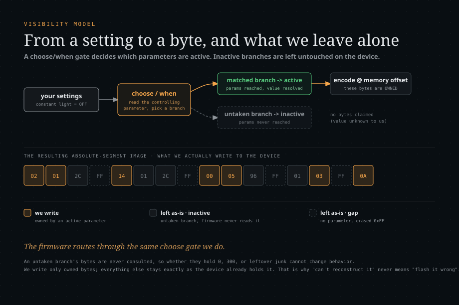

# Device memory model

A KNX device's commissioned state lives in several memory segments, each governed by a
**Load State Machine (LSM)**. Programming a device means driving the right LSM through its
load procedure and writing the segment. This document describes the segments, how the
parameter image is computed from the application program, which bytes Busforge claims
authority over, and where the model stops.

For how the transfer itself is driven see [load-procedures.md](load-procedures.md); for how
the bytes are checked see [verification.md](verification.md). What is proven on real
hardware, per device and per capability, lives in **[status.md](status.md)** and nowhere
else.

## The segments

| LSM | Segment | Holds |
| --- | --- | --- |
| **LSM1** | Address table | The group addresses the device answers to |
| **LSM2** | Association table | Links each group-address entry to a com-object |
| **LSM3** | Com-object table | Com-object descriptors, flags and datapoint sizes |
| **LSM4** | Application / parameter segment | The parameter memory image |
| **LSM5** | Secondary application segment | Extra application code/data on some masks |

Two largely independent axes:

- **Group communication** (LSM1/2/3): which group addresses the device talks on.
- **Parameters** (LSM4, or an absolute segment, see below): how the device behaves.

One can be reconfigured without the other.

## Two parameter models

Not every device stores parameters in an LSM4 memory image. There are two families,
distinguished by the **segment structure the application declares** (`RelativeSegment` vs
`AbsoluteSegment`), not by the mask number. The build picks the path by structure
(`app.absoluteSegments` non-empty selects the absolute path), so a low-numbered mask can
still land on the absolute path.

| Model | Masks seen so far | Parameters live in | Address source |
| --- | --- | --- | --- |
| **Relative segment** | MV-07B0 (System B) | an LSM4 `RelativeSegment` | assigned by the device during allocation, read back via `PID_TABLE_REFERENCE` |
| **Absolute segment** | MV-0700/0701, MV-0705 (System 7) | one or more `AbsoluteSegment`s at fixed EEPROM addresses | a literal `Address` in the application XML |

The absolute-segment family was long assumed to be opaque "property based" storage. It is
not. These devices keep their parameters in fixed-address segments, and the correct image is
the manufacturer `<Data>` default (or a cleared parameter region for `<Data>`-less segments)
overlaid with the visibility-resolved active parameter set. The codec is the same for both
families; the differences are the address source and the load procedure verbs
(`LdCtrlRelSegment` vs `LdCtrlAbsSegment`).

A genuine property-based model does exist (parameters loaded through interface-object
property writes rather than a memory image, as IP interfaces, routers and cEMI servers do).
It is **not implemented**; see the gap table at the end.

## From settings to bytes: the visibility model

### Static declares what exists, Dynamic declares what is active

Every ETS application program has two halves:

- **`<Static>`** declares what exists: parameters, their types (width, signedness, enum or
  number), the `ParameterRef`s that name them, and the memory segments. Every parameter
  carries a `<Memory>` element (segment, `Offset`, `BitOffset`): its fixed address in the
  image.
- **`<Dynamic>`** declares what is active and visible: a tree of blocks, `choose`/`when`
  branches, `Assign`s and modules. The UI walks it to decide what to render, and the same
  structure decides what is written to memory.

A setting is never a byte directly. A setting is a parameter value. Static says where it
lives and how to encode it, Dynamic says whether it is active at all.

### The choose/when gate

```xml
<choose ParamRefId="P-constant-light">
  <when test="1"> ...constant-lighting sub-parameters... </when>
  <when default="true"> ...the simple branch... </when>
</choose>
```

The controlling parameter's current value selects the branch. Only parameters reached inside
a taken branch are **active**: parameters in an untaken branch are neither shown in the UI
nor written to the image. This is the mechanism ETS uses and it mirrors what the firmware
does at runtime, where the controlling value routes execution down one path and the code for
the other path is never entered.

`buildDeviceConfig` (`packages/product/src/config.ts`) walks the Dynamic tree with the
current values and collects `imageValues`: the effective value of every parameter reached in
the active branches. That includes `Access="None"` internal parameters, which ETS hides from
the UI but does write to memory, taking their value from whichever `ParameterRef` the active
branch references.

### ETS evaluates every matching `<when>`, not just the first

A `<choose>` looks like a switch, but ETS evaluates **every** `<when>` whose test matches;
the `default` branch fires only when none match. This differs from first-match only when
tests overlap, which manufacturers use deliberately to drive two independent placements from
one selector. A Theben channel actuator is the canonical case: one choose on the
channel-function parameter places a contact-type field (bits 0-1) under one set of `when`
tests and a union member (bits 2-3) under another, so every value matches exactly two
`when`s and both fields are written. First-match left the union bits unwritten, and a device
read-back disproved it. The resolver (`selectWhens` in `config.ts`) and the module allocator
(`modules.ts`) both walk all matching branches, so the config view, the image build and the
from-scratch instance set stay consistent.

### `<Assign>` targets are written, even when placed only in an inactive branch

`<Assign TargetParamRefRef="T" SourceParamRefRef="S">` sets parameter T's value from S, and
ETS writes T's memory with it. A common manufacturer pattern assigns a hidden
`Access="None"` parameter from a visible one in the ACTIVE branch while placing T's own
`<ParameterRef>` only in a different, inactive branch:

```
<choose ParamRefId="P-38">
  <when test="0"> place P-1; <Assign Target="P-26" Source="P-1"/> </when>   (active)
  <when test="1"> ... place P-26 ... </when>                                (inactive)
</choose>
```

Because the image set is built by visiting reached `<ParameterRef>` nodes, an
assigned-but-not-placed target would keep its default. So `buildDeviceConfig` records each
`<Assign>` target's value in `imageValues` directly (non-memory Merker targets have no
offset and are ignored by the image build). Hardware-confirmed on a Steinel sensor, where
the assigned target landed in the expected bit.

One exception preserves the union invariant: a `<Union>`-member assign target is **not**
recorded. Union branches share one region and the image owns a union byte only for the
actively placed branch; injecting an assigned alternative would let two members claim the
same byte. The active branch's own placement still writes it.

### A block that is invisible still runs its side effects

A `<choose>` can be gated on a Merker (an `Access="None"`, no-memory visibility flag) that
is only placed by a `<ParameterRefRef>` inside an invisible block. Skipping an
`Access="None"` block wholesale therefore leaves the Merker unplaced and the dependent
`choose` reads it as unset, so whole channels vanish from the config view while the image
still materialises them. `buildDeviceConfig` runs an invisible block's Merker/Assign side
effects (with the same `selectWhens` gating, so an inactive branch's placement is still not
reached) without emitting the block.

### Owned bytes and left-alone bytes

`buildAbsoluteSegmentTargets` / `buildRelativeSegmentTarget`
(`packages/product/src/deviceimage.ts`) lay the resolved values into the segment image and
mark every byte they actually wrote as **owned**.

| Kind | Where it comes from | Flash authority |
| --- | --- | --- |
| **Owned** | encoded from an active, resolved parameter | may be written |
| **Left alone** | manufacturer default, an erased `0xFF` gap, an inactive-branch parameter, an ETS-computed table | never written |

Ownership is gated on the encoder actually writing: a type the image does not represent
(text, time, color) or a malformed value writes nothing and claims no bytes.

A second, narrower mask, `verify`, is the subset a post-flash read-back may assert. It
excludes bytes owned only by `Access="None"` device-internal markers (download-recognition
stamps and counters the device rewrites for itself on every download). Those bytes are still
written, because they are part of the correct image, but asserting them would report every
successful flash as failed.



### Why a disabled feature's bytes are irrelevant

A byte belonging to a parameter in an untaken branch is one the firmware never reads,
because the controlling parameter's value routes execution away from it. Whatever it holds
(0, a leftover value, junk from a previous configuration) cannot change the device's
behaviour. The claim is sound because the byte's relevance is gated by the very parameter
value that was already resolved: the branch is inactive if and only if the firmware does not
consult those bytes.

**Honest caveat.** "Irrelevant" is an inference about firmware behaviour from the visibility
model, not something instrumented at the silicon level. It is the same bet ETS makes: ETS
writes its precomputed default there, Busforge leaves the device's existing value, and both
assume the firmware respects its own visibility gating. The read-back corpus supports the
bet (toggling a feature on a real device changes exactly the active bytes), it does not
prove it.

### Unions

A `<Union>` is the same idea applied to shared memory: several parameters get one memory
base, and only the visible branch is active. Ownership needs no special case: an inactive
union branch is simply unowned, exactly like an inactive `choose` branch.

The parsing detail matters, because it is easy to miss: the **`<Union>` element carries the
real `<Memory>`** (code segment plus base offset and bit), and its child `<Parameter>`s have
no `<Memory>` of their own, only a *relative* `Offset`/`BitOffset` into it. A parser that
looks for a `<Memory>` child on the parameter gives union members no location at all and
silently drops them from the image, which makes a union-heavy device look unsupported when its
parameters are merely unplaced. A union member's location is `union base + relative offset`.

## Ownership rules, in detail

The rules below are hardware-derived. They are the difference between a re-configuration
that preserves a working device and one that corrupts a channel.

- **A plain top-level memory parameter is owned at its effective default**, active or not.
  ETS writes every such default and the device holds it: without this fallback, a freshly
  ETS-flashed power supply misses 51 bytes of its image.
- **A `<Union>` member or a module-instance (`…_MI-…`) parameter is owned only when it is the
  ACTIVE branch.** Overlapping branches must not all be written.
- **An inactive `Access="None"` parameter is not owned.** The device byte stays.
- **A `BinaryValue` parameter writes the bytes of the enumeration its value names**, of any
  width. The Theben MIX 2 carries one `<Union>` of `Access="None"` "Objektlink" members per module
  slot (offsets 330, 842 and 1354 of its parameter segment, 21 to 116 bytes each), one member per
  module type, chosen in a hidden parameter block by the slot's module type; the active member is
  owned and written, as ETS's image holds it. A value with no declared bytes, or bytes that do not
  fill the type from bit 0, is refused (`PARAM_BINARY_VALUE_UNDECLARED`).
- **An integer parameter wider than 6 bytes is never owned.** The integer codec caps there
  (`MAX_INT_BYTES`).
- **Where the application declares `<Options DownloadInvisibleParameters="None">`, an inactive plain
  parameter in a branch the configuration rejects is not owned**: one every placement of which lies
  in a `<when>` of a `choose` that was evaluated and not taken (a module slot left empty, a channel
  function not chosen). ETS leaves its bytes at the allocation fill and out of its parameter download
  (Theben MIX 2; the Jung 400021SE declares it too). A `choose` on a Merker no active branch places
  rejects nothing; what it gates is written at its default. An application that does not declare it
  gets such parameters written at their defaults, as the GVS AMMA's ETS downloads show
  ([load-procedures.md](load-procedures.md#the-rules-by-level), R14).
- **A displaced channel variant is not owned.** A channel configured as a module occupies the
  memory of the simple-channel variant. The top-level variant's parameters still parse and
  still carry an offset there, but the memory belongs to the module instance, so an inactive
  top-level parameter whose offset falls inside an active module region must not be written.
  Owning it would push a default into channel memory.

Consequence and scope: re-configuring an already-commissioned device is safe, because the
ETS-computed regions are preserved. A first-time commissioning of a complex module device
from scratch can still need ETS once, to lay down the object-link allocation. The post-flash
verify compares only owned (and verifiable) bytes, because a reload recomputes the rest.

For the repeatable method that finds a new not-owned case, see the drift-forensics section
of [verification.md](verification.md): trace every byte-level diff to its parameter, classify
it, and decide own-versus-preserve before flashing.

## Bit fields are not necessarily byte-aligned

A parameter occupies `SizeInBit` bits starting at `BitOffset`, counted **MSB-first** from the
byte at its `Offset`. Both numbers matter, and a field straddles byte boundaries whenever
`BitOffset + SizeInBit` is not a multiple of 8. Manufacturers pack memory exactly this way:

| Product | Type | Layout |
| --- | --- | --- |
| OpenKNX RaumController | `PT-DelayTime` | 14 bits at BitOffset 2 (the low 14 bits of a 2-byte word) |
| Theben channel actuator | an 11-bit time | 11 bits at BitOffset 5 (3 low bits of one byte plus all of the next) |

So the codec (`image.ts`) computes a field's byte span as `ceil((BitOffset + SizeInBit) / 8)`
and splices the value into the big-endian word it spans, touching no neighbouring bit. Both
shortcuts are wrong and both are silent: a span computed as `SizeInBit >> 3` (floor) makes a
14-bit field one byte, and ignoring `BitOffset` for widths of 8 bits and up places the field in
the wrong bits and throws a raw `RangeError` once the value exceeds 255. The offline corpus
cannot catch either, because none of the 110 such parameters in the catalogue fixtures is ever
written; the first write of one is a device operation (enabling an OpenKNX channel writes a
14-bit delay).

MSB-first is not a convention choice: KNX numbers `BitOffset` from the most significant bit,
so a width-`w` field at offset `b` inside an `n`-byte span is shifted left by
`n*8 - b - w`. An LSB-first codec agrees on byte-aligned fields only, and disagrees with every
sub-byte device on hardware. A value that does not fit its declared type is refused
(`PARAM_VALUE_OUT_OF_RANGE`) rather than masked into the field.

## Float widths come from the encoding, not the size

`<TypeFloat Encoding="IEEE-754 Single">` carries **no `SizeInBit`**. Defaulting every
`TypeFloat` to 16 bits silently encodes an IEEE-754 single as a 2-byte DPT-9 half float,
which is how a pair of latitude/longitude parameters ended up wrong on an OpenKNX device
while every read-back check still passed. The float width is derived from `Encoding`
("IEEE-754 Single" gives 32 bits, "DPT 9" gives 16), and the codec refuses any other width
rather than writing a wrong-sized value.

## Which parameter types reach the image at all

Only `Value` (enum/restriction), `Number`, `Float` and `IPAddress` are encoded into the
parameter image. Text, time-of-day, color and unrecognised bases write nothing and therefore
own nothing, so a numeric-looking text value can never be written as a bogus integer. Three
type details are easy to get wrong:

- **`TypeTime` is a raw unsigned integer**, a count of its `Unit` (seconds, milliseconds),
  and ETS stores it exactly that way (hardware-confirmed: a 60-second duration is stored as
  `0x003C`). Treating it as an unrepresentable "other" type leaves its bytes at the default
  instead.
- **`TypeIPAddress` carries no `SizeInBit`.** It is a 4-byte host address written as
  big-endian octets, so the width is pinned to 32 rather than read from the XML.
- **Signedness must be tested exactly.** KNX writes `TypeNumber@Type` as `signedInt` or
  `unsignedInt`, and a naive `includes("signed")` also matches `unsignedInt`, which
  mis-decodes every unsigned value from 128 upwards as negative on read-back.

## Segments without a `<Data>` default

Some applications declare parameter segments with no `<Data>` default (a self-closing
`AbsoluteSegment`; a Steinel sensor is the reference case). A segment with no manufacturer
image has no precomputed default, so it is built like this:

- **Gaps** (bytes owned by no parameter) stay at the erased EEPROM state `0xFF`.
- **Parameter-owned bytes** start at `0x00` (ETS clears parameter memory before download, so
  a disabled feature's parameters read back as 0), then the active values overlay them.

This is safe by construction: every device that ships a full-size `<Data>` never takes the
path. It leaves one **irreducible residual**: a handful of parameters that sit in an inactive
branch yet hold a non-zero default on the device. Reconstructing those exactly would mean
reproducing ETS's full default-image computation, the very thing `<Data>` normally ships
precomputed. Because the flash writes only owned bytes, those bytes are never written, so
the gap costs nothing: "we cannot reconstruct them" stays "we leave them alone" instead of
becoming "we flash them wrong".

## Module and channel placement

Module placement is not a separate storage class, it is a per-instance offset modifier on
either layout. The effective device offset of a module parameter is

```
its static offset in the ModuleDef + the per-instance value of the Memory@BaseOffset argument
```

That per-instance base comes from one of two interchangeable sources:

- **An imported project**: ETS pins it into `0.xml` as `<ModuleInstance>` arguments.
- **A device placed from the catalogue** (no project): Busforge re-runs the application's
  `<Allocators>` to compute the identical value. The counter is `Start + cumulative
  Allocates`, walked over the visibility-resolved active tree, with `<Repeat Count="k">`
  instantiating k copies. The re-run was validated against real multi-channel devices,
  reproducing all 67 of their project-pinned module instances exactly.

Both memory models resolve module offsets, and both have been exercised on hardware
([status.md](status.md)).

## The com-object table (L3)

L3 is the table a device consults for **every** group telegram: which com-objects exist,
each one's datapoint size, its KNX flags and its priority. A wrong byte does not fail
loudly, it mis-communicates: an object goes deaf, answers a read it should not, or
interprets a 2-byte float as a 1-byte scale. The firmware performs no validation on this
table, so there is no safety net between the builder and a misbehaving device.

### System B layout

```
[count: u16 BE][entry x count],  entry = [flags: u8][sizeCode: u8],  entry i is com-object i (1-based)
flags: bit7 Update | bit6 Transmit | bit5 ReadOnInit | bit4 Write | bit3 Read | bit2 Communication
       bits1..0 priority (00 System, 01 Normal, 10 Urgent, 11 Low)
```

An all-zero entry is an object that does not communicate: that is how numbering gaps and
objects the active configuration does not reach are represented. The layout is not a guess
for this family; OpenKNX devices run the open thelsing/knx stack, so it is read off the
firmware that consumes it (`group_object_table_object.cpp`, `group_object.cpp`), and Kaenx's
independent implementation agrees bit for bit.

A configuration that activates no object (every output of the GVS AMMA disabled) still gets the
table: ETS writes the declared count with every entry `0x0000`, and so does Busforge. Only an
application that declares no object at all is refused (`COM_OBJECT_TABLE_EMPTY`).

The size field is the KNX "value field type" code, which is genuinely irregular (5 bytes is
code 15, not 11), so it is written out rather than computed. The size comes from ETS's
human-readable object size ("1 Bit", "14 Bytes"), not from the datapoint type: in one
OpenKNX application 451 of 1255 com-objects carry no datapoint type at all.

**Priority is only ever exercised at Low.** Nothing in the corpus uses High or Alert, so the
first device that does is also the device that confirms the mapping; a wrong priority costs
bus arbitration order, not data.

### Two things the firmware will not protect you from

1. `TableObject::loadEvent` accepts whatever bytes it is given. LoadCompleted checks no
   length, no checksum, no id. A wrong table is simply believed.
2. `getGroupObject(n)` indexes the table with **no bounds check**. If the table is shorter
   than the highest com-object number the firmware actually uses, the device reads and
   writes past the end of its own heap array.

So the table must be as long as the highest com-object number the application **declares**
(across every choose branch and every module instance), not the highest number the current
configuration activates. Sizing it to the active maximum was hardware-fatal: an OpenKNX
application declares objects up to 1359 and its modules address them by fixed number, so a
table claiming 138 sent the firmware off the end of its array on boot, and the device
death-looped and reverted to factory. `buildDeviceConfig` reports `maxComObjectNumber` and
`buildComObjectTable` sizes to it.

### The Communication flag on unlinked objects

ETS clears the Communication flag on every object **without** a group-address link: an
object with no association cannot communicate. Busforge matches that byte for byte
(hardware-verified against an ETS-programmed device, where this flag on the unlinked objects
was the only remaining difference). The object stays fully present, it just does not
advertise communication. The consequence for a group-address flash is in
[findings.md](findings.md) §7: writing only L1+L2 to link an object whose L3 still says
`comm=0` produces a link that verifies green and is functionally dead.

### MV-0705 layout: manufacturer template plus overlay

Property-mapped System 7 uses a different layout, and it is **not** rebuilt from scratch:

```
[count: u8][ramEnd: u16 BE]  then one 4-byte entry per com-object, entry i is com-object i (0-based)
entry = [dataPtr: u16 BE][config: u8][type: u8]
config: bits0-1 priority | 0x04 linked | 0x08 read | 0x10 write | 0x40 transmit | 0x80 update
```

There is no read-on-init bit. `0x80` is set in the manufacturer's template of many entries; on a
configured object it is the object's update flag, set where the resolved flags say `UpdateFlag` and
cleared otherwise, on every System 7 application that names this table's segment (a family rule,
[load-procedures.md](load-procedures.md#the-rules-by-level), R13). The captures that show it are of
three applications of two manufacturers: the Theben TheLuxa P300 (object 116, `UpdateFlag="Enabled"`,
written `0xCB` over the template's `0xDF`), the Theben Meteodata 140 S (MV-0701, the same table
layout, twelve configured objects) and the MDT BE-06001.02 (objects 36 and 39 written `0xD3`); every
other System 7 capture compared (Gira, Auro, MDT BE-02001.02, ABB) agrees with it. `dataPtr` points into the `0x07xx` RAM value
segment. L3 lives at the application's `<ComObjectTable CodeSegment>` fixed absolute address
and is **not** behind the object-3 table pointer (`tableAddr(3)` returns 0 on MV-0705,
unlike System B).

The decisive finding is that this segment ships a base64 `<Data>` blob which is the
manufacturer's complete static image of L3 (header, every entry's data pointer, type, and a
template config byte, often with `0x80` set). ETS writes that image and
then overlays only the dynamic state. So the build is:

1. Start from the segment `<Data>` (authoritative for the header, data pointers, sizes and
   every inactive entry).
2. **Configured objects** (those the active configuration reaches):
   `config = priority | linked | read | write | transmit | update` from the resolved flags,
   `type` rewritten from the resolved size.
3. **Unconfigured objects**: keep the template entry verbatim, clearing only a stale linked
   bit.

This is robust by construction (the manufacturer image is the base, only what ETS changes is
changed) rather than rebuilding every byte from first principles. The bit layout is a
correlation fit over 169 configured objects across 23 devices; the plausible alternative
formulas (`read = read || transmit`, `transmit = transmit && !write`) fit that same corpus
measurably worse.

The **entry-to-object-number mapping is 0-based**, byte-checked against two ETS full-download
captures of one product. A manufacturer numbering its MV-0705 objects from 1 would either trip
the builder's range guard or shift the whole table by one slot, so the mapping needs its own
byte check on every further product ([status.md](status.md)).

### Known residuals on MV-0705 L3

Six of 24 devices across five MV-0705 application families do not byte-match exactly. The
residuals decompose into named, bounded cases, none of them a missed general rule:

- **Two isolated single-flag anomalies** on specific manufacturer objects (one sensor output
  keeps the base ComObject's read flag although the active `ComObjectRef` disables it; one
  object's transmit flag resolves differently). The corpus honours 349 other refs that
  disable the read flag, so this is not a general "read from base" rule, and no
  flags-derived formula explains it. Device-specific, and a per-object patch would be
  exactly the hand-coded special-casing this project rejects.
- **The module "configured" predicate.** Neither "configured = linked" nor "configured =
  reached" holds for module com-objects: a channel's selected mode picks which
  `ComObjectRef` is live, and only that ref's object is configured. The current active-set
  walk over-includes refs from module instances whose mode does not select them. Top-level
  objects are unaffected (the device configures a reached top-level object even when
  unlinked).
- **Large or special objects.** A 14-byte "software version" object (object 116 of the Theben
  TheLuxa P300) keeps `0x80` where 3-, 6- and 8-byte siblings have it cleared: the object is
  configured and declares `UpdateFlag="Enabled"`, and ETS writes `0xCB`, the update flag in `0x80`
  (above).
- **Device drift**, settled by a clean ETS re-flash rather than by code.

None of these shows in the configurations driven on hardware, so a full download of a device
whose configuration exercises them must be byte-checked before it is trusted.

## Reading device memory

### Chunking and internal read boundaries

`KnxDevice.memRead` reads a segment in chunks. On the classic path a chunk is 12 bytes, the most a
standard frame carries; a device that declares `PID_MAX_APDU_LENGTH` gets requests up to that length
minus the 3 octets of APCI and address, capped at 48 bytes, the size extended reads are shown to
carry over a KNX-USB interface and a KNX IP interface (the path has its own limit, which the
device's property does not know). The OpenKNX RaumController declares 254 and is read in 48-byte
chunks, which takes its 21.6 KB parameter read over a KNX IP interface to about 100 s, against
241 s in 12-byte chunks.
Some BIM M112 devices have **internal read boundaries**: they refuse any single
`A_Memory_Read` that spans the boundary and answer with an empty data response. Every byte
is individually readable; only a request that straddles the line is refused.

So `memRead` places bytes **by address** and, on a short or empty chunk response, shrinks
the request until it fits inside a boundary and advances only by what was actually returned.
A loop that instead concatenates chunk responses and advances by the *requested* length turns
a refused chunk into a buffer that is both short and **misaligned**, silently corrupting the
read-back of every segment that crosses such a boundary.

`memWrite` uses a fixed-chunk loop and is **not** boundary-aware, but its read-back verify
uses the corrected `memRead`, so a write that crossed a boundary fails loudly (verify
mismatch) instead of corrupting silently. No flash target Busforge has driven crosses one, so
that path is untested on hardware and deliberately left unchanged.

### A_MemoryExtended: reaching a segment above 64 KB

The classic `A_Memory_Read` / `A_Memory_Write` services carry a **2-byte** address, so they
reach `0x0000`-`0xFFFF` and no further. Several System B devices allocate their parameter
segment above that (a Jung 2-fold universal interface puts its parameter image at
`0x15000`). Those are served by **A_MemoryExtended**, the KNX service with a 3-byte (24-bit)
address. An address outside even that space is refused (`MEMORY_ADDRESS_TOO_HIGH`) rather
than truncated and written to the wrong place.

- **APCIs**: `A_MemoryExtended_Write` = `0x1FB`, `_Write_Response` = `0x1FC`,
  `A_MemoryExtended_Read` = `0x1FD`, `_Read_Response` = `0x1FE`. Unlike classic memory, the
  byte **count is a payload octet**, not folded into the low APCI bits.
- **Request**: `[count(1)][address(3, big-endian)][data…(write only)]`.
- **Response**: `[returnCode(1)][address(3)]`, then the data for a read (the count is not
  repeated). A non-zero return code, or an echoed address that is not the one asked for, is
  **refused**, never taken as proof.
- `A_MemoryExtended_Write` is a **confirmed service**: every write is answered, so the return
  code is the per-chunk write proof, the extended counterpart of the classic verify-mode
  echo.
- The response layout was decoded byte for byte from a live device: a read at `0x15000`
  answered `00 01 50 00 <data>` (return code 0, address `0x015000`), and a read at `0x0000`
  answered `fd 00 00 00` (return code `0xFD`, that address is forbidden, a legitimate
  refusal).

`memRead` **auto-selects** by address: a range whose last byte exceeds `0xFFFF` is served
entirely by the extended path, everything at or below stays on the classic path.

`memWrite` selects **by device, as ETS does**. Before its first write on a connection it reads
`PID_MAX_APDU_LENGTH` (device object, PID 56). A device that implements it is written with the
confirmed `A_MemoryExtended_Write` at every address, in chunks of at most that length minus the
5 octets around the data; one that does not is written with the classic service. ETS captures
of four devices show exactly this split: the GVS AMMA (55) and the Jung 400021SE (233)
are written extended only, the ABB US/U 4.2 and the MDT BE-02001.02 (property absent) classic
only. The difference matters: the classic write is acknowledged by the transport layer before
the firmware has stored it, and after a segment reallocation the GVS AMMA was overtaken by the
next chunk ([findings.md](findings.md) §13). A confirmed write is **not read back before the
restart**, whatever the caller asks: ETS reads nothing back, and on thelsing/OpenKNX a read returns
the flash while the write still sits in a RAM buffer ([findings.md](findings.md) §16). The
operation's read-back after the restart is the proof.

**Chunk sizes differ by direction**, and the reason is the transport, not the service. Over
a KNX-USB HID interface a request is a single report with no fragmentation. A read request
is tiny (the data comes back in the reassembled response), so it can ask for many bytes; a
write request **carries** its data, so a large write overflows the single report and the send
is dropped. The limits are measured on hardware and split into `EXT_READ_CHUNK = 48` and
`EXT_WRITE_CHUNK = 32` (override with `KNX_EXT_{READ,WRITE}_CHUNK`). At the classic 12-byte
default a 10 KB segment costs roughly 850 round trips per pass.

## What is not modelled

"How many models are there" is two independent questions, and they have to be kept apart.

**Axis A, parameter memory layout.** A small finite set: relative segment, absolute segment,
module placement as a per-instance offset modifier on either, and the genuine
property/interface-object model.

**Axis B, load procedure**, orthogonal to the layout. Modern devices ship the procedure as
data in the product XML (`LdCtrl…` load controls, selected by mask version); legacy BCU1/BCU2
masks have it hardcoded per mask. See [load-procedures.md](load-procedures.md).

A device is end-to-end programmable only when both axes are handled.

| Gap | What it is | Status |
| --- | --- | --- |
| **True property-based loading** | parameters loaded via interface-object property writes instead of a memory image (IP interfaces, routers, cEMI servers). Needs a generic `A_PropertyValue_Write` download path | not implemented |
| **Legacy System 1 / BCU1** | MV-001x, hardcoded `DefaultProcedure`, different memory map | config shown, flash refused |
| **Application code (LSM5)** | a separate application-program download | not implemented as its own capability. A System 7 full download does write the static code segments the load procedure declares, straight from their `<Data>` (see [load-procedures.md](load-procedures.md)); OpenKNX does not need it at all (firmware ships as a USB `.uf2`) |
| **KNX IP Secure** | encrypted tunnelling/routing | out of scope. KNX **Data** Secure is implemented, see [knx-secure.md](knx-secure.md) |
| **Non-TP media (RF, PL, IP)** | different addressing and services than TP | code-shared, never exercised on the wire. The PL/RF/IP masks run the same codec and load procedure as their TP siblings, so they are implemented but unproven; see [status.md](status.md) |

None of these needs a hand-written per-device recipe. They are selected by mask version and,
for modern devices, described by the product XML, exactly the model ETS uses.

## Read-back dumps

To develop against ground truth, the devices of an installation can be read back from the bus
(read-only, `tools/readback.ts` and `tools/dump-param-memory.ts`). The raw dumps land under
`apps/server/data/readback/` and are **gitignored on purpose**: they are a real installation's
memory, including its group addresses, the same class of personal data as a project's instance
file. They are not committed, and no test in this repository requires them.
