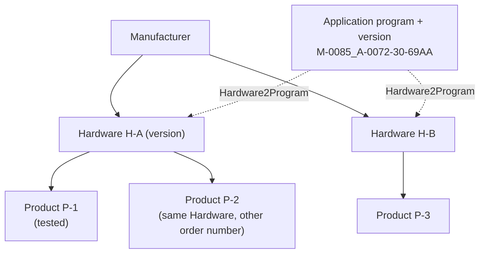

# Evidence contract

How Busforge records what it has proven about a product, how far that proof reaches beyond the
exact device it was taken on, and when a product counts as qualified. The compatibility matrix is
built from these records; nothing else may raise a matrix cell.

The machine-readable format is `EvidenceRecord` in
[`packages/product/src/evidence.ts`](../packages/product/src/evidence.ts), schema
`busforge.evidence/1`. Validated examples live in [`evidence/examples/`](evidence/examples/).
[status.md](status.md) keeps the human-readable claims; this document says what those claims mean.

## Four questions, four axes

A write that "worked" can have succeeded in four independent ways. A record answers each of them
separately, and none of them implies another.

| Axis | Question | Typical method | What it does **not** show |
|---|---|---|---|
| **transfer** | Does the device hold exactly what Busforge wrote (or read what Busforge expects)? | owned-byte read-back after the operation | that those bytes encode the intended configuration |
| **reference** | Are Busforge's bytes the right ones? | byte comparison with an ETS capture, or with a device another tool commissioned | that the device acts on them |
| **behaviour** | Does the device act as configured? | an independent witness connection observes the device on the bus | that it keeps doing so after a power loss |
| **persistence** | Does the configuration survive? | restart or bus power cycle, then read back or observe again | anything about correctness |

Each axis is `pass`, `fail`, `not-assessed` or `not-applicable`. A `pass` must name its method. A
`not-applicable` must say why (for example: write-only outputs, nothing to observe).

**Technical eligibility** is a fifth, separate question: may Busforge attempt the operation at
all? It is computed from the catalog (`classify()` and `capabilities()`), never recorded as
evidence, and never shown as a test result.

### Only independent sources can confirm the bytes

A read-back that equals Busforge's own image proves transfer. It cannot prove reference: a wrong
but consistent encoding reads back green. So `origin.reference` records what the result was
compared against, and the validator refuses a reference `pass` unless the comparison was
independent of Busforge:

| `origin.reference` | May support a reference pass? |
|---|---|
| `ets-capture` (an ETS download or backup of the same configuration) | yes |
| `independently-commissioned-device`, not configured by Busforge, with `priorBusforgeWrites: "none"` | yes |
| `independently-commissioned-device` with prior Busforge writes `some` or `unknown` | **no**: the device now holds our bytes |
| `self-written` (a dump of bytes Busforge wrote earlier) | **no** |
| `none` | no |

A device in an occupied installation therefore stops being a reference candidate the moment Busforge
writes to it, and a record cannot hide that by leaving `priorBusforgeWrites` unknown. A reference
pass must also name the compared artifact and its SHA-256: a comparison nobody can repeat is
recorded as `not-assessed` with the reason, not as a pass.

## What a record carries

| Group | Fields | Unknown is written as |
|---|---|---|
| Identity | `subject.manufacturer`, `productRef`, `appProgramId` (includes its version), `mask` | `productRef: null`; the others are required |
| Firmware | `{state: "unknown"}` or `{state: "observed", value, source}` | `unknown`. Never assumed from the product or the application version |
| Medium and transport | `medium`; `transport.kind` (`ip-udp`, `ip-tcp`, `usb`), `transport.via` (`direct`, `busforge-bridge`) | `"unknown"` |
| Build | `build.server` (version, commit), `build.runner` (tool and revision), `build.spec` (smoke spec and revision) | `null`, or `revision: null` |
| Scope | `scope.operation`, `scope.channel` (`api`, `ui`, `tool`), `scope.configuration` (what was configured), `configurationFingerprint` | fingerprint `null` |
| Origin | `origin.configuredBy`, `origin.reference`, `origin.priorBusforgeWrites` | `"unknown"` |
| Results | `results.transfer`, `reference`, `behaviour`, `persistence` | `not-assessed` |
| History | `recordedAt`, `supersedes`, `supersedeReason` | `recordedAt: null` |
| Source | `source.kind`, `artifact`, `sha256` | `null` |

The validator refuses unknown fields, missing fields, a foreign schema version, a pass without a
method, an observed firmware without its source and a superseding record without a reason. It
never fills a gap with a default.

## How far evidence reaches

The KNX product catalog groups a manufacturer's devices as **Hardware** (one physical device
design, with a version number), its **Products** (the order-number variants of that hardware,
for example two designs of the same push button) and **Hardware2Program** entries (the
application programs that hardware can run). A product in a project is one Product running one
application program.

The mechanisms that decide whether a product is programmed correctly are fixed at different
levels:

| Mechanism | Fixed by |
|---|---|
| Memory model, segment layout, fill bytes | application program (`<Static>`) |
| Load procedure steps and their LSM transport | application program `<LoadProcedures>`, LSM transport per mask |
| Image construction: unions, `Assign`, codecs, bit fields, float width, modules | application program |
| Com-object table layout and sizing | memory model family, declared object count from the application |
| Segment base (System B), load state, whether the device holds this application | the device at runtime |
| Persistence and restart behaviour, application hold during a table rewrite | firmware, currently keyed by manufacturer id (`PERSIST_ON_LOAD_COMPLETED`, `HOLD_APPLICATION_ON_GA_FLASH` in `profiles.ts`) |
| Firmware version | the unit |

**Evidence belongs to the Product it was taken on.** A matrix cell is never raised by evidence
from another Product, not even one on the same Hardware: whether an order-number variant or a
different Hardware running the same application program behaves the same is not established, and
firmware can differ between them. For a Product without its own evidence the matrix may add a
factual hint, never a test state:

| Relation to a tested Product | Shown as |
|---|---|
| same Hardware and same application program version | state `derived`: "same KNX Hardware and application program as P-1, which was tested"; never counted as tested |
| other Hardware, same application program version | "same application program as P-1, which was tested"; technically eligible, untested |
| same application program, other version (`A-0072-30` vs `A-0072-31`) | no hint; technically eligible at most |
| same mask or manufacturer only | no hint; technically eligible if `capabilities()` says so |

Technically eligible Products may be programmed after an explicit notice that they are untested.
The first relation gets its own state, `derived`: the same Hardware running the
same application program version is likely to behave the same, which is worth showing apart from a
Product nothing is known about, but the catalog does not prove shared electronics and firmware. It
sits between technically eligible and tested, never raises a cell to `pass`, and does not count
toward qualification. `buildMatrix()` in
[`packages/product/src/compatibility.ts`](../packages/product/src/compatibility.ts) computes it; the
app shows it in each device's compatibility badge.

## The matrix state of an operation

`buildMatrix()` gives each Product, running one application program, one state per operation:

| State | When |
|---|---|
| `refused` | `capabilities()` does not allow the operation; the Product's own evidence stays visible next to it |
| `conflict` | a transfer cell of the Product's own records, in any channel, is in `conflict` |
| `failed` | the newest transfer result of the Product's own records, in any channel, is `fail` |
| `tested` | transfer `pass` in both the `api` and the `ui` channel, from the Product's own records |
| `derived` | none of the above, and the same Hardware with the same application program version is `tested` on another known Product; shown with that Product and the firmware it was tested on |
| `eligible` | none of the above; possibly with a hint naming another Hardware where the same application program version is `tested` |

The kept records ship with the server as a bundle that `bun run tools/evidence-bundle.ts --write`
generates, together with [compatibility.md](compatibility.md); a test fails when either is stale.

`tested` is the transfer axis only. Whether a Product is qualified (behaviour, persistence, and the
mechanism's reference case, below) is a separate judgement the matrix does not make.

A record whose `appProgramId` or `productRef` is unknown cannot back any cell. Historical records
without a Product stay readable, but they raise nothing.

### Exceptions that always need their own evidence

These are known places where equal application-level mechanisms do not guarantee equal outcomes,
or where the engine refuses. They stay listed even though evidence is per Product, because they also bound the shared
mechanism cases below.

| Exception | Where it is recorded |
|---|---|
| A load procedure step the engine cannot execute (`LdCtrlTaskCtrl1` outside the form captured on each declared-order application, the Auro M-0081_A-FE01, the TheLuxa P300 and the Meteodata 140 S, the absolute `LdCtrlLoadImageProp` outside the ETS-captured applications: refused) | [load-procedures.md](load-procedures.md), [status.md](status.md) |
| An absolute segment without a `<Data>` default (M-008E) | [device-memory-model.md](device-memory-model.md) |
| MV-0705 com-object tables with named residuals (six devices, five application families) | [device-memory-model.md](device-memory-model.md) "Known residuals" |
| Persistence on `LoadCompleted` instead of `A_Restart`, and the application hold during a GA flash: manufacturer-keyed firmware behaviour, only ever learned on hardware | `profiles.ts`, [load-procedures.md](load-procedures.md) |
| A com-object table declared far larger than its active objects (OpenKNX: 1359 declared, 138 active) | [device-memory-model.md](device-memory-model.md) |
| A segment above 64 KB (`A_MemoryExtended`) | [status.md](status.md) |
| Module-instance placement for a device without an imported project | [device-memory-model.md](device-memory-model.md) |
| Any Data Secure session (wired, never driven for a load) | [knx-secure.md](knx-secure.md) |
| A surgical flash never driven on a product whose full download once failed for other reasons (OpenKNX) | [status.md](status.md), the device's smoke spec |

An unknown requirement, one the engine cannot evaluate, is a refusal with a coded error and a
diagnostic option, not an untested-compatible notice.

## Reading a matrix cell

A cell is one Product, running one application program, for one operation, one channel and one
axis. `cellState()` computes it from the records of that cell, and refuses records that belong to other
cells, repeat an id or supersede a record outside the cell:

1. Drop every record another record `supersedes` on this axis. Superseding requires a written
   reason, such as a harness fault shown in its own evidence, and a record that is newer than the
   one it supersedes and assessed the axis itself.
2. Drop records that did not assess the axis.
3. Take the newest remaining record. Undated records rank below every dated one.
4. If any remaining record obtained **under the same conditions** (server commit, spec revision,
   firmware, transport, medium) disagrees with it, pass against fail, the cell is `conflict`.
   A condition nobody recorded counts as equal, because it cannot tell two runs apart.
5. Otherwise the newest record decides.

A newer result on a different build replaces an older one: that is a fix or a regression, and the
build says which. A newer result on the same build that contradicts an older one is unexplained,
and the matrix shows the contradiction instead of choosing the better outcome.

## Representative acceptance

The alpha qualifies the owned product types, not every product or every configuration. Shared
mechanisms are validated once, by representative cases, and trusted for every application program
that uses the same mechanism. Test states themselves stay per Product.

**Per mechanism** (memory model, load-procedure style, com-object table authorship): at least one
reference `pass` from an independent source for the full image, plus codec and layout tests. The
reference case must exercise the mechanism, for example a module device for per-instance offsets.

**Per owned Product**, for each operation `capabilities()` claims:

| Axis | Required |
|---|---|
| transfer | `pass` on hardware, in `api` and, where the UI offers the operation, in `ui` |
| behaviour | `pass` for at least one configured function, or `not-applicable` with a reason |
| persistence | `pass` after a restart or power cycle for at least one write operation |
| reference | covered by the mechanism's reference case; a product-specific reference is optional |

A cell in `conflict` does not qualify until it is resolved by a new record or a superseding one.

**Full download as a substitute for partial programming** (design map Q24) is acceptable for an
application program when all of these hold:

- `fullDownload` has transfer and persistence `pass` on hardware for that application program;
- the full image is covered by an independent reference case for its mechanism;
- a record shows that a setting the user did not change survives the download (behaviour or
  read-back of the unchanged setting against its value before the download);
- the UI states the restart and the service interruption before the download starts.

Read-back equality alone is sufficient for neither the partial nor the full path.

## Terminology

The older vocabulary maps onto the axes as follows. Where a document uses the left column, it
means the right one.

| Term | Source | Meaning in axes |
|---|---|---|
| **hardware** | status.md proof levels | transfer `pass` on hardware, with behaviour `pass` where the table says so |
| **hardware (bytes only)** | status.md | transfer `pass`; behaviour `not-applicable` |
| **offline byte-match** | status.md | reference `pass` from an `ets-capture`, no device |
| **tests only** | status.md | no evidence record |
| **Transfer verification** | GLOSSARY.md | the transfer axis |
| **Capability** check | GLOSSARY.md, testing.md | a transfer record for one operation and channel |
| **Behaviour** | GLOSSARY.md, testing.md | the behaviour axis |
| **Done** | testing.md | every claimed operation transfer `pass` in both channels, every declared behaviour `pass` |
| **supported** (unqualified) | older documents | retired: a claim names its axes instead |

## The examples

| File | Shows |
|---|---|
| [byte-only.json](evidence/examples/byte-only.json) | transfer pass, behaviour not applicable (write-only outputs), reference not assessed |
| [synthetic-ets-reference.json](evidence/examples/synthetic-ets-reference.json) | **synthetic**, not an observation: the shape of a reference pass against a retained ETS download |
| [lost-reference-artifact.json](evidence/examples/lost-reference-artifact.json) | a real reference comparison whose ETS capture was not kept: recorded, but not assessed |
| [self-written-dump.json](evidence/examples/self-written-dump.json) | a read-back of bytes Busforge wrote earlier: transfer only. Undated, because the source records no acquisition time and a file mtime is not one |
| [unknown-firmware.json](evidence/examples/unknown-firmware.json) | behaviour pass through an independent witness, firmware and transport unknown |
| [conflicting-newer.json](evidence/examples/conflicting-newer.json) | a newer failure on indistinguishable conditions, which yields `conflict` |

## Records from reports older than this format

The 28 smoke reports written before this format existed were mapped onto records. 126 records
validate; three items were refused as evidence because the run stopped before any device was
reached (a missing interface host, a dev server that was down).

Every such report lacks the server build, the runner and spec revision, the transport and the
firmware, so failures and passes from different builds look like the same conditions: for the GVS
actuator nine of its fourteen cells read `conflict` for that reason, and one Jung behaviour cell
does too. A spec edit between runs shows as a changed outcome (one Jung capability reads `pass`,
`unsafe` and `pass` again), which only a spec revision can tell apart from a device outcome. These
records stay what they are.
New runs record them: the smoke runner writes `<report>.evidence.json`, `tools/readback.ts` writes
`evidence.json` and `tools/etsdiff.ts` takes `--evidence` ([testing.md](testing.md),
[development.md](development.md)).

Smoke records claim transfer and behaviour, and persistence from a dedicated step. A write path's
own restart proves nothing here: whether it restarts the device at all depends on its load procedure
and firmware. So after the capabilities, and before any behaviour relinks the device, the runner
sends A_Restart itself and requires a reboot it can see: fresh-connection probes must show the
device answering before the restart, then not answering, then answering again. Only the device's
own silence counts; an interface or tunnel error ends the check as a failure. Firmware differs in
timing (the GVS actuator answers once more and drops out about 6 s later; the same device polled
without a restart shows no gap), which is why the probes run for up to a minute rather than once.
It reads the load states of load objects 1-4 before the restart and after the reboot, and every
object that was LOADED must be LOADED again: a device can keep every byte and still refuse its
application at boot (the Jung 400021SE comes back with its application object in ERROR). The
runner then reads the device back through the server and requires the decoded parameters and
group links to equal the project. The com-object table is not read back, so the record says so in
its method. The result goes onto the `fullDownload` and `flashLinks` records of the same run,
because their writes are what the read-back sees; `flashParams` and `structuralFlash` revert every
change they make and get none. A behaviour observed on addresses a full download committed counts only when that
download ran in the same run.

### Firmware

Firmware is read from the device object's `PID_FIRMWARE_REVISION` (object 0, PID 9), a single byte
that is optional. An MDT BE-06001 answers `0`, and a MEAN WELL power supply does not implement it
(it answers PID 25, `PID_VERSION`, which versions the interface object and is not read
as firmware). A device without PID 9 keeps `firmware: unknown`. A revision of `0` is recorded as observed, but
may be a placeholder the manufacturer never maintains; it tells two units apart only when it differs.
