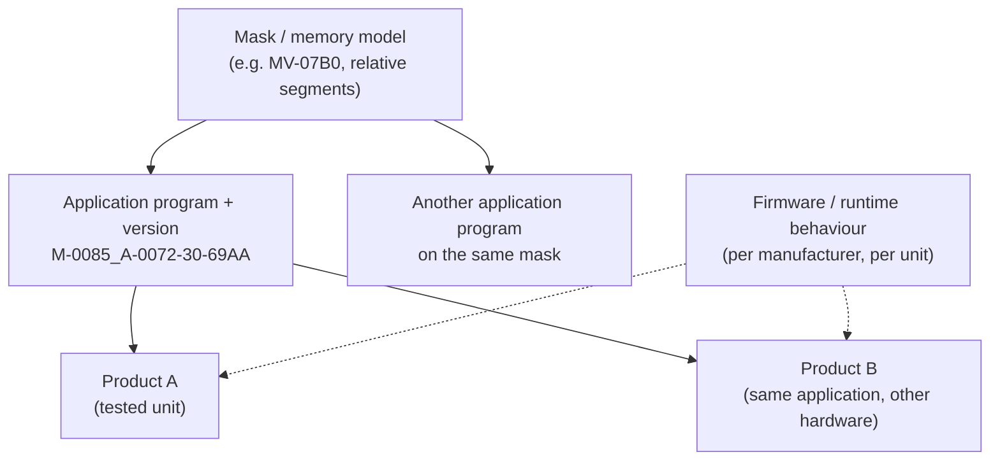

# Evidence contract

How Busforge records what it has proven about a product, how far that proof reaches beyond the
exact device it was taken on, and when a product counts as qualified. The compatibility matrix is
built from these records; nothing else may raise a matrix cell.

The machine-readable format is `EvidenceRecord` in
[`packages/product/src/evidence.ts`](../packages/product/src/evidence.ts), schema
`busforge.evidence/1`. Validated examples live in [`evidence/examples/`](evidence/examples/).
[status.md](status.md) keeps the human-readable claims; this document says what those claims mean.

## Four questions, four axes

A write that "worked" can have succeeded in four independent ways. A record answers each of them
separately, and none of them implies another.

| Axis | Question | Typical method | What it does **not** show |
|---|---|---|---|
| **transfer** | Does the device hold exactly what Busforge wrote (or read what Busforge expects)? | owned-byte read-back after the operation | that those bytes encode the intended configuration |
| **reference** | Are Busforge's bytes the right ones? | byte comparison with an ETS capture, or with a device another tool commissioned | that the device acts on them |
| **behaviour** | Does the device act as configured? | an independent witness connection observes the device on the bus | that it keeps doing so after a power loss |
| **persistence** | Does the configuration survive? | restart or bus power cycle, then read back or observe again | anything about correctness |

Each axis is `pass`, `fail`, `not-assessed` or `not-applicable`. A `pass` must name its method. A
`not-applicable` must say why (for example: write-only outputs, nothing to observe).

**Technical eligibility** is a fifth, separate question: may Busforge attempt the operation at
all? It is computed from the catalog (`classify()` and `capabilities()`), never recorded as
evidence, and never shown as a test result.

### Only independent sources can confirm the bytes

A read-back that equals Busforge's own image proves transfer. It cannot prove reference: a wrong
but consistent encoding reads back green. So `origin.reference` records what the result was
compared against, and the validator refuses a reference `pass` unless the comparison was
independent of Busforge:

| `origin.reference` | May support a reference pass? |
|---|---|
| `ets-capture` (an ETS download or backup of the same configuration) | yes |
| `independently-commissioned-device`, not configured by Busforge, with `priorBusforgeWrites: "none"` | yes |
| `independently-commissioned-device` with prior Busforge writes `some` or `unknown` | **no**: the device now holds our bytes |
| `self-written` (a dump of bytes Busforge wrote earlier) | **no** |
| `none` | no |

A device from the occupied house therefore stops being a reference candidate the moment Busforge
writes to it, and a record cannot hide that by leaving `priorBusforgeWrites` unknown. A reference
pass must also name the compared artifact and its SHA-256: a comparison nobody can repeat is
recorded as `not-assessed` with the reason, not as a pass.

## What a record carries

| Group | Fields | Unknown is written as |
|---|---|---|
| Identity | `subject.manufacturer`, `productRef`, `appProgramId` (includes its version), `mask` | `productRef: null`; the others are required |
| Firmware | `{state: "unknown"}` or `{state: "observed", value, source}` | `unknown`. Never assumed from the product or the application version |
| Medium and transport | `medium`; `transport.kind` (`ip-udp`, `ip-tcp`, `usb`), `transport.via` (`direct`, `busforge-bridge`) | `"unknown"` |
| Build | `build.server` (version, commit), `build.runner` (tool and revision), `build.spec` (smoke spec and revision) | `null`, or `revision: null` |
| Scope | `scope.operation`, `scope.channel` (`api`, `ui`, `tool`), `scope.configuration` (what was configured), `configurationFingerprint` | fingerprint `null` |
| Origin | `origin.configuredBy`, `origin.reference`, `origin.priorBusforgeWrites` | `"unknown"` |
| Results | `results.transfer`, `reference`, `behaviour`, `persistence` | `not-assessed` |
| History | `recordedAt`, `supersedes`, `supersedeReason` | `recordedAt: null` |
| Source | `source.kind`, `artifact`, `sha256` | `null` |

The validator refuses unknown fields, missing fields, a foreign schema version, a pass without a
method, an observed firmware without its source and a superseding record without a reason. It
never fills a gap with a default.

## How far evidence reaches: compatibility classes

The mechanisms that decide whether a product is programmed correctly sit at different levels. The
level at which a mechanism is fixed is the level at which evidence about it may be shared.

| Mechanism | Fixed by | Shared with |
|---|---|---|
| Memory model, segment layout, fill bytes | application program (`<Static>`) | every product running that application program and version |
| Load procedure steps and their LSM transport | application program `<LoadProcedures>`, LSM transport per mask | same |
| Image construction: unions, `Assign`, codecs, bit fields, float width, modules | application program | same |
| Com-object table layout and sizing | memory model family, declared object count from the application | same |
| Segment base (System B), load state, whether the device holds this application | the device at runtime | nothing: read on every operation |
| Persistence and restart behaviour, application hold during a table rewrite | firmware, currently keyed by manufacturer id (`PERSIST_ON_LOAD_COMPLETED`, `HOLD_APPLICATION_ON_GA_FLASH` in `profiles.ts`) | nothing automatically: see exceptions |
| Firmware version | the unit | nothing |

This gives three reach levels for a product without its own record:

1. **Same application program and version, other product.** Transfer and reference evidence
   carries over, because the image and load procedure are identical. The matrix shows it as
   *hardware-tested on a sibling product* and names that product. Behaviour and persistence do not
   carry over as tested: they depend on hardware and firmware.
2. **Same application family, other version** (`A-0072-30` vs `A-0072-31`). Nothing carries over.
   The product is technically eligible at most.
3. **Same mask, other application program.** Nothing carries over. The product is technically
   eligible if `capabilities()` says so, and may be programmed after an explicit notice that it is
   untested. A mask or a manufacturer never promotes hardware evidence.

A record whose `appProgramId` is unknown cannot back any cell, which is why the field is required.

### Exceptions that always need their own evidence

These are known places where equal application-level mechanisms do not guarantee equal outcomes,
or where the engine refuses. They are listed so a class is never widened across them.

| Exception | Where it is recorded |
|---|---|
| A load procedure step the engine cannot compute (M-0008: `LOAD_STEP_UNSUPPORTED`, refused) | [load-procedures.md](load-procedures.md), [status.md](status.md) |
| An absolute segment without a `<Data>` default (M-008E) | [device-memory-model.md](device-memory-model.md) |
| MV-0705 com-object tables with named residuals (six devices, five application families) | [device-memory-model.md](device-memory-model.md) "Known residuals" |
| Persistence on `LoadCompleted` instead of `A_Restart`, and the application hold during a GA flash: manufacturer-keyed firmware behaviour, only ever learned on hardware | `profiles.ts`, [load-procedures.md](load-procedures.md) |
| A com-object table declared far larger than its active objects (OpenKNX: 1359 declared, 138 active) | [device-memory-model.md](device-memory-model.md) |
| A segment above 64 KB (`A_MemoryExtended`) | [status.md](status.md) |
| Module-instance placement for a device without an imported project | [device-memory-model.md](device-memory-model.md) |
| Any Data Secure session (wired, never driven for a load) | [knx-secure.md](knx-secure.md) |
| A surgical re-flash declared `unsafe` for a device (OpenKNX) | [status.md](status.md), the device's smoke spec |

An unknown requirement, one the engine cannot evaluate, is a refusal with a coded error and a
diagnostic option, not an untested-compatible notice.

## Reading a matrix cell

A cell is one application program, one operation, one channel and one axis. On the behaviour and
persistence axes it is also one product, because those depend on hardware and firmware.
`cellState()` computes it from the records of that cell, and refuses records that belong to other
cells, repeat an id or supersede a record outside the cell:

1. Drop every record another record `supersedes` on this axis. Superseding requires a written
   reason, such as a harness fault shown in its own evidence, and a record that is newer than the
   one it supersedes and assessed the axis itself.
2. Drop records that did not assess the axis.
3. Take the newest remaining record. Undated records rank below every dated one.
4. If any remaining record obtained **under the same conditions** (server commit, spec revision,
   firmware, transport, medium) disagrees with it, pass against fail, the cell is `conflict`.
   A condition nobody recorded counts as equal, because it cannot tell two runs apart.
5. Otherwise the newest record decides.

A newer result on a different build replaces an older one: that is a fix or a regression, and the
build says which. A newer result on the same build that contradicts an older one is unexplained,
and the matrix shows the contradiction instead of choosing the better outcome.

## Representative acceptance

The alpha qualifies the owned product types, not every product or every configuration. Shared
mechanisms are validated once, by representative cases, and trusted where the class table above
says they are shared.

**Per mechanism** (memory model, load-procedure style, com-object table authorship): at least one
reference `pass` from an independent source for the full image, plus codec and layout tests. The
reference case must exercise the mechanism, for example a module device for per-instance offsets.

**Per owned application program**, for each operation `capabilities()` claims:

| Axis | Required |
|---|---|
| transfer | `pass` on hardware, in `api` and, where the UI offers the operation, in `ui` |
| behaviour | `pass` for at least one configured function, or `not-applicable` with a reason |
| persistence | `pass` after a restart or power cycle for at least one write operation |
| reference | covered by the mechanism's reference case; a product-specific reference is optional |

A cell in `conflict` does not qualify until it is resolved by a new record or a superseding one.

**Full download as a substitute for partial programming** (design map Q24) is acceptable for an
application program when all of these hold:

- `fullDownload` has transfer and persistence `pass` on hardware for that application program;
- the full image is covered by an independent reference case for its mechanism;
- a record shows that a setting the user did not change survives the download (behaviour or
  read-back of the unchanged setting against its value before the download);
- the UI states the restart and the service interruption before the download starts.

Read-back equality alone is sufficient for neither the partial nor the full path.

## Terminology

The older vocabulary maps onto the axes as follows. Where a document uses the left column, it
means the right one.

| Term | Source | Meaning in axes |
|---|---|---|
| **hardware** | status.md proof levels | transfer `pass` on hardware, with behaviour `pass` where the table says so |
| **hardware (bytes only)** | status.md | transfer `pass`; behaviour `not-applicable` |
| **offline byte-match** | status.md | reference `pass` from an `ets-capture`, no device |
| **tests only** | status.md | no evidence record |
| **Transfer verification** | CONTEXT.md | the transfer axis |
| **Capability** check | CONTEXT.md, ADR 0001 | a transfer record for one operation and channel |
| **Behaviour** | CONTEXT.md, ADR 0001 | the behaviour axis |
| **Done** | CONTEXT.md, ADR 0001 | every claimed operation transfer `pass` in both channels, every declared behaviour `pass` |
| **supported** (unqualified) | older documents | retired: a claim names its axes instead |

## The examples

| File | Shows |
|---|---|
| [byte-only.json](evidence/examples/byte-only.json) | transfer pass, behaviour not applicable (write-only outputs), reference not assessed |
| [synthetic-ets-reference.json](evidence/examples/synthetic-ets-reference.json) | **synthetic**, not an observation: the shape of a reference pass against a retained ETS download |
| [lost-reference-artifact.json](evidence/examples/lost-reference-artifact.json) | a real reference comparison whose ETS capture was not kept: recorded, but not assessed |
| [self-written-dump.json](evidence/examples/self-written-dump.json) | a read-back of bytes Busforge wrote earlier: transfer only. Undated, because the source records no acquisition time and a file mtime is not one |
| [unknown-firmware.json](evidence/examples/unknown-firmware.json) | behaviour pass through an independent witness, firmware and transport unknown |
| [conflicting-newer.json](evidence/examples/conflicting-newer.json) | a newer failure on indistinguishable conditions, which yields `conflict` |

## Historical evidence against this format

The 28 smoke reports of 2026-07-19 to 2026-07-25 were mapped onto records (the conversion lives
outside the repository with the ticket). 126 records validate; three items were refused as
evidence because the run stopped before any device was reached (a missing bench host, a dev server
that was down).

Every report lacks the server build, the runner and spec revision, the transport and the firmware.
The consequence is visible: for the GVS actuator, failures from the first runs and passes after
the fixes carry no build, so they look like the same conditions and nine of its fourteen cells
read `conflict`; one Jung behaviour cell does too. One Jung capability changed from `pass` to
`unsafe` and back because the spec itself was edited, which only a spec revision can distinguish
from a device outcome. Historical records stay what they are.
New runs have to record their conditions, which is tracked on the [roadmap](roadmap.md).
