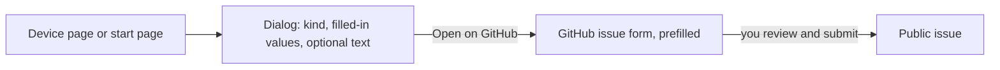

# Reporting problems and device feedback

Reports go to the issues of the public GitHub repository
[busforge/busforge](https://github.com/busforge/busforge/issues). You need a GitHub account.
Busforge itself never posts anything and holds no GitHub token: it opens a prefilled issue form
in your browser, and you review and submit it there with your own account.

## Two kinds of report

| Report | Template | For |
|---|---|---|
| **Problem** | [`problem.yml`](../.github/ISSUE_TEMPLATE/problem.yml) | Something went wrong, or Busforge refuses or does not support a device. Also for problems that involve no device. |
| **Device feedback** | [`device-feedback.yml`](../.github/ISSUE_TEMPLATE/device-feedback.yml) | How one device works with Busforge in your use of it overall: works, works with limitations, does not work. |

A new issue starts from one of these two forms; blank issues are switched off
([`config.yml`](../.github/ISSUE_TEMPLATE/config.yml)), and the chooser links back to this page.

Device feedback is about the whole time you used the device with Busforge, not about the last
operation, and it is not a full qualification of the device. Limitations belong in it.

A report never changes what Busforge says about a device. The support state in the app and on
the [compatibility page](compatibility.md) comes only from tests on real hardware
([evidence-contract.md](evidence-contract.md)). Reports are not counted as votes, and nothing
promotes a device automatically. GitHub does not guarantee that two reports come from two
people, so several reports about one device are related by hand, not added up.

## Reporting from the app

- **About a device:** device page, menu (three dots), **Report on GitHub**. Choose Problem or
  Device feedback.
- **Without a device:** start page, **Report a problem** next to the version at the bottom.

The dialog shows every value the link carries before you open it:

### What goes into the link

Only these, in both templates:

| Field | Value |
|---|---|
| Title | `Problem:` or `Device feedback:`, then manufacturer and order number |
| Busforge version | The version shown at the bottom of the start page, with its commit |
| Product | Manufacturer, order number and the KNX product id |
| Application program | The KNX application program id, e.g. `M-0083_A-00B6-32-9642` |
| What happened? / What do you use it for? | Only the text you typed into the dialog yourself |

Nothing else: not the device's name, its individual address, room or building names, group
addresses, keys, the connection, or anything read from the bus. A product or application id that
is not a well-formed KNX catalogue id is left out rather than passed on, and so is a value too long
for the link; the dialog says so. Values are never cut short. The catalogue's product text is not
used: for some projects it is the device name given in the project. Control characters and
text-direction overrides are removed from every value.

### Long texts

GitHub refuses links above its length limit. When your text would make the link too long,
Busforge leaves the text out of the link entirely (it never cuts it short) and offers **Copy
text**: paste it into the matching field on GitHub. On a Busforge served over plain HTTP the
browser allows no clipboard access; the text is then selected for you to copy with Ctrl+C or ⌘C.

### Related reports

For a device, the dialog links to a search of the issues that name the same application program
id. Mention earlier reports in the **Related issues** field.

## Diagnostic packages

For a device Busforge cannot program, a [diagnostic package](raw-acquisition.md#diagnostic-package)
helps. It is cleaned of project, device and task ids, the connection's host, port and USB serial,
and the device's serial number, but the device memory in it is **not anonymized** and can hold data
from your installation. Review it before you share it.

There is no upload from the app and no upload field in the templates. If you would rather not
attach the package to a public issue, say so in the issue; a maintainer answers there whether a
private way to send it is possible.

## What not to write into a public issue

KNX keys and passwords, project files (`.knxproj`, `.busforge`), room and building names,
individual and group addresses, IP addresses, and recorded bus traffic.
