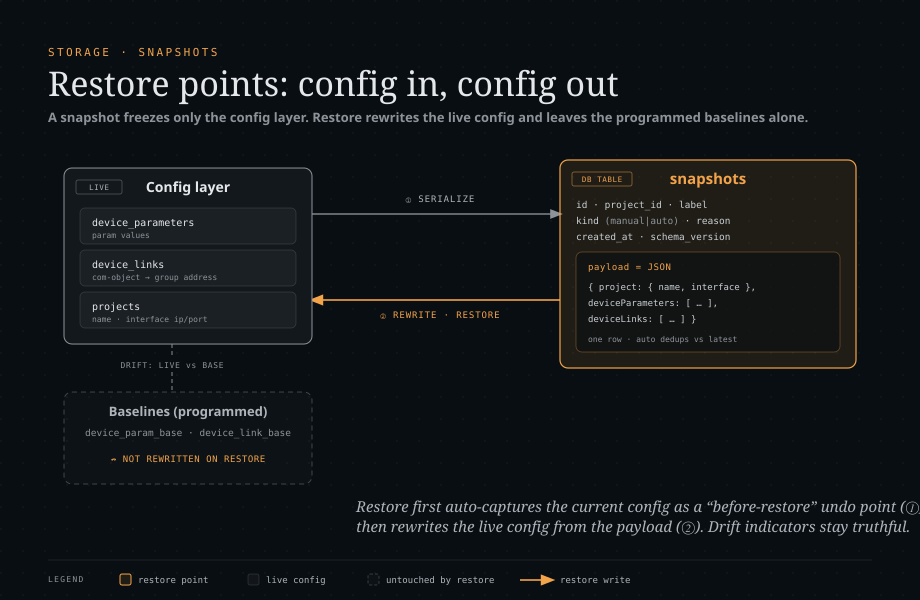

# Storage, catalog and restore points

How a project is stored, how manufacturer data is separated from installation data, and how
configuration restore points work.

## The database is the only source of truth

Everything lives in one SQLite file (`bun:sqlite`, WAL, foreign keys on). The imported `.knxproj`
is **not** kept. Three reasons:

1. **Encryption.** The raw file may be password-protected. Keeping it would mean storing the
   password or re-prompting. It is decrypted at import to be parsed anyway, so only the extracted
   form is worth storing.
2. **Size.** The interesting part is the extracted application-program XML, deduplicated across
   devices, not the whole archive.
3. **Blank projects.** A project created from scratch has no `.knxproj` at all, and Busforge is
   import-only and never writes KNX format back. A file that does not exist cannot be the source of
   truth.

Blobs belong in SQLite here: sub-megabyte XML and small JSON, deduplicated, which is the documented
good case rather than the anti-pattern.

Three things stay outside the database on purpose:

| Outside the DB | Why |
|---|---|
| `data/master.key` (or `BUSFORGE_MASTER_KEY`) | The key that seals Data Secure tool keys. Keeping it inside the file it protects would defeat the point. See [knx-secure.md](knx-secure.md). |
| `data/projects/<id>/backups/` | Raw device-memory dumps taken before every surgical write (a full download's pre-unload backup is opt-in and off by default). Operational recovery artifacts, deliberately plain files, never served over the API. Deleted with the project. |
| `.busforge` archives | The portable form, see [export-format.md](export-format.md). |

## Two layers: catalog and project

An import mixes two things with different ownership and lifecycle, and they are stored separately.

```
                 ingest (source-agnostic)
   .knxproj  ─┐
   .knxprod  ─┼──►  CATALOG LAYER  (per application program, shared, immutable)
              ┘     application programs + product metadata + DCA baggage
                          ▲
                          │ referenced by appRef
                          │
   .knxproj  ───────►  PROJECT LAYER  (per project, mutable)
                          devices, group addresses, values, links, modules, spaces
                          ▲
                          │ subset                    superset
                    RESTORE POINTS                 EXPORT
                  (config-only JSON,         (whole project + referenced
                   rows in the DB)            catalog entries, one file)
```

**The catalog** holds application programs keyed by application-program id, plus the product
metadata needed to browse and place a device (manufacturer, product name, order number, hardware and
application version, mask). It is **global, not project-scoped**: a 200-device building with 20
product types stores 20 application programs, and a re-import reuses the existing entries. The price
is that deleting a project needs ref-counting rather than a plain cascade, and an export must bundle
the entries it references.

The ingest is source-agnostic (`source -> [catalog entries keyed by application program]`). A
`.knxproj` import feeds the catalog **and** creates a project. A `.knxprod` import feeds **only** the
catalog: it carries no installation data and is in fact richer in product metadata. Products ingested
from a `.knxprod` are **pinned**, which makes them independent catalog roots that survive project
deletion; products that arrived only through a project import are unpinned and are garbage-collected
with the last device that referenced them. Re-importing such a product from a `.knxprod` upgrades it
to pinned.

**The project layer** is fully normalised and references the catalog. A blank project is therefore
authorable: create an empty project, then place devices chosen from the catalog. The server allocates
the next free individual address, seeds no parameter rows (so the device runs application defaults)
and writes no programmed baseline.

## Tables

| Table | Holds |
|---|---|
| `projects` | name, import time, group-address level count (2 or 3), the referenced connection |
| `devices` | device instances: individual address, name, product and application refs, manufacturer, the `0.xml` instance id, comment, whether the configuration came from an ETS project (`config_from_ets`) |
| `group_ranges` | main and middle group ranges, a self-referencing tree |
| `group_addresses` | group addresses: raw value, name, DPT, owning range |
| `spaces` / `space_devices` | the building structure from `<Locations>` and device membership |
| `device_parameters` | live parameter overrides, **sparse**: no row means the application default |
| `device_links` | live com-object to group-address links |
| `device_modules` | a device's resolved module instances |
| `device_comobj_overrides` | the com-object flags and priority the project sets per device, the attributes as ETS stores them |
| `device_param_base` / `device_link_base` / `device_comobj_override_base` | the **programmed baseline**: what the device was last known to hold |
| `device_param_assumed` | baseline parameter values a read-back took as **assumed, not proven**, with the value each mark is about |
| `device_memoryless_assumed` | the parameters without memory a read-back assumed on a device, **proven or not**; with `config_from_ets`, what lets a System 7 flash overwrite a hidden byte ([device-memory-model.md](device-memory-model.md#owned-bytes-and-left-alone-bytes)) |
| `snapshots` | configuration restore points, one JSON payload per row |
| `app_programs` | the global catalog of decrypted application-program XML |
| `catalog_products` | browsable product metadata, with the `pinned` flag |
| `catalog_baggage` | the images an application program's `TypePicture` parameters show, from its product baggage, by program and baggage id; dropped with its program |
| `device_baggage` | DCA blobs (`BinaryData/`, `UserFiles/`) per project |
| `connections` | the saved-connection library, see [connections.md](connections.md) |
| `device_security` | sealed KNX Data Secure tool keys, see [knx-secure.md](knx-secure.md) |
| `telegrams` | the recorded bus log, pruned after 30 days |

**Live versus baseline is the whole drift model.** `device_parameters` and `device_links` are what
the project says; `device_param_base` and `device_link_base` are what the device was last observed
or programmed to hold. The change indicator is the difference. Read-back rewrites only the baseline;
flashing rewrites the baseline only when the device verified what was written. It adopts the
submission captured before queueing, not desired rows at completion. A concurrent edit, removed
link or newly added override remains distinguishable from the programmed snapshot. Hidden or
otherwise unwritten fields retain their previous baseline, even when absent from a sparse submission.
Full-download adoption of parameters and links is atomic. Dry-run requests never adopt a baseline.
The com-object flags follow the same model: `device_comobj_override_base` is seeded from the import
and adopted by a verified write that carries a flag edit (group-address flash, structural flash, full
download); a parameter flash leaves it, and a read-back sets it to the flags the device's com-object
table shows, on the objects the device's configuration activates (where the family's read covers the
table), keeping the stored attributes of every bit and object the table does not show.

**An assumed value stays marked.** A read-back asked to assume values for parameters the device does
not hold takes them into the project and the baseline; one the device cannot tell from another value
of its parameter (`unprovenAssumptions`) is recorded in `device_param_assumed` with the baseline value
it is about (`NULL`: the parameter's default, which the baseline holds as no row). The mark belongs to
the baseline value, not to the project's: an edit, a revert or a restore leaves it, and the device page
marks the row **assumed** while it shows that value. Only a read-back ends it: one that assumes the
parameter again and shows its value, or one whose baseline records another value for it; values
compare as they decode (no row is the parameter's default, a float by number). A verified write
(parameter, structural or full download) never ends it, even where the value it records changes
bytes it writes: only a read that proves the value ends the mark. A write that records the
same value keeps the mark; one that records another value moves the mark to that value. A product
replacement drops the marks with the baselines; a `.busforge` export carries them. Its import
refuses a mark on a parameter that is not a parameter without a memory or property location of its
device's carried application: one with a memory or property location, one the application does not
have, or one on a device whose application the artifact does not carry (`BUSFORGE_ASSUMED_NOT_MEMORYLESS`).

An empty baseline says nothing about whether the device was ever written, so a device placed from
the catalog, or whose product was replaced, carries `devices.never_programmed`. A `.knxproj` import
seeds it from ETS's five load flags ([findings.md](findings.md#1-the-knxproj-is-self-contained)): a
`DeviceInstance` that does not carry all of them as `"true"` imports as never programmed. That is a
device ETS never downloaded, including one another tool programmed (ETS cannot know of that), and one
edited in ETS after its last download (ETS dropped `ParametersLoaded` or `CommunicationPartLoaded`), whose
project values are then not what it holds. For a device whose application ETS did download,
`devices.ets_not_downloaded` keeps the parts ETS has still to download (address, medium, parameters,
links: edited after the download, or never downloaded), and the device shows as **Not downloaded in ETS**, naming them, instead of **Never
programmed**; state, gate and remedy are the same, and whatever clears the one clears the other. A
device without an application program (a power supply) is not seeded. It shows as **Never
programmed** and counts as "to program" until a verified full download clears it, or a read-back that
shows the device holds this project's application, parameters and links: one that read parameters and
links, left no device link unresolved, found the device reporting this application's id (PID 13 of the
application object its mask names) with its load-state machines LOADED, and whose parameter and
group-address flash dry runs under the baseline it sets find nothing to write ([architecture.md](architecture.md#read-back-adopting-the-device-state-as-the-baseline)).
That shows the device holds every byte this project's configuration writes into it; a parameter the
device does not hold whose values all write the same bytes stays unshown. A read that misses a part,
leaves a link unresolved, finds another application id or none (a family whose mask names no such
object), a machine not LOADED, or bytes a flash would change leaves the flag as it is. A
surgical flash is refused on such a device (`NEVER_PROGRAMMED_USE_DOWNLOAD`, the flash dialog offers the
download). Where the application's
declared load procedure has a step the full download cannot execute, the surgical flash is refused all
the same, naming ETS (`NEVER_PROGRAMMED_USE_ETS`): nothing would check which application the device
runs before the flash writes into it. A family that cannot be downloaded in full for another reason
is programmed surgically only; there a verified surgical flash clears it. It travels in a `.busforge` export with its parts (`etsNotDownloaded`, taken only on a never-programmed
device); restore points do not carry it, being device
state. A device with no value recorded reads as programmed.

Each device also carries a local `programming_token`, regenerated on insertion and address/product/
application updates. It is not part of the portable device identity. Queued programming refuses a
changed token before executing or adopting results, including same-product replacement and
recreation with the same instance id.

### Migrations

Forward-only. `MIGRATIONS` is an append-only array of SQL strings; `PRAGMA user_version` records how
many have run, and each runs in its own transaction. **Never edit an existing entry**, add a new
one. `SCHEMA_VERSION` is the array length and is stamped into every restore point at capture. A
restore point from a newer schema (one carried in a `.busforge` from a newer Busforge) is refused
(`SNAPSHOT_SCHEMA_NEWER`), because its configuration may hold what this version would drop. Older ones
restore: every change to the payload so far only added optional fields. A change that is not additive
has to upgrade older payloads in `restoreSnapshot`, keyed on the stamped version.

## Restore points

ETS-style restore points, `snapshots` in the database, a panel in the project header. There is no
explicit save anywhere in Busforge: every edit autosaves, so restore points are the undo model.



- **Scope: the configuration layer only.** Parameter values, links, the com-object flags and
  priority the project sets per device (`device_comobj_overrides`), project properties, and the
  group-address and building structure. A restore point taken before snapshots carried those flags
  leaves the current ones in place. Keyed by the stable string ids (device instance id,
  com-object ref id, parameter ref id), so a restore point does not need the application-program
  model, which is resolved at runtime anyway.
- **Storage: one JSON payload per row**, coupled to the project by foreign key, cascading on delete,
  and included in any database backup. Not a loose file.
- **Triggers.** Manual (with a title), and automatic before every dangerous operation:
  `before-flash`, `before-flash-ga`, `before-download`, `before-restore` (so a restore is itself
  undoable), `before-ga-edit`, `before-space-edit`.
- **Read-back is deliberately not a trigger.** A restore point is configuration-only, and read-back
  mutates only the programmed baseline. A snapshot taken before one could never differ from the
  current state; it would be pure noise.
- **Automatic restore points deduplicate.** An automatic snapshot whose payload equals the most
  recent one is skipped, so repeated flashes without intervening edits do not pile up identical
  entries. Manual snapshots never deduplicate: an explicitly named checkpoint is always kept.
- **Retention.** All manual snapshots are kept. Automatic ones are a ring buffer of the last 20 per
  project.

### Restore semantics: configuration only, baselines untouched

A restore rewrites parameter values, links, project properties and the structural trees. It does
**not** touch `device_param_base` / `device_link_base`, nor the marks on assumed baseline values.

This is the load-bearing decision. Restoring the baselines too would resurrect a stale notion of
what the device holds and desynchronise the drift display from physical reality. By leaving them
alone, the change indicators after a restore correctly show how the restored configuration differs
from the device that is actually out there. **A restore is software only and changes no hardware.**

Two details follow from the payload being a plain JSON document:

- Globally autoincrementing ids (group ranges, group addresses, spaces) are **remapped** on restore
  rather than reinserted verbatim.
- A restore point whose payload lacks the structural trees restores the configuration but not the
  group-address structure, and the UI says so instead of implying a full rollback.

## One definition of "the project"

Project-level properties have a single definition in `apps/server/src/db/projectProps.ts`:

```ts
export interface ProjectProperties { name: string; connectionId: string | null }
export function readProjectProperties(db, id): ProjectProperties | null
export function applyProjectProperties(db, id, p: ProjectProperties): void
```

Export, import, snapshot capture and snapshot restore all go through these two functions and embed
the whole typed object rather than cherry-picking columns. Adding a project property is a one-place
change that flows into all four at once, and none of them can silently omit it.

The referenced connection is carried as a property, but a connection's *details* are never
serialised: they live in the global library and are machine-specific. On a foreign system the
reference is re-applied only if that saved connection exists, otherwise it falls away and the user
picks one.

## Endpoints

| Method | Path | Purpose |
|---|---|---|
| GET | `/api/projects/:id/snapshots` | list restore points |
| POST | `/api/projects/:id/snapshots` | create a manual one, with a label |
| POST | `/api/projects/:id/snapshots/:sid/restore` | restore |
| DELETE | `/api/projects/:id/snapshots/:sid` | delete |
| GET | `/api/catalog/products` | placeable products |
| POST | `/api/catalog/import` | ingest a `.knxprod` product database |
| GET | `/api/catalog/apps/:appProgramId/comobjects` | every com-object an application declares, not gated by parameter visibility (what the replace-device link mapping needs) |
| GET | `/api/catalog/apps/:appProgramId/pictures/:baggageId` | the image a `TypePicture` parameter of the program shows (image types only, `PICTURE_MISSING` when the catalogue holds no file) |
| POST | `/api/projects/:id/devices` | place a catalog product as a new device |
