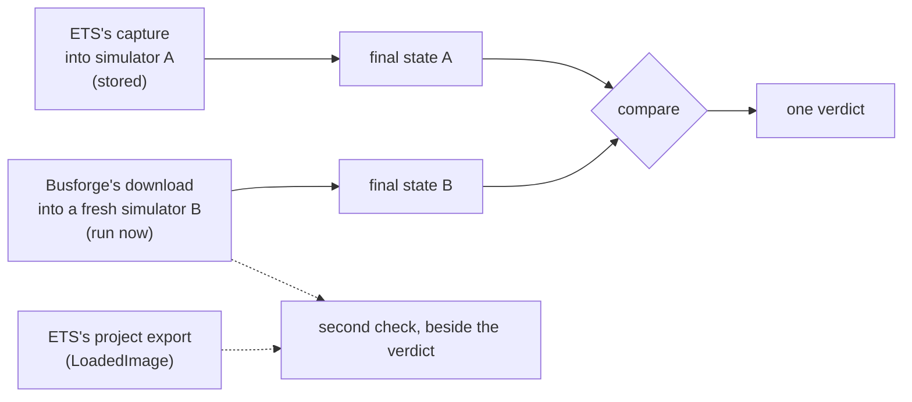

# Testing

Busforge writes bytes into real KNX devices, so its tests are organised around one question:
**what does this level actually prove?** A green suite proves that the software is stable and that
the codec math holds. It never proves that a device is programmed correctly. Only the hardware
smoke framework can do that, and only for the devices it has actually been run against.

Which devices are proven, and how far, is tracked in [status.md](status.md). This document
describes the machinery, not the claims.

## The levels

| Level | Where | Proves | Does not prove |
|---|---|---|---|
| Unit / codec tests | `packages/knx/test`, `packages/product/test`, `packages/project/test` | Frame and APDU encoding, DPT and parameter codecs, `.knxproj` decryption and parsing, load-plan construction, mask classification | That any of it matches what a device expects |
| Fixture snapshots (golden) | `packages/product/test/real-catalogue.test.ts` (needs the [private corpus](#the-private-corpus)) | **Stability**: the parse and the image projection over 16 real manufacturer application programs are byte-for-byte unchanged since the last reviewed regeneration | Correctness. A wrong output stays wrong until a device says otherwise |
| Coverage lock | same file, "every UI-exposed param is image-placeable" | Every parameter the config view exposes has a place in the image. The two projections cannot drift apart | That the placement is the one ETS would pick |
| Round-trip lock | same file, "the parameter image codec round-trips" | `build → decode` is its own inverse on every real fixture, so a codec cannot silently lose or shift a value | That the encoding matches the device's reading of it |
| Doc lock | `apps/server/test/device-support-doc.test.ts` (needs the [private corpus](#the-private-corpus)) | [device-support.md](device-support.md) stays in sync with the mask registry: a new or changed mask fails the suite until the table is updated | Anything about hardware |
| Server route tests | `apps/server/test` | Endpoint contracts, the task queue, and above all the **refusals**: flash guards, stale com-object tables, unsupported profiles, secure devices | That a permitted write lands correctly on a device |
| Capture comparison | `tools/etsdiff.test.ts`, and `tools/bussard-synthetic.test.ts` for [third-party captures](#third-party-test-data) (both need the [private corpus](#the-private-corpus)) | **Reference**: the bytes and services Busforge plans for a device equal what ETS wrote to that device in a capture, byte for byte | Wire behaviour no capture holds: timing, restarts, link handling |
| Capture CRC check | `tools/mcb-crc.test.ts` (needs the [private corpus](#the-private-corpus)) | **Reference** for the check a full download takes in place of a read-back: after each captured ETS full download, the CRC every region of every object reports in its memory-control block is the CRC over the bytes ETS wrote there | That a device without such a capture computes its CRC the same way (where it does not, the download reads back), and that a device computes it from its memory again after the restart: the file shows that on the Jung 400021SE only |
| Corpus archive smoke | `tools/corpus-archives.test.ts` (needs the [private corpus](#the-private-corpus)) | **Readability**: every `.knxproj`, `.knxprod` and `.busforge` in the corpus opens with Busforge's own readers (ZIP, WinZip-AES decryption, the `.busforge` container where the corpus holds one), a failure naming the file; a password-protected archive opens only in a run given its password | That what opens is parsed correctly (it opens the archive and reads `0.xml`, nothing more), and the traditional PKWARE encryption of ETS 4 and 5, which no corpus archive uses (`packages/project/test/older-ets-and-shapes.test.ts` covers it) |
| Image build context | `tools/image-context.ts`, the first step of `bun run check` | The files Docker sends as the build context (the repository through `.dockerignore`) pass the check the `Dockerfile` runs on them, read from the `Dockerfile` itself: no test, fixture, capture, project or key file, database or tool source, a failure listing every such file | That the image runs; the image build on CI shows that |
| Hardware smoke | `tools/smoke` | That busforge places the intended bytes on a real device **and** that the device acts on them | Only what it was run against |

Everything except the last row runs offline and is bundled in the gate:

```bash
bun run check      # image build context + typecheck + lint + tests + build, across every workspace
```

The hardware smoke framework is deliberately **not** part of `bun run check`. It needs a KNX
interface, a powered bus and a device, and sometimes a finger on a programming button.

## The private corpus

Some tests need files the repository does not carry: manufacturer catalogue data, which may not be
redistributed, and captures and backups read from real devices. They live in a directory outside
the repository, the **private corpus**, named by one environment variable and nothing else. Without
it those tests are skipped visibly, and every other test runs; that is how public CI runs.

```bash
export BUSFORGE_CORPUS=/absolute/path/to/busforge-corpus
bun run check
```

It has to be exported. Bun loads the `.env` files of the directory a process starts in, and `bun
run --filter` does not pass the root's on to the workspaces' `bun test`, so a corpus named in a
`.env` would reach the status line and not the tests, or some workspaces and not others. A `.env`
(or `.env.local`, `.env.test`, ...) in the repository root or in a workspace that sets
`BUSFORGE_CORPUS` is therefore refused, and so is one that sets `KNXPROJ_PASSWORDS` (below).

| `BUSFORGE_CORPUS` | What `bun run check` does |
|---|---|
| unset | Runs every test that does not need the corpus. Each corpus test is registered as skipped under the name `[needs private corpus] <name>` (a `corpusDescribe` suite as one skip, `<name> (whole suite)`) and announced while the suite runs, as `[needs private corpus] not run: <name>`, since `bun test` prints skipped tests by name only on a terminal; they count in bun's `skip` total. The check ends with the status line and the files concerned. |
| an absolute path to a complete corpus | Runs every test. The status line says where the corpus is. |
| anything else: relative, not a directory, a file missing | Fails. Every test file that uses the corpus stops with the reason (for an incomplete corpus, each missing file is named), so the check stops at its test step and never reaches the status line; `bun run corpus:status` alone fails with the same reason. |

The status line is the last thing `bun run check` prints (`bun run corpus:status` prints it alone).
Without the corpus:

```
private corpus: absent (BUSFORGE_CORPUS unset); the corpus tests in these <n> test files were skipped, not run:
  apps/server/test/device-support-doc.test.ts
  ...
```

With it:

```
private corpus: present at /absolute/path/to/busforge-corpus; the corpus tests in all <n> test files that have them were enabled; protected archives: KNXPROJ_PASSWORDS set (2 passwords), <k> of <k> opened
```

The end of that line says what the password-protected corpus archives got (see
[below](#the-passwords-of-the-protected-archives)): `protected archives: not opened, KNXPROJ_PASSWORDS absent
(<k> of <m> corpus archives need a password)` for a run without the passwords, which is not the gate; with them,
`KNXPROJ_PASSWORDS set (2 passwords), <k> of <k> opened`. An archive that does not open, protected or not, makes
`bun run corpus:status` fail, naming the file.

A run without the variable also ends green, which is why its last line says what it left out.
Without the corpus, a green run is the gate for a contribution, as it is in public CI; the
maintainers also run the check with the corpus before a change lands. What stays in the repository
are the parts that only point into the corpus: the golden hashes
(`packages/product/test/fixtures/real/golden.json`) and reference vectors such as
`tools/fixtures/raw-acquisition-vectors.json`. The exact list of files a corpus must hold is
`CORPUS_FILES` in `tools/corpus.ts`.

### Writing a test that needs it

Read corpus files only through `tools/corpus.ts` (`catalogueXml`, `listCatalogue`, `captureText`,
`capturePath`, `corpusPath`); each of them refuses when the corpus is absent. Register the test
with `corpusTest` or, for a suite that reads the corpus while it is being collected,
`corpusDescribe` from `tools/corpus-test.ts`. Without the corpus a `corpusDescribe` body is not run
at all and stands as one skipped test; a read at module top level would throw, so it belongs in a
test or a `corpusDescribe` body. A test that does not touch the corpus stays an ordinary `test`,
even in a file that has corpus tests, so it keeps running in public CI.

A new file the tests read from the corpus is added to `CORPUS_FILES` in `tools/corpus.ts`, so a
corpus without it is reported incomplete. `corpusPath` (and with it every other helper above)
enforces that: it refuses a file that is neither listed, nor a directory holding listed files, nor
under a walked directory (`CORPUS_WALKED_DIRS`), nor a project that
`captures/ets-download-records.json.gz` names, and the test that opened it fails naming the file.
A test that walks the corpus (`readdirSync(corpusRoot())`) and reads what it finds with `readFileSync`
is not held to the list; one that opens what it finds through the helpers (`listCatalogue()` with
`catalogueXml`) is, so a catalogue file added to the corpus needs its entry. A contributor without the corpus attaches the file (a catalogue, a capture) privately to
the issue or pull request, and a maintainer adds it.

Most corpus projects are password-protected, and the check holds no password. What
`tools/ets-records.test.ts` needs of them (ETS's download record of each device, its load flags, the
configuration the project stores and the application the device runs, never a key) is kept in
`captures/ets-download-records.json.gz`, written by `tools/ets-records.ts` with the password from the
environment. The test fails when a corpus project is added, removed or changed without that file
following it. `--missing` records every project the file lacks, in the whole corpus or under the
directories named (relative to the corpus root), and leaves the entries the file holds as they are; naming projects records those again
(a changed project). Every run also drops the entries of projects no longer in the corpus. A project
that cannot be recorded (no password opens it, or the import leaves devices out) is named, with every
other one that cannot, and nothing is written. `--dry-run` lists what a run would record and drop,
opens nothing and writes nothing. A device's record names its application as the project's product
data do (on hardware with a PEI program the Hardware2Program's id carries both programs' numbers and
names neither); a device with a download record whose product data name no application is refused. A
file of an earlier format is written again only by `--missing` over the whole corpus; one of a format the
tool does not know is refused.

```bash
# the passwords, one per line, never on disk; every protected project is tried with each
KNXPROJ_PASSWORDS="$(first-password-source)"$'\n'"$(second-password-source)" bun run tools/ets-records.ts --missing [<corpus directory>...]
KNXPROJ_PASSWORD=... bun run tools/ets-records.ts <corpus-relative project.knxproj>...
bun run tools/ets-records.ts --missing --dry-run
```

The pinned counts of `tools/ets-records.test.ts` (devices with a record, compared records, distinct
device states, bytes, and the named deviations and uncompared devices) move with the projects. A
count that differs fails naming the corpus projects whose devices make up the found count, each with
its share, so the pinned number is moved knowingly and not to whatever the run found.

### The passwords of the protected archives

`tools/corpus-archives.test.ts` opens every `.knxproj`, `.knxprod` and `.busforge` the corpus holds, so a
stricter rule in the ZIP reader or a broken decryption fails the check naming the archive. The outer
archive of every project and every archive that needs no password it opens in every corpus run. A
project's inner archive and an encrypted `.busforge` open only with their password, which the check does
not hold: pass them, one per line, in `KNXPROJ_PASSWORDS` (every protected archive is tried with each; one
that none opens fails). Without the variable that one test is registered as skipped,
`[needs KNXPROJ_PASSWORDS] ...`, announced as the corpus tests are, and the status line says `not opened`:
a run without the passwords has not decrypted the protected archives, and is not the run a change lands on.

Two passwords open the protected archives of the corpus; every other corpus archive (the other projects, the
product databases) needs none, and the status line counts it among those that opened without one:

| Password | Opens |
|---|---|
| the password of the house installation's ETS project | the projects under `collections/` |
| the password of the bench ETS project | the projects `internal/captures/bench-*.knxproj` |

A maintainer's run before a change lands sets both, each fetched inline for that one command and never
written to a file:

```bash
KNXPROJ_PASSWORDS="$(<house project password source>)"$'\n'"$(<bench project password source>)" bun run check
```

The kept evidence records are in the corpus as well (`evidence/runs/`, `evidence/reference/`): they
name run times, builds and devices' addresses. `tools/evidence-bundle.ts` generates the shipped
bundle from them ([evidence-contract.md](evidence-contract.md#the-shipped-records)); to keep a smoke
run, copy its report and `<report>.evidence.json` to `evidence/runs/<date>/` in the corpus and run it
with `--write`.

The tools that need the corpus refuse without it: `tools/evidence-bundle.ts` and
`packages/product/test/real-catalogue.gen.ts`. `tools/etsdiff.ts` and `tools/demo-project.ts` take
their files as paths and need no corpus of their own.

### Timeouts of heavy tests

`bun run check` runs every workspace's tests at once, and on a machine that is busy besides a test
can take many times its own time: one of 2.2 s took 44.9 s, one of 0.3 s ran past Bun's 5 s default.
A test that takes 0.25 s or more with the corpus therefore gets twenty times the time measured for it,
at least 60 s: per file with `setDefaultTimeout` and a comment that names the measurement, and a test's
own timeout argument raised to the same rule where it has one. Measure with `bun test
--reporter=junit` once with the file alone and once with every workspace's tests running in parallel.
A timeout is raised to the measurement; a test is never made smaller or left out to fit one. A test
whose assertion is about time does not lean on a wall clock the load stretches: it orders the events
it checks (the read-back route's task, which waits for the request's answer before it ends).

### Temporary directories

A test that needs a directory calls `tempDir(prefix)` from `tools/test-temp.ts`. It creates the
directory inside a per-process root under the system temp dir, and a watchdog process removes that
root once the test process is gone: after a pass, a failure, a timeout, SIGTERM or SIGKILL alike
(`bun test` ends without running `exit` handlers, so a hook inside the process would never fire). A
test needs no `afterAll` for it, and a directory created right before a throw cannot leak.
`removeTempDir(dir)` releases one earlier, for a test that is done with a large one. oxlint refuses a
bare `mkdtemp` or `mkdtempSync` import in a test file (`.oxlintrc.json`). A test that needs a file
rather than a directory puts it in a `tempDir` too. To see what a run leaves behind, point `TMPDIR` at
an empty directory for it and list that directory afterwards.

### A test as GitHub Actions runs it

CI runs the check in the image `oven/bun:1.3`, whose PID 1 is `tail -f /dev/null`: no `ps`, and no
init that reaps an orphan, so an ended orphan stays a zombie that `kill -0` still finds. A test that
starts or watches processes runs there as in CI like this: on a copy of the files git tracks or would
track (the container installs its own `node_modules`; `COPYFILE_DISABLE` keeps macOS `tar` from adding
`._*` files, which `bun test` would load as tests), with `CI=true`, and from the test's workspace, so
that workspace's `bunfig.toml` applies:

```bash
docker rm -f bf-ci 2>/dev/null
docker run -d --name bf-ci -e CI=true -w /repo oven/bun:1.3 tail -f /dev/null
git ls-files -co --exclude-standard -z | COPYFILE_DISABLE=1 tar --no-xattrs --null -T - -cf - | docker exec -i bf-ci tar -xf - -C /repo
docker exec bf-ci bun install --frozen-lockfile
docker exec -w /repo/tools bf-ci bun test ui-instance.test.ts
docker rm -f bf-ci
```

### The demo project

Screenshots and rehearsals show the manufacturer demo, *Musterhaus Sonnenweg*; the open demo,
*OpenKNX-Musterwohnung*, is the one anybody can build. [demo.md](demo.md) describes both and how
`tools/demo-project.ts` builds them. From the private corpus:

```bash
export BUSFORGE_CORPUS=/absolute/path/to/busforge-corpus
bun run tools/demo-project.ts --manufacturers $BUSFORGE_CORPUS/demo/*.knxprod http://localhost:3000
bun run tools/demo-project.ts --openknx $BUSFORGE_CORPUS/demo/openknx http://localhost:3000
```

The corpus holds the manufacturer demo's product databases `demo/*.knxprod` (manufacturer data
only: hardware, application programs and their images) and the open demo's OpenKNX release
archives `demo/openknx/*.zip`, so `tools/demo-project.test.ts` builds both demos without the
network.

### An isolated UI instance

To look at a UI change in a browser beside whatever runs on `:3000` and `:5173`,
`tools/ui-instance.ts` starts a server and a Vite dev server of the checkout it lives in, on free
ports, with an empty data directory of their own, imports a project and prints where to open it:

```bash
bun run tools/ui-instance.ts start --demo dropped-links
```

```text
instance: $TMPDIR/busforge-ui-61820-440Tvs
data directory: $TMPDIR/busforge-ui-61820-440Tvs/data
server: http://127.0.0.1:61820 (process group 51446, log $TMPDIR/busforge-ui-61820-440Tvs/server.log)
web: http://127.0.0.1:61823 (process group 51452, log $TMPDIR/busforge-ui-61820-440Tvs/web.log)
project: 9ca783d1-d79b-4528-ad05-3629270c4b0b Main (3 devices, 3 group addresses; not imported: devicesWithoutProgram 1, unresolvedLinks 7, linksWithoutSender 2)
  http://127.0.0.1:61823/projects/9ca783d1-d79b-4528-ad05-3629270c4b0b
device: P-0001-0_DI-1  1.1.5  Kitchen actuator  http://127.0.0.1:61823/projects/9ca783d1-d79b-4528-ad05-3629270c4b0b/devices/P-0001-0_DI-1
device: P-0001-0_DI-2  1.1.6  Hall actuator  http://127.0.0.1:61823/projects/9ca783d1-d79b-4528-ad05-3629270c4b0b/devices/P-0001-0_DI-2
device: P-0001-0_DI-3  1.1.7  Garage actuator  http://127.0.0.1:61823/projects/9ca783d1-d79b-4528-ad05-3629270c4b0b/devices/P-0001-0_DI-3
stop: bun run tools/ui-instance.ts stop --port 61820
```

| Option of `start` | Meaning |
|---|---|
| `--demo <name>` | Import a demo (below) |
| `--project <file.knxproj>` | Import that file. With `--password-stdin` the password of a protected archive is read from stdin (`<password source> \| bun run tools/ui-instance.ts start --project <file> --password-stdin`), so it is on no command line and in no file |
| `--port <n>`, `--web-port <n>` | The server's and the web app's port instead of free ones; a taken port is refused |
| `--stop-with <pid>` | Stop the instance once process `<pid>` has ended, however it ended, also while the instance is still starting (for scripts and tests). A watchdog process does it; it keeps the instance's record, so it stops the instance even when its directory was removed first. It reports to no one: a stop that does not finish (a server still finishing a bus write) is tried again for ten minutes, and what is left shows in `status`. A process that is already gone is refused |

Without `--demo` or `--project` the instance starts empty.

| Demo | What it holds |
|---|---|
| `dropped-links` | Three invented devices whose import leaves links out: per object (an address the project lacks, an object the application lacks), a device whose application the archive lacks, a configuration Busforge refuses. Built by `tools/ui-demo-projects.ts`, no corpus |
| `dropped-links-many` | The same with eight dropped links on the refused device, for a list that scrolls |
| `openknx` | The open demo of [demo.md](demo.md); its OpenKNX archives come from the corpus where `BUSFORGE_CORPUS` is set, else from GitHub |
| `manufacturers` | The manufacturer demo of [demo.md](demo.md); needs `BUSFORGE_CORPUS` |

`bun run tools/ui-instance.ts status` lists the instances with their ports, process groups and
project. `bun run tools/ui-instance.ts stop --port <n>` takes either port of an instance. It sends
SIGTERM to exactly the process groups the tool started, after checking that each group's leader is
still the process it started (by its start time), and removes the instance directory once they have
ended. After 15 s it sends SIGKILL to the web app and the watchdog, never to the server: a server
still running may be finishing a bus write, so `stop` then keeps the directory and says so, and a
second `stop` finishes the job. `stop` has no default instance: those of other sessions live in the
same temp directory.

Each instance is one directory `busforge-ui-<server port>-*` under the system temp directory: the
data directory, the two logs, and `instance.json` with the process groups. The server runs with
`--watch` as `bun run dev:server` does, and Vite reloads the web app, so a change in the checkout
shows without a restart. Both answer on `127.0.0.1`: `localhost` does not name the same address for
every client everywhere. The start time of a process comes from `/proc` on Linux and from `ps` on
macOS, and on Linux a process that has ended but was not reaped (in a container without an init)
counts as ended. The Vite servers of one checkout share its dependency cache
(`apps/web/node_modules/.vite`), so an instance that has to re-optimise a dependency can make another
Vite of that checkout reload its page.

The tool refuses, stopping what it started and removing the directory, when the server or Vite ends
before it is listening, when the server logs an uncaught error before it listens, when the two are
not listening and (with `--stop-with`) handed to the watchdog within 30 s, when the watchdog ends,
when the import fails, and when the projects through Vite's proxy are not the server's. The import
itself has no time limit; a Ctrl-C while the tool starts an instance cancels it and stops what was
started. `tools/ui-instance.test.ts` starts an instance with `dropped-links`, reads the project
through both ports, stops it and checks that no process and no directory is left; it runs in
`bun run check` and needs no browser.

## Web tests in a DOM

Every test in `apps/web` runs with a [happy-dom](https://github.com/capricorn86/happy-dom) document
when `bun test` runs in `apps/web` (as `bun run check` does; from the repository root the preload is
not found). `apps/web/bunfig.toml` preloads `src/test/dom.ts`, which makes a happy-dom window the
test process's `window`, `document`, DOM classes, `localStorage` and `navigator`. Bun keeps its own
`fetch`, `Request`, `Response`, `Headers`, `WebSocket`, the bodies they take (`FormData`, `Blob`,
`File`, streams), `URL`, abort signals and timers, so the API client tests and the tests that wait run
on the same globals as without a DOM. happy-dom's `FileReader` and `DataTransfer` take only its own
`Blob` and `File` and refuse Bun's with a `TypeError`, so a test of a file drop or a file read does not
work under this preload as it stands. happy-dom's error
capture is off, so an exception in an event listener fails the test instead of being logged. After
each test the preload unmounts what the test mounted (also after a failed assertion; an unmount that
throws fails the test once the rest is reset), empties the body and the storage, and sets the window
back to 1024 x 768.

A test that only needs markup renders with `renderToStaticMarkup` as before. A test that needs
effects, refs, clicks or events mounts the component with `mount` from `src/test/render.tsx` and
drives it inside React's `act`:

```tsx
import { act } from "react";
import { mount } from "@/test/render";

const view = mount(<Checkbox checked={false} indeterminate onChange={() => {}} />);
act(() => view.container.querySelector("input")!.click());
expect(view.container.querySelector("input")!.indeterminate).toBe(true);
```

The DOM covers the whole web suite rather than single files because `bun test` shares one module
cache between test files, and libraries decide when they load whether a DOM exists (Radix's layout
effect, React DOM's feature checks). A DOM installed by one file would come too late for whatever an
earlier file loaded. The preload adds about 55 ms and 27 MiB of peak memory to a web test run of
about 0.33 s.

happy-dom computes **no layout**. Every element's box, offset and scroll size is 0 unless the test sets
it, and the window is 1024 x 768 until the test resizes it. The app's stylesheet is not loaded, so a
Tailwind class styles nothing. A test can therefore check logic that reads a size (the side
`useRoomierSide` picks, with the trigger's rectangle and the window height set by the test,
`src/components/ui/popover.test.tsx`), but not the layout itself. Whether a popover stays inside the
window, a list scrolls inside it, an edge shadow shows, or a row fits at 390 px is measured in a real
browser, on an isolated instance, and stays out of the gate.

## When a change needs a hardware run

A device that took ETS's download is the hardware proof of ETS's bytes. Once the capture
comparison pins that Busforge plans exactly those bytes for that device, running Busforge's
download on the device again shows nothing new. So:

- **A changed plan whose result a capture comparison pins** (write set, table layout, image bytes)
  needs no hardware run. The comparison is the proof.
- **A hardware run is needed only for what no capture can show**: a service, timing, restart or
  link behaviour the captures do not hold; a device or application without a capture; a claim on
  the behaviour or persistence axes that has never been shown for that product.
- **Missing reference? Take a capture**, then compare offline. Do not put a device into an
  artificial state only to reproduce a capture's starting point.

## Taking a capture

A capture is the log of `tools/knxproxy.ts`, a KNXnet/IP-over-TCP proxy that passes every frame
between a tool and a KNXnet/IP server on and logs it in the format `tools/etsdiff.ts` reads. It
speaks TCP on both sides, so the server must accept KNXnet/IP over TCP (Tunnelling v2): the
Busforge bridge, or an interface that offers TCP.

```bash
PROXY_TOOL=ETS PROXY_PORT=3672 BRIDGE_HOST=<server ip> BRIDGE_PORT=3671 PROXY_LOG=$PWD/<name>.log \
  PROXY_ADVERTISE=<this host's ip>:3672 bun run tools/knxproxy.ts
```

`PROXY_TOOL` names the tool that connects, and every line of the log carries it (`ETS->BRIDGE`,
`BRIDGE->ETS`). The proxy cannot see which tool it is, and `tools/etsdiff.ts` takes every `ETS->BRIDGE`
frame for ETS's, so there is no default: without `PROXY_TOOL` the proxy refuses to start. A Busforge run
through the proxy is started with `PROXY_TOOL=Busforge`.

ETS gets this host and port as a KNXnet/IP TCP interface. `PROXY_ADVERTISE` matters for ETS 6: it
follows the control endpoint in the server's search answer and connects there directly, so without
the rewrite the log ends after the search. Check that the log holds ETS's `CONNECT_REQ` before
starting a download.

The setup constraints of a USB interface behind the bridge
([development.md](development.md#capturing-reference-traffic)) apply here as well. A capture
carries the devices' serial numbers and the project's addresses, so it belongs in the corpus, not
in the repository.

**Every ETS session that touches a device is kept, not only the one the work was about.** An address
assignment, a device info read or a test of the interface taken on the way to a download answers a
later question no one has asked yet, and an ETS run is expensive to repeat (hardware, a button press, a
unit in service). So each one goes into the corpus with everything that explains it: the proxy log,
the ETS6.log lines of the same minutes, and the ETS project as exported right after (without a
password), next to a short README naming the unit, the ETS action and what the frames show.

### Captures in pcap form

A capture taken with a packet sniffer instead of the proxy, KNXnet/IP over UDP in the classic pcap
format, is turned into the proxy's log by `tools/pcap.ts`:

```bash
bun run tools/pcap.ts <capture.pcap> [<capture.log>]    # without an output file, to stdout
```

One datagram becomes one log line. The server is every endpoint that sends one of the server's
answers (search, description, connect and connection-state responses) and the data endpoint its
connect response names; a datagram that neither comes from nor goes to the server, an IP fragment, a
truncated record or a datagram that is not one whole KNXnet/IP frame is refused, as is the pcapng
block format and a link type other than raw IPv4 or Ethernet. So a sniffer capture is cut to the
tool's unicast exchange with the server first (ETS's multicast search to `224.0.23.12` left out), on
the server's UDP port:

```bash
tshark -r <sniffed> -F pcap -Y "udp.port == 3671 && !(ip.dst == 224.0.23.12)" -w <capture.pcap>
```

### Third-party test data

The private corpus holds one set of captures taken by another project:
`captures/external/bussard-synthetic/`, the ETS 6.4.1 downloads of the synthetic products of
[bussard](https://github.com/tmbo/bussard) (MIT License, copyright Tom Bocklisch), with the product
data they were taken from. Each product is fabricated under the KNX test manufacturer `M-00FA` and
isolates one construct. ETS downloaded them into a device simulator, so they show what ETS sends for
a construct; where ETS branches on a device's answer, they show its answer to the simulator, never a
device's behaviour. `tools/bussard-synthetic.test.ts` checks the pcap conversion against the set and
holds Busforge's images for these products against ETS's bytes; `tools/bussard-user-memory.test.ts`
holds Busforge's `A_UserMemory_Write` requests against ETS's, frame by frame. The set's README in the corpus names
the commit it was taken from and carries bussard's licence.
`tools/bussard-text.test.ts` holds the bytes of two products' text parameters beyond ASCII against ETS's.
`tools/bussard-unfilled-allocation.test.ts` holds the full download's request and segment bytes of an
unfilled parameter-segment allocation against ETS's. `tools/bussard-com-object-zero.test.ts` holds
the System B com-object table of the products that number an object 0, among them the two whose object 2
hangs on a choose on a ParameterRef nothing places (with that ref placed, too), and the three tables of one
with group addresses on it, against ETS's.
`tools/bussard-load-steps.test.ts` runs Busforge's full download of the products declaring a load step
ETS runs (a pause, a master reset, the task pointers, a property write inside a load bracket, a RAM
segment only the procedure declares) against `tools/download-sim.ts`, a unit that answers as the
simulator answered ETS, and holds the frames Busforge sends to ETS's, frame for frame, and the bytes it
writes to ETS's.

### The capture index

"Does a capture show X" is answered by a lookup, not by a hex search through the corpus. With the
corpus exported, `tools/capture-index.ts` reads every file under the corpus directories that hold
telegram logs or collections (`INDEX_DIRS` in the tool: the captures, the collections and the internal
capture, sweep, compatibility and release-readiness runs) and writes the index into the corpus. The
directories are named, not found by a walk over the whole corpus; a corpus test fails on a telegram log
outside them, and a directory that starts holding logs is added to the list:

```bash
BUSFORGE_CORPUS=<corpus> KNXPROJ_PASSWORDS=<one per line> CAPTURE_KEYS=<name>=<32 hex>,... bun run tools/capture-index.ts
#   internal/captures/INDEX.md     one table row per capture, for reading and grep
#   internal/captures/index.json   every field, for scripts
```

Run it again after adding a capture. It reads four formats, each with its own decoder:

| Format | What it is | How it is read |
|---|---|---|
| `knxproxy` | The log of `tools/knxproxy.ts` | Each frame's hex, decoded with Busforge's frame decoder (`packages/knx`, `tools/etsdiff.ts`) |
| `pcap` | A pcap capture (also when named `.pcapng`) | Turned into the proxy's log by `tools/pcap.ts`, then as above |
| `ets6log` | ETS 6's own log, its `Falcon.KnxStack` lines | ETS's decode as ETS wrote it, including the service inside each secured telegram |
| `groupmonitor` | The group-telegram listeners of bench and house runs | Each telegram's TPDU; the listener's own reads where its line names them |

Per file the index records the tool, the units it addressed or that answered with their device
descriptor 0 (the mask version), the addresses an address assignment wrote, every service with how
often it went each way, the object/PID pairs touched (`<object index>/<PID>`, `t<type>.<instance>/<PID>`
for the extended services, `if ...` for the interface's own objects), the group addresses, the
secured telegrams with the service inside each, ETS's download actions, the requests the interface
confirmed negatively and the lines that did not decode.

Two fields answer "what ran before this capture":

- **First and last timestamp** of the file's telegram lines (connection management, heartbeats,
  confirmations and ETS's download actions do not count), as the file writes them: UTC for a proxy log
  or pcap capture, the ETS machine's local time for ETS's own log, a time of day without a date for a
  group monitor. Compare them within a format; an ETS log and a proxy log of the same download differ by
  the zone's offset.
- **Writes per unit**: how many memory writes (`A_Memory_Write`, `A_MemoryExtended_Write`,
  `A_MemoryBit_Write`, `A_UserMemory_Write`, `A_UserMemoryBit_Write`) and property writes
  (`A_PropertyValue_Write`, `A_PropertyExtValue_WriteCon`, `A_PropertyExtValue_WriteUnCon`) the tool sent
  to each destination address, those inside opened secured telegrams included. A request the interface
  confirmed negatively counts like in the service table. Where both show the inner service, the proxy
  decode and ETS's own log of the same download give the same counts per unit; ETS's log shows a secured
  telegram's inner service as encrypted in some captures, and a proxy log shows it only where a key opens it.

Two things it does not take on trust:

- **The tool.** A proxy names its client by `PROXY_TOOL`, and some proxy logs in the corpus name a
  Busforge run `ETS`. The index also records whose frame builder the tool's frames to units come
  from: Busforge sets the first cEMI control field to `0xBC` (`0x3C` for an extended frame), ETS 6
  to `0xB0` (`0x30`). Where label and frames disagree, the row says so and
  `INDEX.md` lists the file at the top. A pcap capture names no tool; its frames do.
- **A line it cannot read.** A telegram line whose frame does not decode, or whose data is short of the
  layout its service fixes, is counted in its file's row with its line number, never skipped. A file in no format above, or in more than one, is listed under
  "Not read" with the reason; the files that cannot hold a telegram log (project exports, JSON
  collections, scripts, product data) are counted by kind, and named one by one in `index.json`.

#### Secured telegrams

ETS's own log names the service inside a secured telegram. A proxy log or pcap capture carries it
encrypted, and the index opens it with Busforge's own Data Secure decoder (`tools/secure-capture.ts`,
which `tools/secure-capture-decode.ts` prints a single capture with) and the keys the corpus holds:

- the tool keys and group keys of every ETS project (`.knxproj`) under the indexed directories, each tried
  without a password and with each line of `KNXPROJ_PASSWORDS`;
- the tool keys, FDSKs and group keys of every ETS keyring (`.knxkeys`), with the same passwords and the
  public one the bussard set names for its synthetic keyrings;
- device keys the corpus cannot hold, such as a bench device's FDSK from its certificate, from
  `CAPTURE_KEYS` (`<name>=<32 hex>,...`).

Every tool-access telegram is tried with every device key, whatever its destination, so a secured
broadcast (ETS assigns a secure device's address by serial with tool-access telegrams to `0/0/0`) opens
like a point-to-point one; a Sync answer opens against the challenge of the Sync request it answers; a
tunnelled request, whose source the tool leaves 0.0.0, is opened at the next tunnel telegram with the tunnel
address known by then, which the confirmation right after it carries. An
opened telegram's inner service counts among the file's services like a plain one, its assigned
address and object/PID pair included, and `INDEX.md` lists every service seen inside a secured telegram
with the files that show it, tagged with what the frame shows in clear: tool access, broadcast, group.
A telegram no key opens stays in the count as `(not opened)`; one shorter than its service's layout is
`(truncated)` and counts as an undecoded line. The keys stay in memory: the index names
the file a key came from and which keys opened a capture, never a key or a plaintext, and lists each
project or keyring it could not open with the reason, so an index written without the passwords says so,
and the keys a project holds that it did not give (Busforge's project reader takes only the first
installation and the devices in its topology, and gives no KNX IP Secure key or password and no BCU key; a
key that is not 16 bytes is left out). The tool key of a device ETS never commissioned (no serial) is tried like any other.

#### Property answers

Per file the index also records every property answer (`A_PropertyValue_Response`,
`A_PropertyExtValue_Response`, those inside opened secured telegrams and those in ETS's log included):
the property, the answering unit, the element count, and whether octets follow an answer of no
element (the error octet). A device contract that depends on how units answer a property is checked
against the whole corpus with one query of the written index, which writes nothing:

```bash
BUSFORGE_CORPUS=<corpus> bun run tools/capture-index.ts --properties 0/56 t17.1/51
# | Property | Elements | Error octet | Unit | Descriptor 0 | Tool | Answers | Files |
```

Without property arguments it lists every property; a property not written the way the index names it
is refused, and one no capture answers is named under the table. Each row is one property, element
count, error octet, unit, device descriptor 0 (as that capture shows it, `?` where it shows none) and
tool, summed over the captures that show it. A unit is its individual address within a capture: captures
of different installations reuse addresses, so units that share an address and descriptor 0 share a
row, which names its files. Below the table the query says what it cannot see: secured telegrams whose
service is not shown, undecoded lines, files no reader here takes, and projects or keyrings whose keys
were not read.

## A simulated unit

`tools/sim-unit.ts` is one System B unit (MV-07B0), and the transport core of the other masks' units, on the
`KnxTransport` seam, which `KnxIpServer` puts on the network like the USB stick behind the bridge: ETS or
Busforge download into it over KNXnet/IP as into a real unit, and `tools/knxproxy.ts` in front logs the run as a
capture. It is built from a read-only collection of a real unit of the product (identity, every
property and description the unit answered, where it placed its segments and what they held) and
checked against the product's application program (mask, declared property compares); what only the
unit's captures show (how it takes a restart and when its line is back, the authorization key it accepts,
how long its line took to confirm a frame, its device control after an unload, what it changes in its own
memory after a restart, its programming mode and the rest of its answer to a serial-number read, the
largest APDU an MV-0705 unit takes where it reports none, whether it answers a read while a segment loads)
is written next to it in `tools/sim-units.ts`, with the captures named. Where the
only collection of a unit was taken in a later state than its captures found it in, the answers the
captures show different are taken from them, each named.

It models the transport layer of one connection, the interface's APDU limit, the descriptor,
authorization, property, function-property and memory services (`A_Memory_Read`/`_Write`,
`A_MemoryExtended_Write`, and `A_MemoryExtended_Read` where the unit answered it when collected), the
load-state machines with their table references and the memory-control blocks (one per segment, or the blocks written while loading, each with its CRC), verify mode, the basic and
the confirmed restart, and the address reads by broadcast (in programming mode, which the restart ends, and by
serial number, as far as a unit's captures show them). Everything else it refuses: a line in its log and in `refusals`, and no answer, so
the tool's own timeout ends a run where an invented byte would have let it go on. A behaviour the unit's
captures do not show is refused the same way: a frame in a time after a restart no capture shows the line
in, a frame on the connection a restart ended, the device control after an unload (or, on MV-0705, a load while the
application is loaded), a property write or a
memory service its captures and collection do not show. Three exceptions are chosen, not shown, all where
Busforge's restart proof probes, so its download test does not hang on the scheduler or a refusal: the MEAN
WELL's line, down 0.38 s and up 0.65 s after its restart, is taken back at 0.5 s; the Meteodata 140 S's and the
Auro presence detector's lines, shown up 41 ms after the restart (the Auro's 1 ms after the interface confirmed
it), are taken as up from the restart on. A confirmed restart's line runs from the
moment the tool's T_Ack reaches the unit, as the captures time it, also on the wall clock.

`tools/sim-unit-0701.ts` is a memory-mapped System 7 unit (MV-0701) on the same transport core: its
load-state machines take their controls as 11-octet memory writes to `0x0104` and report their states at
`0xB6EA` onwards ([load-procedures.md](load-procedures.md#the-meteodata-140-s-memory-mapped)). Its memory is the
memory its collection read, octet by octet; a read of an octet the collection did not read is refused,
naming the read that would close it. The state of each machine comes from its PID 5 in the collection (the
unit's single-octet read of a state answers the same; a read of more than one state octet is refused, the
ABB US/U 4.2 answers it otherwise). The additional load controls (absolute segment, task segment, task
control 1) are taken only where the unit's captures show it taking them, each field checked against them:
a task segment at a declared segment, carrying the application the unit holds and the PEI type its
captures carry. After an unload, load completed is taken only once an absolute segment and the task
segment were declared. Memory writes go only into an EEPROM segment of a machine that is loading: the
segments declared since its unload, or the application's for a machine the unit holds loaded. No property
write is taken (none is shown on these units), and neither PID 5 nor the device control is answered after
an event of the session. What only a unit's captures show besides (whether its tables' PID 7 follows a
declaration, what its address table's count reads after the declaration, a download marker it clears at
the restart) is in its entry in `tools/sim-units.ts`; where a unit's captures leave a gap after its restart
(the ABB US/U 4.2: no frame between 42 ms and 1.04 s after it), a frame in the gap is refused.

`tools/sim-unit-0705.ts` is the property-mapped System 7 unit (MV-0705) on the same core: its load-state
machines take their events on PID 5 like System B, but absolute and stack segments at the address the
request names and the task segment, which must name a segment the machine holds (or the address the application
declares for the machine, at the end of a segment or inside one, where the unit's captures show a task segment of
that machine there) and carry the unit's PEI type and the application it holds, and the task control 1 the
application declares where the unit's captures show one of that machine, count and address place, over one memory at fixed addresses whose bytes
an unload keeps; after an unload, load completed is taken only once a segment, the task segment and the task
control 1 the application declares for the machine were declared; no property write but PID 5 and the device control
is taken, and the device control after the application's unload, or its load while it is loaded, only where the
unit's captures show it (memory writes after such an unshown event are refused too, but where its captures show them
answered as before; once unknown, the device control stays so until it is written or the unit restarts, whatever a
later event shows of its stopped bit); the load states
are readable as memory at `0xB6EA` onwards as well. Where the unit reports memory-control blocks (PID 27), it
computes one element per segment it reports in the form its collection shows (the segments flagged for it, or
every EEPROM segment with the flagged ones marked and the others without a CRC), with the access the allocation
named and the CRC its collection shows; where it reports none they stay refused, and so does a table reference
no capture shows. Which segments a unit holds at the start comes from its application's
declaration or, where they differ, its own memory-control blocks. A read into a segment that is loading is
answered only where the unit's captures show it, and only with the bytes written since the load; what the
unit answers on a connection its restart ended, where no capture shows it, is refused.

The units simulated, and how each is held to its captures (`tools/sim-unit.test.ts`,
`tools/sim-unit-0701.test.ts` and `tools/sim-unit-0705.test.ts`, with the private corpus; `tools/sim-unit-replay.ts` replays a capture):

| Unit | Captured downloads replayed | Busforge's full download |
|---|---|---|
| MEAN WELL KNX-40E-1280D power supply | Every request of ETS's six captured downloads (a link, a parameter, the revert, the full download, a parameter that shows an object, on and off), in order into one unit: every frame the simulator answers (its control field too, where the interface reports the frame type) and every confirmation on the line equal the unit's | Through `KnxIpServer` and the proxy, with the server's download task: taken without a refusal and verified; the bracket from the first unload to the restart equals the capture of the same download into the unit in every frame both ways (each TPDU without its sequence number, the unit's control field, every confirmation on the line) but for the order of the segments, which this build writes parameter segment first as ETS's capture of the unit shows and the captured run wrote last (so the run in this order is the simulator's, not the unit's); the session before it and the verification after it differ by Busforge's own changes since that capture, which the test names |
| Theben DALI-Gateway KNX plus | Every request of ETS's six captured downloads (the full download it ran as a table download, a parameter, a link, the revert, the unload, the full download after it), in order into one unit: every frame the simulator answers (its priority; this interface reports no frame type) and every confirmation on the line equal the unit's | Taken and verified, with the memory-control blocks its read-back proves; its restart proof sends frames in times after the restart no capture shows the line in and on the connection the restart ended, which the simulator refuses |
| OpenKNX RaumController | Every request of ETS's four captured downloads (the full download, a parameter, a link, the revert), as above | As the Theben DALI-Gateway |
| Theben MIX 2 HMG 6 T | Every request of ETS's six captured downloads (the full download, a parameter, a link, the revert, a diagnosis parameter on and off), as above; the two captures that end before the interface confirmed ETS's last T_Disconnect are replayed up to it | Taken and verified without a refusal |
| Jung 400021SE | Every request of ETS's full download (plain, before the unit took Data Secure), with the long writes the bridge refused and the connection timeouts they caused: every frame with its control field and every confirmation equal the unit's. Its only collection is of the unit under Data Secure in a later configuration: the capture's security mode (plain) and application load state (error) are taken from the capture | Taken and verified without a refusal |
| GVS AMMA-04/06.S | Every request of ETS's full download at the application's defaults (plain), as the Jung's but for the last T_Disconnect, which the capture ends before the interface confirmed. Its only collection is of the unit under Data Secure: the capture's security mode (plain) is taken from the capture | As the Theben DALI-Gateway |
| ABB US/U 4.2 universal interface (MV-0701) | Every request of ETS's captured downloads onto the loaded unit (the partial form, read and compared): a configuration and the download that undid it, in order into one unit, which then holds every octet the collection after them read; two application downloads at the defaults, each from the collection before it. ETS's first full download and the partial download after it, which no collection precedes, run on the earliest collection, taken after them: every frame and confirmation equal the unit's but for memory reads ETS made before writing, which answer what the unit held before and differ only in octets ETS then wrote | The defaults, from the collection before ETS's application download at the defaults: taken without a refusal and verified; ETS's partial form, its memory writes on the wire exactly ETS's, the unit's memory after it exactly what ETS's download left |
| Theben Meteodata 140 S weather station (MV-0701) | Every request of ETS's four captured downloads (the full download, a parameter, a link, the revert), in order into one unit from the collection before them: every frame the simulator answers and every confirmation equal the unit's, the full download's 191 memory reads included | The configuration of ETS's full download (the project's parameter values, the links the unit's tables held) from the collection before it: taken without a refusal and verified; the declared form, its memory writes on the wire ETS's two (the address table's count and the download marker), the unit's memory after it exactly what ETS's download left |
| MDT BE-02001.02 binary input (MV-0705) | Every request of ETS's three captured full downloads (a unit in programming mode at the application's defaults, one link, a later configuration), in order into one unit, the restart of Busforge's address assignment, and Busforge's two captured full downloads (its read-back of each write while a segment loads, its probes after each restart, its verification): every frame the simulator answers and every confirmation on the line equal the unit's, but for one answer, to a request the capture of ETS's third download does not hold, and Busforge's reads of the configuration the unit held before its downloads, which the collection, taken earlier, does not; the unit's start-up group telegrams after a restart are not simulated | Through `KnxIpServer` and the proxy, at defaults into a fresh unit: taken without a refusal and verified. The unit's answer to a read outside its memory (a response without data) is not modelled |
| Gira Tastsensor 3 Komfort 3fach (MV-0705) | Every request of ETS's captured full download, its partial form on a unit holding the application (the stamps read before and after, the tables rewritten, the application loaded again without an unload), and of Busforge's captured full download (its read-back of each write while a segment loads, its probes after the restart, its verification by the memory-control blocks): every frame the simulator answers and every confirmation on the line equal the unit's; the unit's start-up group telegrams after a restart are not simulated | The configuration ETS downloaded, the same way into a fresh unit: taken without a refusal and verified |
| Theben MIX 2 JMG 4 T, RMG 8 T (the HMG 6 T's application) | Every request of ETS's four captured downloads of each (the full download, a parameter, a link, the revert), and of the RMG 8 T's diagnosis parameter on and off from the collection before them, as the HMG 6 T's; the collection of each is taken after ETS's first four downloads, as the one before them read only the first of the application segment's two memory-control blocks, and ETS's full download writes the whole segment. The RMG 8 T's parameter download ends before the interface confirmed ETS's T_Ack of the restart's answer: it is sent, its confirmation not compared | The configuration ETS downloaded: taken without a refusal and verified, with ETS's memory-control blocks |
| Auro presence detector (MV-0705) | Every request of ETS's six captured downloads (the full download, a parameter, a link, the revert, and a link removed and restored from the collection before them) and of Busforge's three captured flashes (two parameters and a group address, its read-back of each write while a segment loads, its probes after each restart): every frame the simulator answers and every confirmation on the line equal the unit's | At defaults into a fresh unit: taken without a refusal and verified |
| Theben theLuxa P300 presence detector (MV-0705) | Every request of ETS's four captured downloads (the full download, a parameter, a link, the revert), as above. Its line right after a restart is not shown (Busforge's probe 41 ms after it acknowledged in some captures, not in others) | At defaults into a fresh unit: verified; its restart proof's first probe is refused |
| MDT BE-06001 universal interface (MV-0705) | Every request of ETS's four captured downloads (the full download, a parameter, a link, the revert) and of Busforge's captured full download, as above | At defaults into a fresh unit: taken without a refusal and verified |

```bash
BUSFORGE_CORPUS=... bun run tools/sim-unit-serve.ts <unit id> --tool ETS --log ./capture.log \
  [--port 3700] [--proxy-port 3701] [--advertise <this host's ip>] [--override <object>/<PID>=<hex>]...
BUSFORGE_CORPUS=... bun run tools/sim-unit-serve.ts <application id> --product <file> --tool ETS --log ./capture.log \
  [--donor <unit id>] [--learned-from <ETS6.log>]... [--port ...] [--proxy-port ...] [--advertise ...]
```

`<unit id>` is a unit's `id` in `tools/sim-units.ts` (`meanwell-knx40e`, `theben-dali-gateway`,
`openknx-raumcontroller`, `theben-mix2-hmg6t`, `jung-400021se`, `gvs-amma`, `abb-usu-4.2`,
`theben-meteodata-140s`, `mdt-be02001`, `gira-ts3`, `theben-mix2-jmg4t`, `theben-mix2-rmg8t`, `auro-m0081`,
`theben-theluxa-p300`, `mdt-be06001`). The tool connects to the proxy
port over KNXnet/IP TCP; the simulator's own lines go to
`<log>.sim.txt`, and Ctrl-C prints its refusals. `--override` (System B units) makes the unit answer
another first element for a property than its collection holds, or none (`0/78=`): a deliberately wrong
identity, to see what ETS makes of it; the first line of `<log>.sim.txt` names it. An application id without an
own unit serves its catalogue unit (below) of the application program in `--product` (a `.knxproj` or `.knxprod`
holding it, or its manufacturer XML), with the donor its mask's rule picks or `--donor`, and with what ETS required
in each `--learned-from` ETS6.log, in order.

ETS connects to the simulator as to an IP interface: a DESCRIPTION_REQUEST, then a `SEARCH_REQUEST_EXTENDED` on
each of two further TCP connections, then its tunnel and device-management connections on the last. `KnxIpServer`
answers each search ([connections.md](connections.md#speaking-enough-knxnetip-for-ets)); ETS was connected
within a fifth of a second of the download's start in every run of the catalogue rows measured. A server that leaves the searches unanswered costs 3 s each: ETS's setup
then takes 6 to 7 s, and where anything delays it by another second (frames lost on the way back to ETS) it
gives the connection up as "Die Verbindung … ist nicht verfügbar" before its CONNECT_REQUEST, and the row fails
for the harness, not for the product. What ETS sends
once connected is the same either way.

A download into the simulator is evidence on no axis
of [evidence-contract.md](evidence-contract.md) by itself: it shows what a tool sends given the
simulator's answers, and the answers are a real unit's only as far as the table above says.

### A unit's identity from its product alone

A catalogue row of the sweep has no collection of a real unit. `tools/sim-unit-product.ts` takes from the
application program alone what it says of the unit's identity: the mask (descriptor 0), and, each with its
source, the manufacturer the application is registered under (object 0 PID 12) and what each
`LdCtrlCompareProp` expects, bit by bit where the compare masks. Refused: a mask whose identity is not
held in a device object's properties (only System B and System 7 are taken), and an application whose
identity rests on what is not modelled (`LdCtrlCompareMem`, a `choose` in its load procedure, a compare
on another element than the first, with a malformed mask or with further attributes). Nothing else is
taken.

When ETS finds the unit's identity unfit for the product, it refuses the download and logs in
`ETS6.log` what it required:

```text
Required data mismatch at SystemProperty(0/78)[$0000]: <device> instead of <required>
```

`rerunIdentity(unit, log)` reads those lines (Latin-1, as ETS writes them) from a failed row's log and
returns the identity to run the row again with, each required value put in with its line as its
source, or the reason not to: no such line (the failure is not the identity), a line it cannot read, a
value the product or another line contradicts, a line whose device value is not what the unit answers
(the log of another run), or a value the unit already answers (a rerun would fail the same). Only the
form above is read, the values as contiguous hex; another index than `$0000`, a range or spaced octets
are refused until a recorded line shows what they mean. ETS writes the line in this form, as its
`VerifyAdditionalResourcesTask` warning, for a MEAN WELL KNX-40E-1280D that answers another hardware type
(0/78) than its product requires; `tools/sim-unit-catalogue.test.ts` reads that line.

`tools/sim-unit-product.test.ts` holds the product unit of each simulated unit against
the unit built from its collection and lists every difference. The manufacturer is right on all of them,
also where the application was made for another manufacturer; a compare's value is right but for its
length where the unit answers fewer octets than the compare declares, and the bits a mask leaves out.
Everything else a unit answers ETS before a download (its serial, order info, version, a hardware type
no compare names, device control, maximum APDU, load states, table references, descriptions) the
product does not give: a simulated unit of a catalogue row takes it from a donor (below).

### A catalogue row's unit: the product over a donor

A catalogue row whose application has no own unit borrows one (`tools/sim-unit-catalogue.ts`): the unit of a
donor, an own unit of the application's mask, with the product's identity put over it and what ETS required in an
earlier run put over that.

| Source | What the unit answers from it |
|---|---|
| the product (the application program) | the mask (the donor's must be the application's), the manufacturer (0/12), the application's program id (PID 13 of the application object), every bit its `LdCtrlCompareProp` steps expect, on System 7 the PEI type of its task segments, on MV-0705 the task segments and task control 1 it declares, which the unit checks a download's against |
| the identity loop | each value an ETS6.log `Required data mismatch` line required (`learnIdentity`, `rerunIdentity` against what the unit answered) |
| the donor | everything else, as its collection and its captures show it: serial, order info, hardware type where nothing above names one, descriptions, maximum APDU, segment places, load states, restart, link timing |

A value is put over the donor's element bit by bit, at the donor's length; bits past it must be zero (ETS takes a
shorter answer with a zero tail). What neither source gives is refused, never filled in: a property the product
gives only some bits of and the donor never showed, a value longer than the donor's element with bits set past it,
a value given whole and shorter than the donor's element (what the unit answers after it nobody gave), a segment
the donor places nowhere, a task segment for another application than the product's. The unit answers
the product's program id as the application it holds, as each donor answered its own when it was collected; its
memory and segments at the start are the donor's application's (what an MV-0701 download reads before it writes).

**The donor** is chosen by one rule per mask, never per product, from the own units there are (`DONOR_RULES`):
a unit of the mask qualifies where its application leaves its memory as written after a restart (another
application's would not), its captures show its answer to each restart a download of the application ends
with (a confirmed restart for a System B application with Data Secure or a declared master reset, a basic
restart otherwise), and its collection shows its answer to each property the application's `LdCtrlLoadImageProp`
reads at the end of the download (the memory-control blocks, which both MDT units refuse): an element of it, or its
count alone where the unit's captures show what the block reports after a load; how many elements it then holds the
simulator computes from the download's segments, and a read past them it refuses. On MV-07B0 its captures
must also show `A_MemoryExtended_Write` where the application declares extended memory services (ETS writes its
memory so), and where it declares none, its device control after its application's unload (the memory is then
written with `A_Memory_Write`, which the unit echoes in the verify mode that octet holds); on MV-0701 it must take
every additional load control the application declares; on MV-0705 its captures must show its device control after
its application's unload where the full download unloads it (the memory is always written with `A_Memory_Write`),
each task control 1 the application declares (of its machine and count, its address 0 or at the same place against the segments) and each
task segment it declares at an address that starts no declared segment (of its machine, at the end of a segment or
inside one as declared), and an application that declares a segment or task on another machine than objects 1 to 3
has no donor (the task segment on machine 5, which ETS never sends, aside). Of the
units that qualify, the one whose captures leave the fewest of its answers unshown is taken, then one collected in
the state its captures show, then by id. A new own unit enters the choice as it is added to `tools/sim-units.ts`.
A mask without a qualifying unit refuses the row, naming each unit and why. With the units simulated today:

| Mask | Donor | Why the others do not qualify, or rank lower |
|---|---|---|
| MV-07B0 without Data Secure or extended memory services | MEAN WELL KNX-40E-1280D | the Theben DALI-Gateway leaves more unshown; the OpenKNX RaumController shows no device control after its application's unload; the Theben MIX 2, the Jung 400021SE and the GVS AMMA show no basic restart |
| MV-07B0 with extended memory services, without Data Secure | OpenKNX RaumController | the MEAN WELL and the Theben DALI-Gateway show no `A_MemoryExtended_Write`; the Theben MIX 2, the Jung 400021SE and the GVS AMMA show no basic restart |
| MV-07B0 with Data Secure and extended memory services | GVS AMMA-04/06.S | the Theben MIX 2 and the Jung 400021SE change their memory after a restart; the others show no confirmed restart |
| MV-07B0 with Data Secure, without extended memory services | none | the GVS AMMA shows no device control after its application's unload; the Theben MIX 2 and the Jung 400021SE change their memory after a restart; the others show no confirmed restart |
| MV-0701 | ABB US/U 4.2 | the Theben Meteodata 140 S clears a download marker at its restart; an application that declares task control 1 has no donor |
| MV-0705 without a task control 1 or a closing read of the memory-control blocks, every task segment at the start of a declared segment | MDT BE-02001.02 | the Auro presence detector, the Theben theLuxa P300 and the MDT BE-06001 leave more unshown (four answers to its three); the Gira Tastsensor 3 shows no device control after its application's unload |
| the same with a closing read of the memory-control blocks | Auro presence detector | both MDT units refuse the blocks; the Theben theLuxa P300 ranks after it by id |
| MV-0705 with a task control 1 of count 0 at address 0 and the application's task segment at the end of a segment | Auro presence detector | the others show no task control 1 of count 0 at address 0 or no task segment at the end of a segment |
| MV-0705 with a task control 1 of count 1 at an address inside a segment and the application's task segment inside a segment | Theben theLuxa P300 | the others show no task control 1 of count 1 inside a segment or no task segment inside a segment |
| MV-0705 with a task control 1 or a task segment place no single unit's captures cover with the rest (the Gira Tastsensor 3's application: count 0 at address 0, its task segment inside a segment) | none | the Auro shows the count, the theLuxa P300 the place, no unit both; both MDT units refuse the memory-control blocks the application reads at its end |

**Sources in the log.** The unit's log begins with what it is (application, donor, rule) and the source of each
property it answers otherwise than its donor; each read it answers is noted with its source: the product, the
identity loop, the donor, or this session where the answer is no longer what the unit held at the start.

`tools/sim-unit-catalogue.test.ts` holds it: a catalogue unit (the MDT BE-06001 on the MDT BE-02001.02) answers
every read of ETS's calibrated row of its donor, each with its source, its frames the donor's but for the hardware
type the application's compare gives; one of an application without an own unit (the Steinel True Presence on the
Theben theLuxa P300) answers ETS's reads of the donor's captured download, its frames the donor's but for the
manufacturer, and takes the task segment and task control 1 its own application declares, not the donor's; a
property neither side gives is refused with that reason; and the catalogue unit of each qualifying own unit's
application on that unit answers ETS's whole download of its row (or, without a row, of its captured full download
into the real unit) frame for frame as the own unit does.

### A sweep row: ETS and Busforge into the same simulated unit

A sweep row holds ETS's download of one application at one configuration into a simulated unit, and
judges Busforge's download of the same configuration into a fresh unit of the same product against
it (`tools/ets-sweep.ts`). ETS's side is stored once, in the private corpus; Busforge's side runs
again on every check, through `KnxIpServer`, the logging proxy and the server's own download task, so
every change to Busforge's planner meets every stored row without ETS.



**What is compared.** Each run's requests to the unit as the unit took them (a transport-layer
repetition once; a frame the line confirmed negatively, or a numbered one outside a connection, not at
all, as the unit drops it), and the unit's answers:

- every segment octet either side wrote or an allocation with fill set, a later one winning; a byte
  only one side set is a difference, whichever side set it, and so is an octet both set by different
  memory services;
- every property write, by object and PID, with its elements and values, in order;
- each load-state machine's load controls (events and allocation records) in order, by property or,
  on MV-0700/0701, by the control register at `0x0104`;
- every function-property command; the restart form; every other service that is no read, in order;
- the load state and table reference the unit last reported for each load-state machine, where it
  reported one to both runs (a state only one run asked for is that run's read).

Reads (descriptions, identity, memory-control blocks, the read before a compare, a function property's
state, such as the security mode ETS reads of a unit that can run Data Secure) and the requests the unit
did not take are recorded and listed per side, not compared.

**Verdicts**, exactly one per row:

| Verdict | When |
|---|---|
| `identical` | every compared item is equal |
| `differs` | the differences, the first first; each carries its cause once explained |
| `refused` | Busforge refuses the download with a coded refusal (its planner's or its server's) where ETS downloads; any other error of its download fails the run instead |
| `busforge-only` | Busforge writes where ETS failed or the simulator refused ETS |
| `sim-refused` | the simulator refused a request of either run (its log names it); nothing is compared, but for the refusals below |
| `ets-failed` | ETS's log shows no completed download: its load task failed (ETS logs the task's exception in place of its end; the verdict quotes it), no end of its load task, no load-procedure step executed, or the programming state it records after the last step not all loaded (address, configuration, application, parameters, group addresses) |
| `driver-failed` | ETS's log shows not exactly one download of the device, or the download connected to nothing or to anything but the simulator |

**A refusal after the restart** leaves the comparison whole where all three hold: it comes after the
run's last restart, after which the run changed nothing; the refused request changes nothing compared
(a T_Connect or T_Disconnect, a read, a read on the connection the restart ended); and every request of
the run the unit did not take changes nothing either (it took every write and load request). Such refusals (a tool's restart proof or closing T_Disconnect at a
time no capture of the unit shows) stand beside the verdict with their request and time, in the
manifest and the tool's output; every other refusal makes the row `sim-refused`.

**The second check.** Where a row holds ETS's project export from after its download, Busforge's
images for the row's configuration are held against ETS's own record of that download
(`LoadedImage`, [verification.md](verification.md)), with the comparison `tools/ets-records.test.ts`
runs over the corpus projects; its result stands beside the verdict.

**A row in the corpus** is a directory `captures/ets-sweep/<application id>/<variant>/` holding
`row.json` (the simulated unit: an own unit's id, or for a catalogue unit its donor with a digest of its collection,
its application program and its behaviour, the rule that chose it, the identity loop's lines and the source of each property it answers
otherwise than its donor, each held against the unit built today, so a row whose unit moved runs again; ETS's build, the simulator's endpoint ETS was set to, the export
where there is one, the calibration where there is one), `configuration.json` (the device's
configuration ETS downloaded, which Busforge downloads), ETS's capture `ets.log` with the simulator's
lines `ets.log.sim.txt`, `ets6.log.txt`, and `explained.json` (the row's verdict today and every
difference with its cause; for a refusal or a failure the verdict whole, `detail`: its run and the simulator's
refusals, or the failure's reason, each time after a restart written `<n> ms`, as Busforge's run is on the wall
clock). A row may also hold
`checks/<name>/`: runs of the driver below that repeat the row or were made to fail, each with the outcome
its ETS6.log must give (`expected.json`), which `tools/ets-sweep.test.ts` holds it to; they are no rows
of their own. A catalogue unit's application program comes from the row's export, not from the corpus's
`catalogue/`. The tool writes the verdicts into `internal/ets-sweep/manifest.json`, with each row's unit source
(own, or the donor and its rule, and the donor the rule picks today where that is another), a catalogue unit's
property sources, and where ETS went by an answer of the unit (`etsBranches`: the maximum APDU it negotiated from
PID 56, the memory verify mode it detected, the unit's answer to a confirmed restart, and on MV-0701 how many octets
the unit answered it before it wrote there and how many of them it then wrote, a write the line refused not
counted), which a catalogue unit gives as its donor does:

```bash
BUSFORGE_CORPUS=... bun run tools/ets-sweep.ts [<application>/<variant>]... [--keep=<dir>]
```

It judges the rows side by side through the same worker pool as the check below (`tools/ets-sweep-workers.ts`),
printing each row once it is judged.

**Rejudging rows** after a change to the comparison or to Busforge is one command:

```bash
BUSFORGE_CORPUS=... bun run tools/ets-sweep.ts --rejudge [<application>/<variant>]... [--out <dir> | --in-place]
```

It reruns the rows as above and writes, in the corpus's layout, the manifest with their entries and
the `explained.json` of each row whose verdict, differences or `detail` moved (a row where nothing moved keeps
its file). A difference or calibrated position that stays keeps its cause; a new one gets cause `null`,
never an invented one, and the command exits 1 naming it, so the row stays red until it is explained.
It exits 1 as well where the verdict moved to a refusal or a failure, and where a refusal's or failure's
`detail` moved (a refusal of another cause, or one recorded for the first time), whose reason only `notes.md`
gives, and names each explained difference that is gone with the cause it had. `notes.md` is
not written: the output names what moved since the manifest for it (the verdict and its first
difference or refusal, a refusal's or failure's detail, differences, calibrated positions, refusals beside the verdict, reads, the
requests the unit did not take, the second check). The output goes to `--out`, an empty directory
outside the corpus (by default a new one under the system's temporary directory), to be checked before
it is copied in; it goes straight into the corpus only with `--in-place`.

**A calibrated row** names in `row.json` ETS's capture of the same configuration downloaded into the
real unit. ETS's dialogue with the simulated unit (its requests with their line confirmations, the
unit's frames with their first control field) is held to its dialogue with the real unit position by
position. Where the capture holds steps before its download that the row does not run (ETS's address
assignment), `row.json` names the position the download begins at (`calibrationFrom`), and the
comparison starts there. Every position that differs is listed with its cause in `explained.json`
(`calibration`): what such a row's simulator answers is what the real unit answered ETS, or the row
names where not.

`tools/ets-sweep.test.ts` runs every row with the private corpus and holds its verdict, its
differences and a refusal's or failure's `detail` to `explained.json`: a new difference fails, and so does an
explained one that is gone, and a refusal of another cause than the one held; the same holds for a calibrated
row's positions. The rows run side by side, one per worker thread (`tools/ets-sweep-workers.ts`, as many workers
as half the cores), each row's time limit counted from when a worker takes it; a row past it is rejected and its worker retired, not
ended (on Bun 1.3.8 a worker thread that ends while the process runs on crashes the process), so its job runs on
unheard until the process exits:
Busforge's run into a simulated unit spends nearly all its time waiting on the simulated line, but each row needs
an event loop of its own, because one row's parse of a large application would hold up the timers of every other
row's line. Busy threads beyond the cores (the workers, and the other workspaces' tests `bun run check` runs at the
same time) starve the timers too: the simulator then refuses frames that arrive at instants its captures do not
show (`sim-refused`), which fails every row, one whose verdict is `sim-refused` already too, as its refusals are
held.
Without the corpus it is skipped visibly. A row is evidence on no axis of
[evidence-contract.md](evidence-contract.md): it shows what Busforge sends next to what ETS sends,
both given the same simulator's answers.

### ETS's side of a row: the driver

`tools/ets-driver.ts` takes ETS's side of a row in one command. ETS 6 runs under Wine on a bench host's
X display, maximised, German UI; the driver runs on the machine with the private corpus, drives ETS
over ssh with `xdotool`, reads the screen by OCR (`tesseract`, screenshots taken at full resolution
and enlarged only for reading) and serves the simulated unit itself (`tools/sim-unit-serve.ts`).

```mermaid
flowchart LR
  D[driver] -- ssh, xdotool --> E[ETS on the bench host]
  E -- KNXnet/IP TCP --> S["simulated unit<br/>(sim-unit-serve)"]
  D --> S
  E -. ETS6.log, export .-> D
  S -. capture .-> D
  D --> R[row directory]
```

```bash
bun run tools/ets-driver.ts up        # display, VNC and ETS, each process recorded by PID and start time
BUSFORGE_CORPUS=... bun run tools/ets-driver.ts row <unit> <variant> --order <order number> \
  [--simulator <this host's ip>:3701] [--project "Busforge Sweep"] [--password-env <VAR>] [--configured] [--out <dir>]
BUSFORGE_CORPUS=... bun run tools/ets-driver.ts same <ets.log> <ets.log> <unit> [<from>]   # two runs, frame by frame
bun run tools/ets-driver.ts down      # closes what `up` started, and nothing else
bun run tools/ets-driver.ts import <project.knxproj> [--password-env <VAR>]   # prints the copy's name
bun run tools/ets-driver.ts delete <project name>   # only a project `import` brought in
```

One row, step by step:

1. **The project.** ETS's own sweep project (no password), or with `--project` another one (its
   password, where it has one, from the variable `--password-env` names), is opened by ETS's project
   search, which must list exactly that one under that name, and checked by its window title and its tab; another open
   project is refused, not closed. On the first open of a project after ETS crashed, ETS restores its
   views as a second tab of the project; the driver closes every tab of it but the first. `import` brings a corpus project in for that: ETS imports it as a
   copy where it holds one with its id ("Kopie importieren", never over the one it holds), and the copy's
   name is read from ETS's project store, the one directory the import added; `delete` removes only a
   project `import` brought in, once ETS's delete question names it.
2. **Line 1.1 emptied, the project compressed**, and the product **inserted from the online catalogue**
   by its order number. ETS keeps the product data of every device ever inserted into a project; its
   "Jetzt komprimieren" (the project's details dialog) deletes what no device uses, so the row's project
   holds no earlier row's product. ETS closes the project for it; the driver checks ETS's project store,
   which then holds no manufacturer's product data, and opens the project again. ETS's search lists every
   catalogue row whose text holds the order number (other manufacturers' and other versions' too), each
   manufacturer's group opened where its arrow shows it closed (a group that stays closed is refused);
   each row whose product data ETS has loaded is selected and its application read back from ETS's properties panel
   (a row not loaded is named, see "The screen readers") (device type, program
   version, fingerprint, which together are the application id: the fingerprint of the id ETS's product
   store holds). The row whose application reads as the unit's is inserted, whatever else the search
   lists; several rows of that one application (it is offered in several catalogue items) are one
   application, and the first is taken. OCR reads a fingerprint unreliably, so where none reads exactly,
   the rows at the application's device type and version are taken whose fingerprint reads closest, if
   no other reading is as close; what was inserted is then checked exactly: a catalogue unit's on the
   project exported right after the insert, an own unit's when the row is written. A search that lists
   more rows than the grid shows at once is refused. ETS's
   question for a project password, which it asks for a product that can run Data Secure,
   is cancelled (the device stays plain). A product whose plug-ins need ETS's compatibility mode (ETS asks
   to restart in it right after the insert, or for a download plug-in at the download) is refused: the
   driver runs ETS in its normal mode only. A catalogue row's unit (above) takes its application program
   from an export of the project taken right after the insert. The device then gets the unit's address. `--configured` skips
   this step and downloads the device the project holds at that address as it is configured there: its
   row in line 1.1's opened tree, or else line 1.1's device list filtered by ETS's search to the address
   (a project with many devices shows more than the tree's panel; a device number up to 25, which begins
   three-digit ones, is never searched for: ETS's highlighting of the overlapping matches throws); the
   address is read back from the properties, and the search emptied again after the download.
3. **The interface set explicitly** to the configured connection at the simulator's endpoint, in the
   toolbar (where the toolbar does not offer it, it is made the project's connection first), and its
   check mark read back. "Automatisch" would let ETS pick an interface itself.
4. **The application download** by its shortcut; the driver waits for ETS6.log's end of the load
   task, or the exception that ended it (`ETS_TASK_FAILED`; ETS's other warnings of the task, such as
   falling back to a partial download, do not end the wait).
5. **The export** of the project, from the project's row in ETS's project search (a project's password stays on its export; the export's project name is checked), and
   the row written: `row.json`, `configuration.json` (the device's configuration as the export holds it), the
   simulator's capture `ets.log` with `ets.log.sim.txt` and its output `ets.log.serve.txt`,
   `ets6.log.txt` from the row's start, `export.knxproj`. The export is stored reduced to the product data of
   the devices its project holds (`tools/ets-export-reduce.ts`): ETS keeps every product ever inserted into a
   project and exports them all. Every entry outside the manufacturers' product data stays (the project with its
   signature and certificate, `knx_master.xml`, `.validation`), but for an ETS app attached to the project
   (`UserFiles/M<manufacturer>-A<app>.etsapp`, a DCA a product brought, which ETS keeps after the product
   is gone) of a manufacturer whose data no device needs, and the project's signature with it (a
   password-protected project's attachments lie in its encrypted archive, which stays whole); and of each
   manufacturer of a device its
   `Hardware.xml`, `Catalog.xml` and the application programs the devices' Hardware2Program entries name, each
   entry byte for byte as ETS wrote it; baggages, the other products and the manufacturers' signatures go. A
   Hardware2Program described twice, or naming a program without its id, refuses the reduction: which programs to
   keep is then not said. The row
   is written from the reduced export, which then replaces ETS's; it is a record for Busforge to read, not a
   project to import into ETS again. A row from scratch is refused where ETS's export holds an application
   program or a manufacturer the reduction drops: the project was not cleared of an earlier row's product.
   The device's application is the one its Hardware2Program names in the product data (on hardware with a PEI
   program that id carries both programs' numbers). Where the project holds an own unit's application
   under another build's id (same manufacturer, number and version, another content hash: the OpenKNX
   release ETS took in), the row is written only if that build parses as the unit's; its parameter and
   module ids are then written as the unit's (the `appRef` keeps the export's build) and the project's
   build named in `row.json` (`exportApplication`).

The row is written to `--out`, by default under the system's temporary directory
(`ets-sweep-rows/<application id>/<variant>/`), never straight into the corpus: `tools/ets-sweep.test.ts`
reads every row there, and a row belongs there only with its `explained.json`, which is written after
`tools/ets-sweep.ts` judged it.

Every row is judged by ETS6.log (`etsOutcome` above): a download that connected to anything but the
simulator is `driver-failed`, whatever ETS made of it. A row the driver cannot finish gets
`driver-failed.txt` first, then `failure.png` (full resolution), the ETS6.log tail and the simulator's
log. Dialogs in ETS's window (ETS dims the rest of it) are closed, cancelling where they offer it, else
ETS is restarted: only the processes `up` started, each checked by PID and start time, and only where the
driver runs that ETS. Between its steps the driver checks that ETS's window is there and shows no dialog: a
dialog it does not expect fails the row with its text and `dialog.png`, a window that is gone fails it as
ETS gone. Two options exist to check the verdicts on real
logs: `--stop-sim-after <n>` stops the simulator once ETS sent it n frames (a download ETS aborts),
`--wrong-interface <host:port>` sets ETS to another configured connection than the row's simulator.

**The screen readers.** The readings of ETS's screen that runs showed to be fragile are functions of a screenshot,
which the driver takes fresh for each reading (`projectTabs`, `treeRowIn`, `catalogueGroups`, `catalogueProducts`,
`propertiesTable`, `compatibilityWarning`, `catalogueDownloadDialog`, `selectionPattern` and the others
`tools/ets-driver.ts` exports; its other steps still read the screen in place). `tools/ets-driver-screens.test.ts`
feeds them full-resolution screenshots of ETS 6.4.1 that real driver runs left, kept in the private corpus (they show
manufacturers' product names), and checks what each must read: the project's tabs and which one stands in front, line
1.1 collapsed, open or selected and the row under it, a catalogue group's arrow and its product rows, the properties
panel's order number and application, ETS's dialogs, the catalogue grid's selection and its Herunterladen. Where OCR
misreads a value at every size the driver could read it at (a fingerprint now and then), the test holds what the driver
does with the reading instead: the row is still the one picked, by the closest fingerprint. A screen the driver misreads
on a run is kept as such a screenshot, and its test is written, failing, before the reading changes. The tests run
`tesseract` and ImageMagick (`magick`), as the driver does.

Each screenshot the driver keeps (a row's `dialog.png` and `failure.png`, the catalogue download's `refused-rows-*`,
`failed-row-*` and `driver-failed-row-*`) gets a sidecar beside it, `<name>.json` (format
`busforge-ets-driver-screen/1`): the step it was kept in (a row's step, or a batch of the catalogue download), why it
was kept (the failure, or the dialog with its text), the screenshot it was copied from where it was one the step's
readers read, and that step's readings (the latest 200, `dropped` counting older ones): each reader's name, the
screenshot it read, its arguments besides it, and what it read. A misreading on a run is then a grep over its
sidecars. Where a reading names the screenshot the sidecar was copied from, the kept screenshot is the fixture for its
test; a `failure.png` is taken after the failure, so its readings name the step's own earlier screens. A sidecar that
cannot be written is said on stderr and fails nothing.

In ETS's catalogue a row whose product data ETS has not loaded shows a cloud at the grid's left, where a
manufacturer's group header shows its arrow. The driver reads such a row as a product row marked not loaded and names
it in its output and in a refusal; it does not select it, since what ETS's properties panel shows for it is not known. A
search that lists only rows not loaded is refused.

**A wrong identity.** `--sim-override <object>/<PID>=<hex>` passes `--override` to the simulator. ETS
reads the unit's identity before it writes and refuses one that does not fit the product: the load
task fails with "inkompatible Produktdaten", and ETS6.log names what it required, one line per
property:

```text
WARN  Knx.Ets.Hawk.Impl.VerifyAdditionalResourcesTask - Required data mismatch at SystemProperty(0/78)[$0000]: 620100000005 instead of 620100000004
```

`bun run tools/ets-driver.ts rerun-identity <row dir> <unit>` reads those lines with the identity loop of
`tools/sim-unit-product.ts` and prints the overrides to run the row again with, or why not (a value the
product gives that ETS contradicts is not overwritten). A catalogue row's unit learns them instead:
`row <application id> … --learned-from <ETS6.log>` (repeatable, in order) builds its unit with what each
earlier run's ETS6.log required.

### Unattended batches

`batch` runs the rows of the catalogue list (below) one after the other, each as `row` runs it, for hours
without anyone watching.

```bash
HA_TOKEN=... BUSFORGE_CORPUS=... bun run tools/ets-driver.ts batch <catalogue-list.json> --out <dir> \
  [--only <file of application ids>] [--from <application>] [--count <rows>] [--rerun-failed] [--rerun <application>]...
```

- **Where it writes.** Each row under `<out>/<application>/defaults/` (the corpus's layout, outside the
  corpus until the row is judged), with `batch-result.json` beside the row's files: how it ended
  (`completed`, `ets-failed`, `sim-refused`, `driver-failed` with the reason), its minutes, every attempt,
  the unit, the screenshot of a failure. `<out>/batch.log` holds a line per row with its minutes and how it
  ended, every restart of ETS, every pause, and a heartbeat line every three minutes naming the row and step.
- **Resume.** A row with a result is never run again unless asked (`--rerun-failed` for the `driver-failed`
  ones but those the driver refused by name, `--rerun` for one row). A row directory without a result is a run that stopped in the middle: it is
  moved aside under `<out>/.interrupted/` and the row runs again from its start. A batch stopped by a signal
  stops its simulator with it.
- **The unit.** An application with an own unit runs on it; every other on its catalogue unit. A catalogue
  row that ETS fails on a `Required data mismatch` runs again with what ETS required, up to three rounds;
  each earlier run is kept under `<out>/.attempts/`. No donor for the row's mask, or a product identity the
  donor cannot carry, ends the row `sim-refused` before any download. A unit that refused a request of
  ETS's run ends the written row `sim-refused`, whatever ETS made of the missing answer (ETS's message
  beside the refusal), as `tools/ets-sweep.ts` reads ETS's side of a row (Busforge's run, which the batch
  does not make, can still make the row `busforge-only` when it is judged); a refusal after the unit's
  restart that leaves the comparison whole is only named.
- **Before it starts**, the bench host must be kept awake (it sleeps in the evening otherwise): the batch
  reads its keep-awake switch in Home Assistant (`HA_TOKEN`) and refuses to start where it is not on.
- **A failure of a row** is classified by its message (`classifyFailure`, `tools/ets-batch.ts`):
  - ETS gone (its window, under any step) or one of its internal errors in a dialog (an exception's
    text): ETS is restarted and the row runs once more; a second time it ends `driver-failed`.
  - A dialog the driver does not know: the row ends `driver-failed` with the dialog's text and
    screenshot; the dialog is closed (cancelled where it offers it, else Escape) or ETS restarted.
  - A bench host that does not answer over ssh (or drops a connection in the middle of a command), a
    KNX-ID login ETS asks for, an online catalogue that does not answer, an ETS that cannot be started
    or brought back after a failure: the batch pauses, writes why, and ends with exit code 3; the row
    has no result and runs again on resume. The login is never worked around.
  - Anything else is the row's own failure: `driver-failed`.
- **Second programs.** ETS downloads a hardware's PEI program with its application; such a row is driven
  (where the unit has no place for the PEI program's segment, it refuses it). A second program that is
  no PEI program is refused before the row runs.
- `--inject-kill <application>` and `--inject-dialog <application>` kill ETS, or open its project details
  dialog, in that row once the project is compressed (the row must be one the batch runs): they exist
  to show the recovery on a real run. A batch stopped by SIGINT or SIGTERM stops its simulator and
  writes no result for the row it was in.

### The catalogue's rows

The sweep's rows come from ETS's online catalogue, as ETS keeps it on the bench host's disk; nothing
is read from a manufacturer's file by another route. ETS's files are only read: ETS itself fills its
product store when the driver clicks its catalogue's "Herunterladen".

```bash
bun run tools/ets-driver.ts catalogue-download [--batch <rows>] [--from <row>] [--out <dir>]
bun run tools/ets-catalogue.ts fetch [--out <dir>]
bun run tools/ets-catalogue.ts list <fetched dir> --json <file> --md <file> [--market Germany] \
  [--masks 07B0,0701,0705] [--bussard <manifest.json>]
```

- **The index.** ETS holds the online catalogue as one index file per manufacturer: every entry's
  order number, application (number, version, fingerprint), name and the markets it is offered in.
  It does not hold the application's mask.
- **The mask** is in the product data, which ETS holds only for products it loaded.
  `catalogue-download` loads them all through the catalogue panel's "Herunterladen", which loads the
  selected rows' product data without inserting a device. It walks the whole catalogue grid in
  batches from its first row (a project open, the catalogue's search empty).
  - The catalogue server refuses a selection by the product data it holds, not by its rows
    ("Online-Katalog-Download fehlgeschlagen", `(400) Bad Request` in ETS6.log). Such a batch is tried
    again at half its size from where it stood: a refusal keeps the selection, anchored on the batch's
    first row, so the driver shrinks it from its end (a key that does not arrive leaves the batch
    larger, never elsewhere). Where the grid shows another selection after the refusal, the keys move
    nothing, or the batch ran into the grid's end, the walk starts again at the grid's first row.
  - A batch that loaded is followed by one a quarter larger (up to `--batch`); a row refused alone is
    written down with its full-resolution screenshot and passed.
  - The walk ends where Down moves nothing counted from the grid's first row: a Down that moves
    nothing after a batch is tried once more from there, as the keyboard focus may have left the grid.
    A row is written down as refused alone only where the grid shows one row selected.
  - `<out>/progress.json` holds the next row, the batch size and every refused row after each step;
    `--from` that row resumes at that size. Rows already loaded leave "Herunterladen" disabled and
    pass at once, so a run started again resumes.
- **`fetch`** copies the index files, the market file, the `<AP …>` element of every application ETS
  loaded, the product store's catalogue items and hardware-to-programs, and where they came from (ETS's
  version and licence from ETS6.log, the index's date). `list` refuses a directory fetched without
  the store's listings: fetch it again.
- **`list`** builds one row per application the market offers at the given masks.
  - The application is the program at the index's number, version and OEM in the hardware-to-program
    of the store's catalogue item for the entry; the other programs there are its second programs (a
    PEI program, or a second application), named on the row with their type from the product data.
    ETS's store can hold an application under another hash in its id than the index names: the row
    carries the store's id (the one a project ETS exports names) with the index's ids beside it, and
    one the index names under two hashes that the store holds once is one row. A catalogue item or
    hardware-to-program the store holds twice with different contents, or one that names no such
    program, is refused.
  - Its mask comes from the product data (an application not loaded has no row and is listed as
    such, never guessed from its name); its version as ETS shows it; every order number it is offered
    under, and one to search for, where it is the only catalogue row at its version (an order number
    is searched across the whole catalogue; compared without spaces and with O and 0, I, L and 1 taken
    as one).
  - Two applications under one order number and version are both rows (one whose product data is
    refused is listed as refused instead), each naming the other; a row
    without an order number of its own (each one lists more than one catalogue row at its version,
    another application's or its own again) is flagged: the driver tells them apart by the application
    id it reads for each catalogue row, as it does for every row. Two order numbers that differ only in
    O and 0, I, L and 1 (which OCR confuses) are flagged the same way.
  - An entry whose id, application identifier, fingerprint or manufacturer disagree, and an
    application whose product data does not fit it, is refused with the reason.
  - With bussard's manifest (ids as the index names them) it lists the applications in either list
    and not the other, each with the reason the lists show. The Markdown's generated part is
    rewritten between its markers; text around it stays.

## Why the golden snapshot is not a correctness proof

The golden file is generated from busforge's own output. It locks the output against accidental
change, which is exactly what you want when refactoring a parser, and it says nothing at all about
whether the bytes are right. The honest counterpart is a read-back from a real device
(`tools/verify-images.ts` against dumped device memory, see [development.md](development.md)) and the
smoke framework below. See [verification.md](verification.md) for the full model.

## The hardware smoke framework

`tools/smoke/` drives real devices through the production code paths and checks the result twice:
once against the bytes, once against the bus.

### The model

Three terms, defined in [/GLOSSARY.md](../GLOSSARY.md) and used consistently in the code:

- **Capability**: a single programming path busforge can drive. Its name matches a
  `DeviceCapabilities` key (`fullDownload`, `flashLinks`, `flashParams`, `structuralFlash`,
  `readParams`, `readLinks`).
- **Behaviour**: a function the device performs on the bus (`heartbeat`, `output`, `inputToOutput`),
  declared per device.
- **Channel**: the path a capability is driven through over the *same* hardware, `api` (the
  production endpoints directly) or `ui` (the real web app in Chromium). Assertions always read the
  API; the browser is driven, never asked to confirm itself.

**A device never declares its capabilities in the test.** The runner reads them from the product at
run time (`config.capabilities`, that is `classify().capabilities()`) and exercises exactly that
set. Two consequences, both deliberate:

- A capability the product **claims** but the run never exercises is a **hard failure, never a
  skip**.
- A capability the product does **not** claim gets the opposite check: its endpoint must **refuse**
  with a coded error. Guarding the guardrail is part of the run.

### Why capabilities and behaviours

- **Read-back is a write-path proof, not a correctness proof.** A value encoded wrongly but
  consistently reads back green. So read-back stays the capability oracle (Busforge can place the
  bytes and the device accepts them), and a **behaviour** on the bus is the correctness proof.
- **Capabilities are the product's `DeviceCapabilities`, not a parallel vocabulary**, so the test's
  view of what a device supports cannot drift from the server's own endpoint gate.
- **Both channels run over the same hardware.** API-only never catches a broken user-facing path;
  UI-only loses the fast regression.
- **Configuration values are fuzzed** (seeded, bounded, biased to boundaries and enum values) over
  the device's own parameter and com-object model, with "device read-back equals Busforge's image"
  as the oracle. Hard-coded single values cover too little.
- **No mocked-device UI tier.** Pure UI tests without hardware would be a separate subproject, and
  the bugs worth catching there are caught by the UI channel against hardware too.

### The done bar

A device counts as **done** only when every capability its product claims (from
`classify().capabilities()`, plus provisioning and the UI click-through) passes on real hardware in
**both** channels, together with every behaviour its spec declares. One green channel is not done,
and neither is a device that byte-verifies without ever acting on the bus, unless its spec states
why no behaviour is observable (write-only outputs). [status.md](status.md) applies this bar per
spec.

A device in service meets it **as a unit in service**: every capability its product claims, the full
download and the UI click-through included, passes in both channels with every declared behaviour on
a unit in use, taken over by read-back instead of provisioned. Provisioning from the factory state is
not shown by such a run.

### What each check proves

A **capability** check is a write-path proof. Its oracle is always the same: the device's own
read-back matches busforge's image (zero owned drift, `verified: true`), re-checked through an
independent `read-back` endpoint that decodes on a different path from the flash verify. It proves
busforge can reliably *place* bytes. It does **not** prove the configuration is correct: a
wrongly-but-consistently encoded value, a float of the wrong width for example, reads back green.

Where the product's read-back reads the device's com-object table (`readbackSupport.flags`), every
read-back of the run must take each object's flags from it; the server only warns when it cannot, so
the run fails instead. `readLinks` names the objects whose flags on the device differ from the
project's without judging them, as it does for links; the write steps and the persistence check judge. `flashLinks` writes more than one link: after the first address it adds a second behind it
(the first stays the sending address) and, where the product's downloads write it, turns the object's
read flag over, both in one GA flash, then takes both back in a second; each write is read back. In
the `ui` channel this goes through the device page's address and flag editors and the flash dialog.

A **behaviour** check is the correctness proof. The framework configures the function, links its
com-object to a random group address, flashes, then observes the bus through an independent
tunnel and requires the device to act:

| Kind | Check |
|---|---|
| `heartbeat` | Listen on the object's group address for a telegram within a window (optionally a specific value) |
| `output` | `GroupValueRead` the address, require a `GroupValueResponse` from the device itself |
| `inputToOutput` | Write the input's address, read the output's. A **sequence** of transitions to different values, so a stuck output cannot pass by luck. The runner refuses a spec with fewer than two steps |

These three check in plain. A fresh address the runner creates for `heartbeat` or `output` is set to
Data Secure mode "off", since on a secure device an address in "auto" mode is secured, as ETS does
it; a secured object is checked with `securedOutput`.

This is the only layer that catches a byte-perfect flash of a semantically wrong value: a link,
for example, that byte-verifies green while the device's own com-object table keeps the
Communication flag cleared, so the link is functionally dead.

### What a device spec declares

`tools/smoke/spec.ts` defines `DeviceSpec`, the declarative fixture for one device. It carries only
what the product cannot know:

| Field | Meaning |
|---|---|
| `device` | `appRef`, `appProgramId` (the application the device runs), `productRef`, target individual address, expected mask. Refs are pinned **verbatim** from `GET /api/catalog/products` and `GET .../config`, never reconstructed, so a typo is a compile error rather than a silent no-op. The runner refuses a catalogue product or a project device that runs another application than `appProgramId`, and `tools/smoke/spec-applications.test.ts` pins every spec's id against the corpus |
| `provision` | `skip-if-present` (the device already answers on its address, unattended), `require-prog-mode` (the operator presses the programming button), `import-knxproj` (the project is imported from `device.knxprod`, password in `BUSFORGE_SMOKE_KNXPROJ_PASSWORD`; the only way a KNX Data Secure device's keys reach the server. The run ends with a restore to the file's configuration, also after a failure) or `in-service` (a commissioned device in use, see [Devices in service](#devices-in-service)) |
| `inService` | `in-service` only: the fingerprint and the steps the run may write |
| `precondition` | A human-run step printed before provisioning |
| `configure` | Ordered baseline steps (`set` a parameter, `link` a com-object) that bring the device to a known, linkable state |
| `behaviours` | The bus-observable functions to prove. Empty means the device is proven to the byte only, which the report states plainly instead of hiding |
| `fuzz` | The seeded generator's policy: the group-address range to draw from, parameter and com-object exclusion lists, round budgets |
| `structuralTrigger` | A parameter change that alters the com-object table. The `structuralFlash` driver sets it, writes it as one structural flash, writes the revert the same way and requires a read-back without drift; absent, the capability is reported `unproven` |
| `channels` | Which channels this device must pass in (default: both) |
| `secondSyncAfterWrongKey` | Data Secure only: the device leaves the first Sync after a wrong tool key unanswered ([findings.md](findings.md) §30). The robustness check records that silence as its own result and requires the right key to open the session on the next Sync; without the flag a silence fails |
| `unsafe` | A claimed capability that must **not** be exercised on this device, with the hardware reason. Reported as `unsafe`, proven by nothing, never faked green |

`unsafe` is the one honest exception to "exercise everything claimed". It is declared in the spec
and visible in the report, which is the difference between an exception and a silent skip.

### KNX Data Secure devices

A spec with `provision: "import-knxproj"` whose device has a tool key in the project file is run
securely end to end: the server gets the keys from the import, and the runner reads the same file for
its own connections to the device (reboot, load states, firmware), which open a secure session. Neither the
keys nor the password reach the report or the evidence records. The file is the bench's ETS project in the
[private corpus](#the-private-corpus) (`device.knxprod`, corpus-relative; `BENCH_ETS_PROJECT` in
`tools/corpus.ts`), its password the bench ETS project's (`BUSFORGE_SMOKE_KNXPROJ_PASSWORD`); a run without the
corpus is refused before it touches the bus. ETS writes a new tool key whenever it switches a unit's Data Secure
on again, and an export taken before that no longer opens the unit (`SECURE_SYNC_NO_RESPONSE`), so a bench
session that does so replaces the path with its new export.
`tools/smoke/spec-projects.test.ts` pins that each such file holds the spec's unit, its tool key and the group
keys its secured reads use; that the key is the one the unit holds today only a bench run shows. The bridge
sends every point-to-point frame as the interface's own address, and a secured frame's MAC binds the address it
was sealed under, so a secure unit answers only over the tunnel that has that address: start the bench bridge
for such a run without `--addresses`, so its one tunnel is that one. On top of the capabilities and behaviours such a run adds:

| Phase | What must hold |
|---|---|
| `securedOutput` behaviour | The witness sends a GroupValueRead encrypted with the address's key; the device's own secured response must open with that key and carry a sequence above any seen before from it. Needs the witness's tunnel address among the address's senders in the project |
| Robustness | No tool key in the project reports `SECURE_KEY_MISSING`; a different tool key `SECURE_SYNC_NO_RESPONSE`, after which the right key still opens a session; a read-back whose secured answers have a bit flipped reports `SECURE_ANSWER_REJECTED`, one whose answers are an earlier answer delivered again `DEVICE_NOT_ANSWERING`. The last two route the server's read-back through a local pass-through (`tools/smoke/faultproxy.ts`) that changes only the device's secured data answers; a check it never acted on fails |
| Restore | Parameters, links and com-object flags the run changed are set back to the imported file's, written, and then a read-back must show no parameter, link or flag drift and the GA flash dry run must say `unchanged` |

The saved connection is matched on host and port (`BUSFORGE_BENCH_HOST`, `BUSFORGE_BENCH_PORT`,
default 3681), since one host can offer several interfaces.

### Devices in service

A device that is commissioned and in use (a unit in a building, not a bench device) gets a spec with
`provision: "in-service"` (`tools/smoke/inservice.ts`). The run never brings such a device to a known
state: the configuration it holds **is** the state. The run takes that configuration over by
read-back and writes only the steps the spec names, each set back and read back before the next. It
never erases, never runs a baseline configuration or the fuzzer, and runs a full download only when
the spec offers one **and** the operator passes `--full-download`. Records go through the same
evidence path as every other run, in both channels.

#### The sequence

```
fingerprint     ask the interface which it is (refused where it is the unit itself),
                then read the spec's interface object properties or memory; any mismatch stops the run
adopt           read-back (assuming the values in assumeParams); the project takes the device's values;
                a second read-back under them must resolve every association, which also ends the
                device's "never programmed" (this application's id, loaded, the image a flash would
                leave as it is); the dry runs of the parameter and GA flash, where the product
                offers them, must find nothing to write (the server keeps a backup of the device's
                memory with each); the configuration found is recorded; the parameters in
                expectParams must hold their expected values, those in assumeParams the assumed ones;
                with hiddenValuesFromProject the configuration found must be the project's, and the
                second read-back must find the <Data> at every parameter it hides; last, the server's
                collection reads the unit's memory as the backup, which must be complete
capabilities    every write capability the product claims has a step in the spec or an `unsafe`
                reason; readParams and readLinks are claimed; every step's target is checked
params          parameter flash there, parameter flash back, read-back without drift
links           GA flash of the object to the --test-ga address (an unlinked object, or with addToLinked
                the address added behind a linked object's own), read-back, witness behaviours,
                A_Restart + read-back (persistence), GA flash back, read-back without drift
structural      structural flash there, structural flash back, read-back without drift; with
                hiddenValuesFromProject a read-back finds the <Data> at every parameter the configuration hides
                (after the full download too)
fullDownload    only with --full-download: the configuration found, downloaded, read-back without drift
final           the same dry runs find nothing to write, and the unit's memory, collected again,
                equals the backup byte for byte
```

A phase runs only when the spec has its step. Every write is preceded by a dry run that must offer a
change of the expected kind (surgical, or structural for the structural step); a coded refusal, such
as `COM_OBJECT_TABLE_STALE_USE_DOWNLOAD`, stops the run and is never routed to a download. Before
each write the project must hold the configuration found plus the step and nothing else, and the
other kind of write (parameters or group tables), where the product offers it, must report
`unchanged`, so an edit the step did not ask for never goes out with it. A write that goes out
whatever it finds (the System 1 download, which also writes state it does not read) never reports
`unchanged`: its dry run finds nothing to write when no byte it compares differs, and a step's dry run
must find bytes that differ. A unit that stores a field it does not give back (it reads `FF` there
whatever was written) differs there from every read. The parameter flash leaves such a byte alone where
the project's value has not changed since the unit was last programmed, as ETS's parameter download
does (the result names it, `leftFF`, and nothing counts it), so the run does not write it.
Where the project's value there differs from the last programming, the dry run counts the byte and
names it (`readsFF`, the differing bytes the unit reads as `FF`), since only a write tells it from a
byte that holds `FF`. The adoption takes a parameter flash dry run whose differing bytes all read `FF`, names them
in the run's log and the configuration found (`readsFF`), and counts the same bytes as nothing to
write from then on; every parameter write of the run that writes them must then show each of them on
its write confirmation alone (`confirmedOnly`; a write that leaves them, `leftFF`, shows nothing of
them), else the unit gave them back and did not hold the configuration
taken over, and the run stops. A spec without a parameter or structural step cannot show them, so its
adoption stops. The first parameter write of the run writes those bytes with the project's value, as
ETS's parameter download sends bytes that differ from its record; the writes after it leave them, the
project's value there being the one last programmed. So after the run the unit holds the project's
value there, and what it held before is not known (the restore says so). For the structural step the group tables are checked before its
parameter is set (while a change that alters the com-object table is pending, the server's GA flash is
the structural flash itself), and the structural flash then writes them from links that still equal the
configuration found. After each step the read-back must equal the configuration found.

The dry runs compare the unit with the project, and the run's own writes set the project. A byte a
write changes and the project then holds as well (a parameter the configuration taken over hides, where
a memoryless value the read-back could not see is missing) passes every dry run and read-back after it.
So the restore also compares the unit's memory itself: at the end of the adoption the runner has the
server collect the unit (`POST .../collect`, read-only, [raw-acquisition.md](raw-acquisition.md)): on
System 7 every application segment inside the mask's memory segments, which holds the group tables and the
com-object table too, on System B the tables of the load-state machines, on System 1 the EEPROM. That is
the backup; a collection that stopped, failed or left planned memory unread stops the run before its first
write. Named as not compared, in the log and the restore: a table whose load state is Unloaded (it holds
nothing), an application segment outside the mask's memory segments, which the master data lets no memory
read reach (RAM, such as `0x0700` on MV-0705), and a record whose bytes the package takes out (a serial
number). Interface object properties (load states, memory control blocks, stamps) are not compared. A unit
whose tables a collection cannot locate or size (the OpenKNX RaumController reports no memory control
block) has no complete backup, so its run stops before the first write. After the run,
and after an undo, the runner collects again and compares byte for byte; a byte read only once, or a later
collection that is incomplete, fails the restore. Allowed to differ, and named where they do: after a link
step, the two entries behind each count-prefixed group table's counted end, which the link's tables covered
and the unlink leaves, as ETS's group-address downloads leave them (two, since an association table behind
the address table moves by the added address and grows by the added association); and the bits the spec
lists in `inService.runtimeMemory`. Every other difference fails the restore with its address and both
values, a unit that changes its own memory in service (a learnt scene, a counter) included, until the spec
names those bits. A stop after every write of the run was set back still compares the memory. A MIX 2 unit's structural step leaves the value it wrote at a parameter the revert hides again
(R14 in [load-procedures.md](load-procedures.md)), so its run restores the memory only with
`--full-download`, which writes the segment's fill there; without it the restore fails on that byte.

When the run stops with a change still out, it sets the whole project back to the configuration
found and writes the difference with the same kind of flash over the API, then reads back; it never
falls back to a full download. A full download that breaks off is not undone: the device may hold
its application unloaded (a full download unloads before it loads), and the run reports exactly that.
A stop it cannot undo says so and names the configuration found (in the report) and the server's
backups (with the project, which a run on a device in service always keeps) as the starting point for
a recovery by hand.

A stop before a step's first write (`<capability> preflight`) and a failure of the runner's own
connections (`harness: …`, a witness or restart that broke off) fail the run but produce no evidence
record: the device did nothing the record could state. Records of a device in service name the
configuration as "the device's own configuration, taken over by read-back", its origin as unknown,
and never the test address.

Persistence is checked once, while the test link is placed, and the record attributes it to the GA
flash only. A spec without a link step but with a requested full download checks it after the
download instead. A reboot the probes cannot see after a negatively confirmed restart (a probe left
unanswered or unacknowledged, a later one answered, never two unanswered in a row) leaves the step not assessed with
that reason, and the run green, if the load states and the read-back after it hold; if not, it fails
([evidence-contract.md](evidence-contract.md)).

#### Writing a spec

One file per product in `tools/smoke/specs/`, registered in `specs/index.ts`. A spec declares device
data and the steps, nothing else:

```ts
export const exampleInService: DeviceSpec = {
  id: "<product>-in-service",
  device: { appRef: "…", appProgramId: "…", productRef: "…", ia: "1.1.x", mask: "MV-…" },   // verbatim, as for every spec; appProgramId is the application the device runs
  provision: "in-service",
  inService: {
    fingerprint: [
      { name: "application id", object: 4, pid: 13, expect: "00faa01255" },  // System B, see below
      { name: "version", object: 0, pid: 25, expect: "0945" },
    ],
    expectParams: [{ name: "module type", paramRefId: "…_R-…", value: "6" }], // optional
    assumeParams: [{ name: "rocker function", paramRefId: "…_R-…", value: "2" }], // optional, no memory location
    param: { paramRefId: "…_R-…", value: "2" },                          // flashParams
    link: { comObjRefId: "…_O-1_R-…" },                                  // flashLinks (addToLinked: true for a linked object)
    structural: { paramRefId: "…_R-…", value: "1" },                     // structuralFlash, optional
    fullDownload: true,                                                  // offered, optional
  },
  configure: [],
  behaviours: [{ kind: "output", label: "…", comObjRefId: "…_O-1_R-…", expectValue: "01" }],
  unsafe: [{ capability: "fullDownload", reason: "…" }],                 // each claimed write without a step
};
```

| Field | Rule |
|---|---|
| `inService.fingerprint` | The application id and the version property of the mask's family (table below), each `expect` as lower-case hex; further properties may follow. Take the values from a collection of the unit (`bun run tools/collect.ts <host[:port]> <ia> <out.json>`, read-only): the `identity` records' `target` (object, PID) and `bytes`. A record with outcome `refused` is a property the unit does not have. A family that keeps the application id in memory names the range instead: `{ name, memory, length, expect }`, the bytes from the collection's memory record |
| `inService.dataSecure` | `true` for a unit that runs KNX Data Secure. Such a unit answers plain reads with nothing usable, and only a project file brings its keys, so the run imports the installation's project file the operator gives (`--knxproj=<file>`, its password in `BUSFORGE_SMOKE_KNXPROJ_PASSWORD`; both belong to the installation, never to the spec) instead of placing the unit from the catalogue. The file's device at the spec's address must be the spec's product and carry a tool key. The server takes the unit's tool key, the keys of its group addresses and, for a KNXnet/IP interface, its IP settings with the import; the runner reads the same file for its own connections (fingerprint, restart), which open the unit's secure session. The configuration found is still the one the read-back takes off the unit, not the file's. The test address must be no group address of the file, and is set to plain (Data Secure "off") before the link, so the unit takes it without a key and the witness reads it plainly. The kept project holds the installation's keys, sealed as any import's |
| `inService.hiddenValuesFromProject` | `true` for a unit whose structural step shows parameters its configuration hides (a channel switched on), whose values only the installation's ETS project holds: the unit holds the segment's `<Data>` at their bytes, so no read-back sees them, and ETS writes the project's values once the step shows them. The run imports the installation's project file the operator gives (`--knxproj=<file>`, its password in `BUSFORGE_SMOKE_KNXPROJ_PASSWORD`), as for `dataSecure`; the file's device at the spec's address must be the spec's product and must carry no tool key. The read-back takes every parameter the unit's configuration shows and keeps the project's values of the others. Before the first write the run refuses unless the configuration found is the project's (every parameter its configuration view lists holds the project's value, and the project's view lists no other), so the values it keeps are of parameters inactive on the unit. Active parameters the view does not list (`Access="None"`, hidden Merker) are not compared there: the read-back takes no value of them, so they hold the project's value either way, and where they have memory the adoption's parameter dry run compares their bits with the unit, a constant download marker aside (R17). The run also refuses unless the second read-back compared bits of parameters that configuration hides and found the segment's `<Data>` at each (`hiddenDiffer` present and empty; [architecture.md](architecture.md#read-back-adopting-the-device-state-as-the-baseline)), since the step's revert writes the `<Data>` there. After the structural step and the full download, and in the undo after a broken-off step, a read-back compares them again; bits left otherwise stop the run or fail the restore. Bits the step writes that its revert does not set back (an `Access="None"` parameter with memory only the step places, bits past the end of the `<Data>`, a segment without `<Data>`) are not refused before the step; that check reports them afterwards, the unit left changed. Only a family whose read-back reports `hiddenDiffer` (System 7) can run it, and a unit whose configuration hides no parameter bit is refused, since there is nothing the flag could take from the project; the dry runs compare only the bits the configuration places. Needs a `structural` step. The test address must be no group address of the file |
| `inService.ipInterface` | For a unit that is a KNXnet/IP interface or shares its housing with one: `ia`, that interface's individual address, `restart`, what a restart of the unit does to its tunnels (the run's own included), and `shown`, where that was shown. Before anything reaches the unit the run asks the interface it goes through for its KNXnet/IP device information (a DESCRIPTION_REQUEST on its own connection, as ETS sends it over TCP) and records the individual address and serial number the interface reports, with the run's tunnel address, in the report. With `restart: "drops"` the run may go through that interface: the server's writes reconnect after the unit's restart, and so do the runner's own tunnels (`tools/smoke/tunnel.ts`) once the interface has reported itself as that one (through any other interface a lost tunnel stays a failure; the route query itself only retries a refused connect): a refused connect is tried again every 3 s, a read whose tunnel the interface drops runs again on a new one, both within 90 s, a persistence probe that meets the dropped tunnel connects a new one and counts as neither silence nor answer, and an A_Restart whose tunnel the interface drops while it is sent counts as sent and not confirmed, so the probes on the new tunnel need two silences in a row. A tunnel loss wipes what the probes saw before it and gives the probes a new window, so the reboot is shown only by the unit's own silence and answer on the last tunnel; with the unit answering there and never silent the step is not assessed with that reason, and a check that ends on a loss is a harness failure. It refuses the unit itself should the box report the unit's address, and an interface that reports no individual address, since it could not show it avoids the unit; with `"keeps"` it goes through it as through any interface. The server's connection, the witness and the restart go to the same host and port. The bench specs' Data Secure robustness checks (a wrong tool key, altered answers) never run on a device in service |
| `inService.expectParams` | Optional. Parameters whose values the device's own configuration must hold once the project has taken it over, each with a `name` for the report and the value as `GET .../config` shows it. A mismatch, or a parameter the configuration does not show, stops the run after the adoption and before the test address is probed or anything is written. For what the fingerprint cannot tell: products that share application, firmware and hardware type (a module-type parameter), or a setting the run relies on staying as it is (an output's download or bus-return behaviour) |
| `inService.assumeParams` | Optional. Parameters **without a memory location** (a rocker's function, a status LED's mode) that the unit runs off their catalogue default, each with a `name` and the value as `GET .../config` shows it. No read-back sees them, so a unit taken over by read-back alone keeps their defaults, and the objects they show stay hidden: the adoption stops with the unresolved object numbers, split as the read-back splits them, and proposes an assumed value only for objects the unit's own configuration does not place. The first read-back assumes these values; the server takes them only if the unit's configuration then shows an object for every link it holds, and refuses a parameter with a memory location ([architecture.md](architecture.md#read-back-adopting-the-device-state-as-the-baseline)). The values come from the unit's ETS project. The server checks them against the unit's links and its parameter image (a dry run under them must find nothing to write); several values of a parameter may show the same objects, so mostly the image decides. A value another value of its parameter writes the same is taken unproven; the run logs it and records it in the configuration found (`unprovenAssumptions`). A download marker the device clears itself is no difference there ([load-procedures.md](load-procedures.md#the-rules-by-level), R17). Not the parameter of a step, not also in `expectParams` |
| Refs | Every `paramRefId` and `comObjRefId` is the full ref as `GET .../config` lists it; a ref that matches only by its end is refused |
| `inService.param` | A parameter the unit shows, writable, in the parameter image, whose change leaves the com-object table alone (a delay, a threshold, a number; not a channel function or anything that shows or hides objects). `value` must differ from what the unit holds. The run reads the unit's own value and writes it back |
| `inService.link` | An object the unit holds **unlinked**, or with `addToLinked: true` one it holds **linked**: its own addresses stay and the test address is added behind them, then removed again. The object's read flag (the application's, with the project's own laid over it) must be on when a behaviour is an `output`; the run refuses the object otherwise. With `addToLinked` the test address must lie above every address the object holds: an object sends on the address its association table lists first, and the run adds the test address behind the object's own, but only one ETS capture shows an object whose first address is not its lowest ([findings.md](findings.md) §36), so on other products a lower test address could take the sending place. An object answers a read of any of its addresses on its first association, the address it sends on ([findings.md](findings.md#36-ets-lists-the-sending-address-first-and-the-device-sends-on-it)), so with `addToLinked` the `output` witness reads the test address and takes the answer on the object's own first address: a GroupValueResponse from the unit there, after its read went out. It listens half a second before reading; a GroupValueRead of the test address or of any of the object's own addresses by another client that it sees in that time or while it waits, or a response on the first one before its read, would put an answer there that is not the witness's, and the run fails as a harness failure without a behaviour record. Once the test address is removed, the witness reads it again: an answer on the object's first address then fails the behaviour, and only then is a pass recorded. That contrast rules out a unit that answers on its first address whatever is read, and a client reading the object more often than the witness's window; a read the witness cannot see (from another tunnel of the interface) that falls into its first read's window it does not rule out. The addition goes through the channel under test, as the GA flash does: on the `ui` channel the device page's address editor adds the test address behind the object's own and the run waits until the editor lists it there. In both channels the run first creates the object's own addresses in the project, since the project takes a link only to an address it holds. The test group address is not in the spec (it belongs to the installation): the operator gives it with `--test-ga=<main/middle/sub>`. It must be unused **in the whole installation**: the linked object may send on it (on every restart, for one), and any device listening there would act on it. The run refuses an address an object of the unit uses, or one on which anything answers a read or sends within 5 s, but it cannot see a device that only listens; checking that is the operator's job. The run refuses an object whose links do not match the step (linked without `addToLinked`, unlinked with it) and never replaces a link |
| `inService.structural` | Only where the product claims `structuralFlash`: a parameter whose change alters the com-object table, and the value to set. The dry run must offer a structural flash |
| `inService.runtimeMemory` | Memory bits the unit changes on its own after a write, each `{ address, mask, why }`: the restore's comparison of the unit's memory with the backup lets these bits differ and names each where it does. Today the download markers of R17 ([load-procedures.md](load-procedures.md)) that the unit clears once it has seen a download: Theben TheLuxa P300 and Meteodata 140 S `0x4800`, Theben MIX 2 `0x3C25` bit `0x80` |
| `inService.weatherGuard` | `true` for a weather station whose alarms protect the installation (an awning's wind lock) and which sends no measured value and no alarm while a write runs and while it restarts. The run needs the operator's weather guard, `--weather-guard=wind:<ga>:<threshold m/s>,<name>:<ga>,...` (the installation's addresses and the station's wind alarm threshold, at most 60 m/s, never in the spec), and reads it through the witness before the channel, before every write (each ends with the unit's restart) and before the persistence restart, the undo's writes included. Only the unit's own GroupValueResponse counts. It stops the run when an address is not answered by the unit, the wind (a 2-byte float, DPT 9) is at or above 70 % of the threshold, or any other address (1 bit: rain, an alarm, a lock) reads anything but 0; the stop's reason, which goes into the record, names each address by the operator's name, never the address. The reads are a snapshot before each write: nothing is read during a write, which for a full download takes minutes. The undo reads it once before each of its writes; a stop there leaves the change on the unit and the restore failed, named, for the operator to write back once the weather allows |
| `inService.fullDownload` | `true` offers a full download of the configuration found. It runs only with `--full-download` on the command line; without it the capability is reported `unproven` |
| `behaviours` | `output` (a GroupValueRead on the test address is answered, optionally with `expectValue`; with `addToLinked` on the object's own first address, with the control read after the removal, see `inService.link`) or `heartbeat` (the object sends on the test address within `windowMs`; not with `addToLinked`, since the object sends on its own first address), on the linked object, without `ga` or `enable`. Empty leaves the link proven to the byte only, which the records state |
| `unsafe` | Every write capability the product claims (`flashParams`, `flashLinks`, `structuralFlash`, `fullDownload`) without a step here, with the reason. The run stops before its first write when one is missing, and when a step names a capability the product does not claim |
| Steps | At least one of `param`, `link`, `structural`, `fullDownload`. `readParams` and `readLinks` must be claimed by the product (the run takes the configuration over by reading it); they pass on the channel's own read-backs after the steps |
| `configure`, `fuzz`, `structuralTrigger`, `precondition` | Must be empty or absent; the spec is refused otherwise |

The fingerprint follows the mask's family. The application id is PID 13 of the object the mask's
master data names for it, or on System 1 a memory range; the version is the object-0 property the
family's units report, while they refuse the other:

| Family | Application id | Version | Refused, so not in the spec |
|---|---|---|---|
| System 7 | object 3 PID 13 | object 0 PID 9 (firmware revision) | object 0 PID 25 |
| System B | object 4 PID 13 | object 0 PID 25 (version) | object 0 PID 9 |
| System 1 | memory `0x0104`, 4 bytes (manufacturer, application number, version; `BCU1_APPLICATION_ID_RANGE`) | none: the collections of an MV-0012 unit show no object-0 version property; the mask version is the device descriptor, which the read-back checks | |

A System 1 unit has no load-state machines, so its persistence check reads the run error byte
(`0x010D`) instead: `FF` before the restart and after the reboot.

The version columns come from read-only collections of MV-0705 and MV-07B0 units; the rule applies
to the whole family, and a unit of another mask that refuses its version property stops the run at
the fingerprint, before anything is written. A spec for a mask of another family is refused until
its rule is added (`FINGERPRINT_RULES` in `inservice.ts`) from a collection of one of its units.

`bun test tools/smoke/inservice.test.ts` checks every registered device-in-service spec against
these rules, so a spec that breaks one fails `bun run check`.

`tools/smoke/inservice-specs.test.ts` (private corpus) runs every registered device-in-service spec
against the real server routes and the real read and write paths of its family, on its unit emulated
from a read-only collection taken before any write (`packages/product/test/collected-unit.ts`: it
answers only what the collection holds and refuses any other read; on a memory-mapped mask,
MV-0700/0701, it keeps each load-state machine's state in the bytes at `46825 + LSM` and, after a load
event, refuses that machine's PID 5, as no capture shows whether the unit's PID 5 follows). The run must pass, make the
writes its plan lists, and leave the unit's memory as it found it, but for table residues, on a System B application that declares
`DownloadInvisibleParameters="None"` the bits of parameters a reverted step left inactive, holding the
step's value (R14), and the bits of a download marker the real unit clears after a download and the
emulated one keeps (R17, [load-procedures.md](load-procedures.md#the-rules-by-level)). A spec with
`hiddenValuesFromProject` runs with the values the installation's project holds for its unit (the
private corpus's capture of that project's export), as its import holds them, live and baseline alike;
its structural step must write exactly the bytes ETS's capture of the same change wrote, and its
refusals (a project that is not the configuration found, a unit off the `<Data>` at a hidden parameter)
stop it before a write. This shows the run gets through the
server's guards, the adoption and the dry runs on the unit's real bytes; it does not show that the
device acts on them (the emulated witness answers when the unit's tables hold the association) or keeps
them (the emulated restart keeps everything). A spec whose unit cannot be emulated is named there with
the reason.

Not supported in this mode: `inputToOutput` behaviours (they need two links), and a secured test
address (the witness reads plainly).

#### Running it

```bash
bun run tools/smoke/runner.ts <spec-id> --plan --test-ga=<a/b/c>      # the sequence, no server, no bus
BUSFORGE_BENCH=1 BUSFORGE_BENCH_HOST=<interface> bun run smoke <spec-id> --channel=api|ui --test-ga=<a/b/c> [--full-download]
BUSFORGE_SMOKE_KNXPROJ_PASSWORD=… BUSFORGE_BENCH=1 BUSFORGE_BENCH_HOST=<interface> bun run smoke <spec-id> … --knxproj=<installation.knxproj>   # a Data Secure unit, or one with hiddenValuesFromProject
BUSFORGE_BENCH=1 BUSFORGE_BENCH_HOST=<interface> bun run smoke <spec-id> … --weather-guard=wind:<ga>:<m/s>,<name>:<ga>,...   # a weather station
```

`--plan` prints the reads and writes in the order the run performs them (and refuses a spec or
options the run would refuse). `--test-ga` is needed whenever the spec has a link step, `--weather-guard` whenever it declares `weatherGuard`. A device-in-service spec
runs only when named: running every spec leaves it out. `BUSFORGE_BENCH_HOST`/`BUSFORGE_BENCH_PORT`
name the interface that reaches the unit, which must be a saved IP connection. The runner's own
connections (fingerprint, witness, restart) are KNXnet/IP tunnelling over TCP to that host and port;
an interface without TCP tunnelling stops the run at the fingerprint.

### The run

The runner (`tools/smoke/runner.ts`) knows the lifecycle and nothing about any device:

```
preflight (product in catalog, interface reachable)
  → create project, place device, set address
  → provision (assign address, or programming-button flow)
  → baseline configure
  → read capabilities from the product
  → run each claimed capability's driver, in the selected channel
  → persistence (A_Restart, observed reboot, load states still LOADED, read-back equal to the project)
  → ui-click-through (ui channel: every parameter and com-object the API exposes must render)
  → behaviours (observe the bus)
  → refusal probes for unclaimed write capabilities
  → teardown (a failing run keeps its project for post-mortem)
```

The click-through requires each parameter's row and each com-object's link row to be rendered and
visible. A display parameter (a heading or note without a value) has an empty value cell, so its row
instead must be visible and show the parameter's name, as the server names it in the language the
page renders in (its `<html lang>`; a catalogue names a parameter differently per language, and a page
that names no language it knows stops the check). In a grid cell the page carries a parameter's
name only as the cell's tooltip, so there the check proves the row, not the name on screen; the pass
detail counts those rows, and the display parameters without a name to show.

Parameter values are generated by a seeded fuzzer (`generate.ts`): a `mulberry32` PRNG, a
per-parameter value strategy (each enum option; min, max, mid and one seeded in-range value for
numbers, honouring `float` and `step`; read-only, non-image and unbounded parameters skipped). The
seed is recorded in the report, so a failing round replays exactly. A parameter that alters the
com-object table runs as a structural flash, or is auto-routed to a full download where the server
refuses it with `COM_OBJECT_TABLE_STALE_USE_DOWNLOAD`. On a device kept addressed between runs, the
UI's full download runs from the flash dialog's full-download action.

### The honesty contract

The framework invents no notion of success. It consumes the server's own `FlashResult` union
(`unchanged` / `dryRun` / `flashed`, where a `flashed` must carry `verified: boolean` from a
post-restart read-back byte-match), and its retry policy is the project doctrine applied to itself:

> **Retry a transient transport glitch. Never retry a coded refusal.**

`verified: false`, `COM_OBJECT_TABLE_STALE_USE_DOWNLOAD`, `LOAD_PROC_CHECK_FAILED` and friends are
the regressions the framework exists to catch, so they are thrown, never retried away. A run that
cannot complete fails naming the transport error instead of faking a pass. A capability result is
`pass`, `fail`, `unsafe` or `unproven`; only `pass` counts.

### Verification layers

The layers stack, and the report states per layer whether it ran. A layer that did not run is never
implied by one above it.

- **L0, endpoint contract (always).** The `FlashResult`: a dry-run returns `dryRun`, a real
  operation returns `flashed` with `verified: true` and the expected mask. `verified: false` is a
  hard failure even though the HTTP call succeeded, and so is an `unchanged` where a write was
  expected.
- **L1, independent read-back decode.** The device is re-read through the read path (a different
  decoder from the flash verify); the runner asserts zero drift on the flashed refs and the expected
  group addresses on the expected objects.
- **L2, functional bus drive.** The witness tunnel sends `GroupValueRead` / `GroupValueWrite` and
  requires the device to respond or transmit. The only layer that proves the application acts.

### Running it

Prerequisites:

- A KNXnet/IP interface (or the busforge bridge with a KNX-USB interface) reachable on the network,
  saved as an IP connection in busforge.
- The device under test on that bus, and its product imported into the catalog.
- `bun run dev:server`, plus `bun run dev:web` for the `ui` channel. To run against an empty database
  beside another instance, start an isolated pair on ports of your own
  ([development.md](development.md#an-isolated-instance)) and give the run the same two URLs in
  `BUSFORGE_API` and `BUSFORGE_WEB`.

```bash
BUSFORGE_BENCH=1 bun run smoke <spec-id> --channel=api|ui [--seed=N]
```

#### Variables of a smoke run

| Variable | Meaning |
|---|---|
| `BUSFORGE_BENCH` | Must be `1`. Without it the runner exits "refused: no bench", never "passed" |
| `BUSFORGE_BENCH_HOST` | Host of the KNX interface this run drives. **Required, there is no default**: it must match a saved IP connection in busforge, and the runner refuses in preflight without it |
| `BUSFORGE_BENCH_PORT` | KNXnet/IP port of that interface. The runner's default is `3681`, which matches a bridge started with `--port 3681`; the bridge's own default and a standard gateway use `3671` |
| `BUSFORGE_API` | The server (default `http://localhost:3000`) |
| `BUSFORGE_WEB` | The web app, `ui` channel only (default `http://localhost:5173`) |

Omitting the spec id runs every spec except the device-in-service ones. `--channel` selects one channel per invocation; a device
counts as done only with both green, so it is run once per channel. `bun run smoke` implies
`--report`, writing one JSON artifact per run under `tools/smoke/reports/` (git-ignored) with the
spec, channel, seed, every verdict and the raw `FlashResult`s (`--report=<dir>` picks another directory
inside the repository; one outside it is refused, because a record names its report by its repository
path, and a backup path the server returns is written relative to its data directory). Next to each report the run writes
`<report>.evidence.json`: one [evidence record](evidence-contract.md) per observed capability,
click-through and behaviour, with the persistence result on the writes it covers, naming the server build (read from `/api/version` before the first
run), the runner revision, the spec revision (a hash of the spec), the transport and the device's
firmware revision where it reports one (device object PID 9, read over the same interface after
the run). A run that stops before it reaches the device writes no device record, and the runner
refuses to start when it cannot read the server's version. A failure inside a driver is recorded as
a failure even when the harness caused it; a later record that supersedes it must say so.

| Variable | Meaning |
|---|---|
| `BUSFORGE_BENCH_VIA` | `busforge-bridge` or `direct`: how the interface under test reaches the bus. Not detectable on the wire (the bridge's name is configurable), so without it records say `unknown` |

The witness opens its own tunnel for group traffic only. An interface with a single tunnel channel
(a typical KNX-USB stick behind the bridge) can serve it only between the server's bus operations,
which the framework respects: every flash completes and releases the bus before the witness
connects.

### What it catches, and what it does not

**Catches** regressions anywhere in the production write path (catalog parse, config engine, image
and table builders, load procedures, transport, bridge), including the "looks done but isn't"
class: a download that stops verifying, a parameter that silently stops landing, a group address
that decodes differently on read-back, a UI flow that no longer reaches the endpoint, a capability
that silently flipped, byte drift, and, through behaviours, a functionally dead flash that still
byte-verifies.

**Does not catch:**

- **Behaviour beyond the declared behaviours.** Each spec declares a few, so a byte-verified
  download with a semantically wrong parameter elsewhere still passes.
- **Other devices of the same class.** A green spec proves *that* device; siblings sharing the code
  path stay "code-shared, unproven" (see [device-support.md](device-support.md)).
- **Media other than the one tested.** The specs run on TP; RF, PL and IP-medium variants are
  unproven.
- **The assign-address blind spot** ([commissioning.md](commissioning.md)): a silent device on the
  target address during the pre-check is invisible to KNX itself.
- **Timing, soak and power-loss persistence.** One lifecycle pass says nothing about days on a bus,
  and the persistence step reboots the device with A_Restart; it does not cut bus power.
- **Firmware-side failure modes** such as a device that only tolerates full downloads: the framework
  surfaces them honestly but cannot prevent them.

### Coverage

The specs in `tools/smoke/specs/` cover System B and System 7 devices of several manufacturers,
including a module device, a device commissioned via `A_MemoryExtended` and a KNX Data Secure
device. That is a handful of devices, not a device fleet: the framework proves the code paths those
devices exercise, and nothing else. Which specs pass, in which channel, is in [status.md](status.md).

### Adding a device

1. Import the product, place the device in a project, and read `GET /api/catalog/products` and
   `GET /api/projects/<pid>/devices/<did>/config`.
2. Copy `appRef`, `appProgramId`, `productRef`, parameter refs and com-object refs **verbatim** into a new
   `tools/smoke/specs/<id>.ts`. Never reconstruct a ref by hand: a fabricated ref fails preflight,
   and a plausible one is worse.
3. Declare the baseline `configure` that makes the behaviour's objects visible, then the behaviours
   themselves. A device with nothing observable on the bus is byte-only, and the report says so.
4. Register it in `specs/index.ts` and run both channels.
