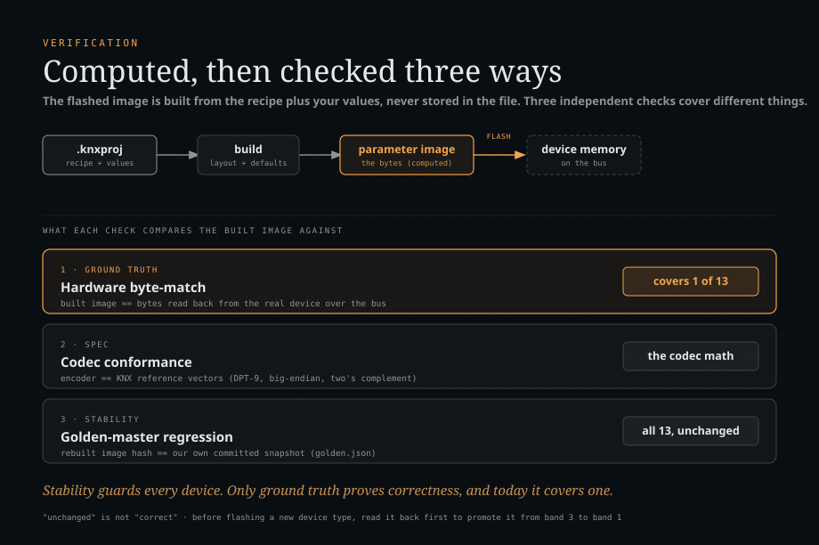
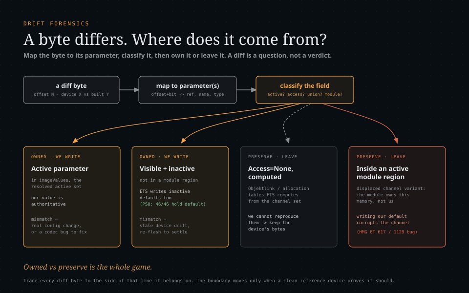

# How Busforge verifies what it flashes

Flashing writes bytes into a real KNX device's memory. Wrong bytes mean a misconfigured
device. That is recoverable (re-flash, or ETS as the last resort), but it is exactly the
outcome nobody wants. This document is the honest account of **how we know the bytes are
right**, and, just as important, **where we only know they are stable**.

Per-device and per-capability results live in **[status.md](status.md)**. This page describes
the mechanisms and their limits.



## What a `.knxproj` actually contains

A project file does **not** store the bytes that get flashed. It stores the **ingredients**,
and the image is **computed** from them on demand:

| In the file | What it is | Where |
| --- | --- | --- |
| Application program | the manufacturer's parameter definitions, memory **layout** (which parameter sits at which byte and bit), and the default segment image (base64) | `M-XXXX/..._A-....xml`, plaintext in the outer zip |
| Project instance data | the parameter **values**, device addresses, group addresses | `0.xml`, WinZip-AES encrypted |

The flashed image is `layout + defaults + your values -> build -> bytes`. ETS computes it
this way, Busforge computes it this way. Nothing stores the baked result, so "compare against
what was flashed" always means comparing against a **freshly computed** image, never a value
read out of the project file.

## Three independent checks

Correctness and regression safety come from three separate sources. They cover different
things and must not be confused.

### 1. Hardware byte-match (ground truth)

Build the image from project data, read the **actual device memory** over the bus, compare
byte for byte. This is the only check that proves our bytes equal what the real hardware
(and therefore ETS) expects. It is the strongest evidence and covers the fewest devices,
because it needs the physical device on the bus.

It comes in two strengths, and both are honest hardware evidence:

- an **owned-byte read-back match**: build the image, read the device's memory, compare the
  bytes Busforge owns (`tools/verify-images.ts`);
- a **full flash round-trip**: apply a real change over the bus and restore it, byte-checked
  each way.

A read-back records a device value as the programmed baseline only for the parameters the
**device's** configuration shows. Visibility follows parameter values (a sensor type set to "none"
hides that sensor's settings), so relevance taken from the project alone skipped exactly the
settings a device has and its project lacks: after "revert to the device", a flash would have reset
them without any visible change (13 bytes on the house's OpenKNX RaumController). The
read-back therefore overlays the device's values for every parameter active in the image (hidden
Merker included) on the project and recomputes until the active set is stable, then records drift
for what the project's or the device's configuration shows. It refuses (`READBACK_UNSTABLE`) if the
set never settles.

Ownership is per bit: a sub-byte parameter owns only its own bits of the byte it shares, so a
parameter flash carries the byte's other bits over from the device and the read-back compares
only the owned ones ([findings.md](findings.md) §12). When a union switches branch, the other bits
of a shared byte therefore keep the device's value, as unowned whole bytes always did. The full
download writes and reads back every byte a parameter touches. Only owned bits are compared, because the
unowned ones are not under our authority: an
ETS-computed object-link table or an unused erased-flash region is carried over from the
device rather than proven (see [device-memory-model.md](device-memory-model.md)). A narrower
mask still, `verify`, excludes device-internal markers the firmware re-stamps on every
download, because asserting those would fail every successful flash.

**It proves the bytes are RIGHT. It does not prove they are SAVED.** That distinction cost a
full session and a device that came back factory-fresh, so it belongs here rather than in a
postmortem nobody reads twice:

> A System B device (thelsing/knx) does not persist its configuration when it is told the
> load is complete. `LdCtrlLoadCompleted` only flushes a buffer. The flash metadata (the four
> load states, the table addresses, the individual address, everything it validates on the
> next boot) is written from exactly one place reachable over the bus: on receiving
> **`A_Restart`**.
>
> Before that restart, every available check reads **RAM**. All four load states read LOADED,
> all three tables read back byte-identical, and the device's own CRC over the parameter
> segment matches ours, on a device that has not written one byte to flash and will come back
> factory-fresh at the next power cut. Every one of those checks is *honest*; they are simply
> answering a different question than the one being asked.

So a byte-match is ground truth for **the image**, not for **the download**. Persistence is
proven by the restart itself, and `KnxDevice.restart()` therefore does not assume the reboot
happened: it requires the device to have stopped answering on the connection it just
acknowledged on. A device that keeps answering did not reboot and did not save, and that is a
`RESTART_IGNORED` failure. See [load-procedures.md](load-procedures.md).

### 2. Spec conformance (the codec math)

The encoding primitives are tested against KNX reference vectors and known encodings,
independent of any device: DPT-9 float (`21.0 -> 0x0C1A`, `-0.01 -> 0x87FF`), big-endian
integers, two's-complement sign, MSB-first bit-field placement
(`packages/product/test/codec.test.ts`, `image.test.ts`). This proves the codec arithmetic
regardless of which device uses it.

### 3. Stability (golden master and byte-identity through refactors)

`real-catalogue.test.ts` rebuilds the default image for every real application program in the
fixture set and compares a hash against a committed snapshot. Every refactor of the parser or
codec was additionally checked old-versus-new (the old code pulled from git history) to
confirm the bytes did not change.

> The golden test compares against **our own frozen output**, committed by us. It is a
> regression guard ("did we change something by accident?"), not a comparison against the
> device or against ETS. A green golden after a codec change means the change was
> behaviour-preserving, nothing more.

## The gap all three share: our image versus ETS

A read-back proves `device == our image`. It can never prove `our image == what ETS would
write`, because the device faithfully holds whatever it was given. Two real bugs lived
exactly in that gap and passed every check above: a 32-bit float encoded as a 16-bit DPT-9,
and a com-object table sized to the wrong maximum.

Closing it needs a different oracle: **an ETS download of the same device at the same
configuration, captured on the wire**. `tools/etsdiff.ts` is that check, and it is the gate for
the reference axis of [`evidence-contract.md`](evidence-contract.md). It found the float bug (and,
once it was fixed, reported zero divergences for that capture).

What it compares:

- **ETS's side**: every `A_Memory_Write` (APCI 0x280) and `A_MemoryExtended_Write` (0x1FB) ETS sent
  to the device under test, replayed in capture order so a later write wins per byte. Writes to
  other devices are counted and ignored.
- **Busforge's side**: the full-download image, built by the planner the server's download runs
  (`DeviceProfile.planFullDownload`), so it refuses whatever the server would refuse. That covers
  both memory models Busforge downloads: System B (parameter segment, com-object table,
  association and address table) and System 7 (every absolute segment, including the MV-0705
  authored com-object table).
- **Per segment**: bytes ETS wrote, bytes compared, every divergence with its address, both values
  and the parameters the application declares at that byte. ETS bytes that fall in no Busforge
  segment, and Busforge bytes ETS never wrote, are listed. The only exclusion is a named rule
  printed with the bytes it covers (today one: the memory-mapped load-control register `0x0104`
  of MV-0700/0701, whose writes are load events, not memory).
- **The configuration** comes from a `.knxproj` (`--project`: parameters, module instances,
  links, as the import stores them) or, when there is no project, from the application program
  (`--app`, an `.xml`, `.xml.gz` or `.knxprod`) at its defaults plus whatever `--param` and
  `--link` state.

A pass needs every ETS-written byte compared and equal, no ETS byte outside Busforge's image and
every segment placed. Bytes only Busforge writes are named in the record as not covered: on the
MV-0705 address table, for example, ETS does not write the device's own address (bytes 1-2) and
Busforge does.

Worked case, the MDT BE-02001.02 (MV-0705, two captures in `tools/fixtures/`, pinned by
`tools/etsdiff.test.ts`): every byte ETS wrote matches, in the address, association and
com-object tables and the parameter segment, at defaults and with one link. The comparison first
found one divergence in the parameter segment, and it was a Busforge bug: the debounce time
carries `LegacyPatchAlways`, which Busforge used to leave out of the image
([findings.md](findings.md) §8).

Two lessons from using it, both cheap to relearn the hard way:

- **Compare in the same address frame.** A System B relative segment is written at the address
  the *device* assigns during allocation, so ETS's absolute write addresses sit at
  `segment base + offset` while our image is 0-based. Diffing the two frames directly made
  every single write look divergent and produced a confident, wrong root cause (a resolver
  "under-activation" bug that did not exist). A 100%-divergence result is a reason to suspect
  the harness, not the code: correlate for a constant offset before authoring a cause. The
  tool takes each System B segment's base from the device's own answer to ETS's
  `PID_TABLE_REFERENCE` read in the capture; `--seg-base=<lsm>:<n>` pins one. Without either, the
  parameter segment's base is inferred from the alignment of distinctive multi-byte runs, and a
  table segment is not compared, which fails the gate. ETS's allocation (PID 5) gives the size and
  fill it asked for, so a byte it allocated with a fill and never wrote is compared as that fill.
- **Test the competing hypothesis.** The suspected resolver was cleared by a control run:
  writing every union member's default instead of only the active branch *diverges* from ETS,
  so the active-branch gate is exactly what ETS does.

Not covered yet: the property writes of a download (the program-id stamp, load events) are
listed but not compared; the System B table-segment placement from `PID_TABLE_REFERENCE` is
exercised only by synthetic frames, because no System B capture is kept in the repository; and
the project mode has no offline test against a real `.knxproj`. The durable form of this check
diffs the built image against a **live read-back**, resolving the segment base from the device
itself, so no capture is needed. That is not built yet.

## Placement is not behaviour

A read-back verify is a **placement** proof. It says the device now holds the bytes we
intended. It says nothing about whether the device still works.

Two hardware findings make that concrete, and both were caught by observing the bus, not by
reading memory back:

- A group address linked by a flash that wrote only the address and association tables read
  back byte-perfect and was **functionally dead**, because the com-object table still carried
  `comm=0` for that object ([findings.md](findings.md) §7).
- A group-address flash on one System B stack left all three tables LOADED and byte-perfect
  while the **application program object** dropped to ERROR, so the device answered management
  fine and ran no application at all ([load-procedures.md](load-procedures.md)).

Both now have a guard, and both are the reason the hardware smoke framework
([testing.md](testing.md)) asserts bus behaviour and not only bytes.

## What protects you when flashing an unverified device

Even for a device whose image has never been read back, the flash path does not fly blind:

1. **Mask check.** Refuse if the device's application mask does not match the program (wrong
   device, or wrong application).
2. **Declared pre-flight.** Run the application's own `CompareProp` checks (hardware type,
   application id) before any write; a mismatch aborts.
3. **Backup.** A surgical flash reads and saves the current segment to disk before writing, so
   the previous bytes are recoverable. A full download does not: it rebuilds every byte from the
   project, and its pre-unload backup is opt-in and off by default
   ([load-procedures.md](load-procedures.md)).
4. **Dry run.** Show exactly which bytes would change before anything is written.
5. **Post-flash read-back verify.** Read the segment back and confirm it matches what was
   intended, over the owned-and-verifiable mask; never report success on a mismatch. The
   comparison is retried through a settle window, so a device still recovering from the
   closing restart cannot produce a false failure.

The one thing read-back verify **cannot** tell you is the gap named above: it confirms "the
device now holds the bytes we built", not "the bytes we built are what ETS would have built".

**Recommendation:** before trusting a flash on a new device type, run a read-back
byte-compare first, to promote it from "stability-pinned" to "hardware-verified".
Read-back-first is the safety philosophy the whole project is built on.

## Drift forensics: where does a byte come from?

When a device's memory does not match what Busforge builds, the byte-level diff is a
**question, not a verdict**. A mismatch can mean three very different things, and the only
way to tell them apart is to trace the byte back through the device definition: which
parameter maps here, is it active, and who owns this memory.

A byte that differs is one of:

1. **A real configuration difference** (device and project genuinely disagree).
2. **Stale-device drift** (the device was last flashed from a different project or version).
3. **Our bug** (we build the wrong value, or write a byte we should not own).

These look identical at the byte level. "The device has 0, we build 2" is equally consistent
with all three. Guessing picks one and ships it. Tracing tells you which.



### The procedure

Given a differing byte at offset `N` (device `X`, our build `Y`):

1. **Map the byte to its parameter(s).** A byte is bit-packed, so several parameters can share
   it. For every `ParameterRef` in the model, check whether its `offset .. offset + size`
   covers `N`, and list each with its `BitOffset`, size and human label. Now `N` reads as
   settings, not hex.
2. **Decode both sides per field.** Extract each sub-byte field from the device byte and from
   ours (MSB-first, `shift = 8 - bit - size`). Most fields usually agree, and the diff narrows
   to one or two. Name them.
3. **Classify each differing field by visibility and placement.** This is the crux:
   - **Active?** Is the ref in the visibility-resolved active set? If so our value is
     authoritative, and a mismatch is a real config change or a codec bug.
   - **`Access="None"` and computed?** Internal parameters whose value ETS calculates (the
     channel object-link tables, allocation counters). Not reproducible, not ours to write.
   - **Union member?** Overlapping memory; only the active branch is real.
   - **Inside an active module instance's memory region?** The subtle one. A channel
     configured as a module *occupies* the memory of the simple-channel variant. The
     top-level variant's parameters still parse and still have an offset here, but the memory
     belongs to the module. They are **displaced**.
4. **Reach a verdict per field.**
5. **Confirm against a clean reference, not a guess.** If you are unsure whether ETS writes an
   inactive parameter's default, do not theorize, measure it on a freshly ETS-flashed device.

### Worked example: the "drift" that was our bug

Two bytes on a Theben channel actuator differed after a build: device `0`, build `2`. The
flash would have written them. The UI showed no changed parameters. Drift, or bug?

**Map.** Both bytes decode, at bits 4-7, to the same parameter (a relay-channel cyclic-send
time), default `2`.

**Classify.** The parameter is inactive (the collective-feedback feature is off). The rule "a
visible-inactive parameter is owned at its default" (which is correct in general, see the
discriminator below) wrote `2`. But one more check changed the verdict: **both offsets fall
inside an active module instance's memory span**, one of them inside a blind-channel module.

**Verdict.** The channel is configured as a blind module. The relay-variant parameter is the
*displaced* variant: its memory belongs to the module, ETS never writes it, and the device
correctly holds `0`. Writing the displaced default would have corrupted the channel on flash.
**Our bug**, not drift. The fix excludes a non-module inactive parameter from ownership when
it lies inside an active module region; the clean reference device stayed at zero diffs and
the actuator dropped from two to zero.

### The discriminator: prove ETS's rule on a clean device

Step 3 hinges on one fact: **does ETS write an inactive parameter's default, or skip it?** Do
not assume. A freshly ETS-flashed device with no modules (a power supply) is a clean
reference. Measuring it: of 46 inactive but visible parameters whose default differs from the
segment `<Data>`, **46 of 46 hold their default on the device**. So ETS does write inactive
defaults, and "own visible-inactive parameters at their default" is right, *except* where the
memory is displaced by an active module. That single measured fact separated the correct rule
from the bug and kept the fix from regressing the clean device.

A clean reference device per behaviour is worth more than any amount of reasoning about what
ETS "probably" does.

### Why the owned-byte model stays

The displaced-parameter bug was a flaw in *computing* the owned set, not a reason to abandon
it. Two reasons it is permanent:

- **Some bytes are unreproducible by construction.** Channel devices store `Access="None"`
  object-link tables that ETS *computes* from the com-object and link allocation. Regenerating
  them would mean reimplementing ETS's allocator per device family, the brittle per-case path
  this project rejects. They can only be preserved, so a complete from-scratch image for such
  a device is impossible and a full-segment write would zero real configuration.
- **It is the read-back-verify philosophy applied to writing:** change only what you can
  prove, leave the rest exactly as the device holds it.

The bug actually validated the model. The boundary between "what we know" and "what we
preserve" is the whole game; that episode made the boundary more precise by adding a third
not-owned case. Every new one is found the same way: trace the byte.

### Tooling

The trace is a handful of small scripts over the parsed model, the resolved active set, the
module instances and a real device read-back. The reusable pieces:

- byte to covering parameters: iterate the model's refs, match `offset .. offset+size`.
- per-field decode: `shift = 8 - bitOffset - sizeInBit`, `(byte >> shift) & ((1<<size)-1)`.
- module spans: per `…_MI-…` instance, `[min(offset), max(offset+size-1)]`.
- the discriminator: decode every inactive-visible parameter on a clean device and compare it
  to its default and to the segment `<Data>` byte.

These are throwaway probes, not product code. Keep them next to the (gitignored) device
read-back corpus.

## Running the checks

```bash
# Stability across the real catalogue, part of `bun run check`:
bun test packages/product/test/real-catalogue.test.ts

# Regenerate the golden after an intentional, reviewed parser/codec change:
bun run packages/product/test/real-catalogue.gen.ts

# Hardware byte-match against a live device (check 1):
bun run tools/paramtest.ts <interface> <ia> <app-xml> <0.xml> <device-id>

# Our-image versus ETS, from a captured ETS full download (exit 0 = pass):
bun run tools/etsdiff.ts <ets-capture.log> --project=<file.knxproj> [--password=<pw>] [--ia=<a.l.d>] [--evidence=<out.json>]
# ... or without a project, at the application's defaults plus stated values:
bun run tools/etsdiff.ts <ets-capture.log> --app=<app.xml|.xml.gz|.knxprod> [--app-id=<M-XXXX_A-...>] --ia=<a.l.d> \
  [--product=<productRef>] [--param=<ParameterRefId>=<value>]... [--link=<objNum>:<ga>[,<ga>]]...
# e.g. the MDT worked case (passes: every byte ETS wrote matches):
bun run tools/etsdiff.ts tools/fixtures/mdt-be02001-ets-fulldownload-linked.log \
  --app=packages/product/test/fixtures/real/M-0083_A-00B6-32-9642.xml.gz --ia=1.1.56 --link=0:3/3/1
```
